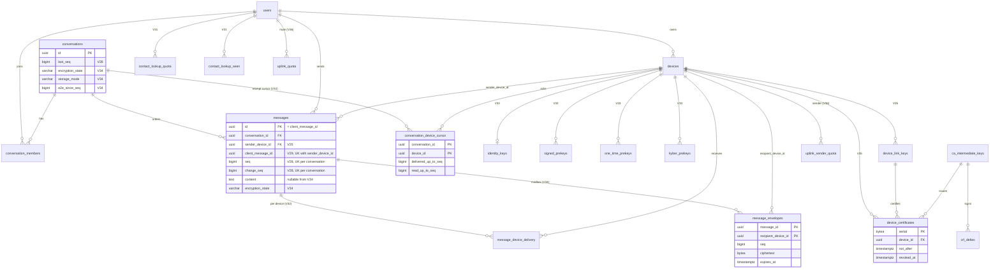

# Muhabbet multi-transport delivery — Data model

> **Status: Proposed — pending owner approval.** No migration, schema file or driver change may be
> written for any scope in this document until the owner records approval for that scope in
> [`APPROVAL.md`](APPROVAL.md). This document is derived from, and must agree with, the
> [decision brief](decision-brief-2026-11-12.md) §11 (the single source of truth). Where they
> disagree, the brief wins and the disagreement is recorded as a reviewer-note
> callout.

| | |
|---|---|
| **Date** | 2026-11-12 |
| **Base** | `dev` @ 2434324 (branch `claude/muhabbet-p2p-architecture-wdan5r`); latest applied Flyway migration on `dev` is `V27__two_step_login_gate.sql` |
| **Owning ADRs** | [0013](../../adr/0013-delivery-semantics-and-ticks.md), [0014](../../adr/0014-ordering-seq-change-feed.md), [0018](../../adr/0018-identity-keys-device-certificates.md), [0020](../../adr/0020-data-at-rest-and-erasure.md), [0021](../../adr/0021-adr0008-amendment-storage-modes-e2e.md), [0025](../../adr/0025-store-and-forward-custody.md), [0028](../../adr/0028-kmp-module-structure.md), [0029](../../adr/0029-compliance-boundary.md) |
| **Companion** | [`icd-wire-protocol.md`](icd-wire-protocol.md) (the interfaces these tables serve) |
| **Evidence** | [Findings register](../../reviews/2026-11-12-findings-register.md): BE-02, BE-03, BE-06, BE-07, BE-14, BE-15, BE-18, BEV-M1, BEV-M2, CICD-09, C7, C8, M1, M2, M3, MOB-01, MOB-03, MOB-04, MOB-05, MOB-10, KMP-05 |
| **Conventions** | DDL below is a **sketch**: column names, types, constraints and indexes are normative; formatting, constraint names and batch sizes are not. Milestone names are the ROADMAP names (brief naming note). Every literal limit marked *(config)* lives in `application.yml` or a companion object |

---

## 1. Principles

| # | Principle | Source |
|---|---|---|
| D-1 | The **server** owns identity, device registry, key directory, per-conversation order and the mailbox. The mobile DB is the **device's** source of truth for what it has seen and what it owes (outbox), never an ordering authority | ADR-0010, ADR-0011 |
| D-2 | One cursor model in every era: a per-(device, conversation) watermark over `messages.change_seq` | ADR-0014, ADR-0021 |
| D-3 | There is **no backend outbox table**. Pull-by-seq makes hint loss harmless | brief §3 judge disagreements |
| D-4 | Domain models ≠ JPA entities; JPA adapters implement out-ports; nothing here is read by a controller directly | CLAUDE.md hexagonal rules |
| D-5 | No key material that a server must not hold is ever stored server-side (private keys of devices, the device-CA intermediate, the uplink private key) | ADR-0018, ADR-0025, ADR-0031 |
| D-6 | No stable recipient identifier in any custody or relay store (mobile or server) | C7, ADR-0025 |
| D-7 | Schema change is **expand → migrate → contract**, never in one release | CICD-09 |

---

## 2. Backend migration discipline (Flyway)

### 2.1 Rules

1. **One version, one release.** A Flyway version ships in exactly one release, and versions ascend in
   release order. `outOfOrder` stays `false`, so a lower version shipped after a higher one would
   fail validation in production.
2. **Dotted versions** (`V28.1`, `V29.1`, `V31.1`, `V34.1`) carry a follow-up of a family: the contract step
   of an earlier expand (later release), a split forced by rule 1, **or a same-release split** forced
   by rule 6 (a non-transactional `CREATE INDEX CONCURRENTLY` script). They sort between the integers.
3. **Expand / contract** (CICD-09). Release N may add nullable columns, tables, indexes, `NOT VALID`
   constraints and dual writes. Only release N+1 or later may set `NOT NULL`, `VALIDATE CONSTRAINT`,
   drop columns or tables, or stop dual writes. Every migration below names its contract step.
4. **N-1 on N.** CI applies release N's migrations to a database built by N-1's migrations, starts the
   N-1 image against it and runs a smoke suite (CICD-09). A migration that breaks N-1 is not mergeable.
5. **Lint.** Migrations are linted with a Postgres DDL linter (squawk, per CICD-09) for
   table-rewriting and lock-heavy statements.
6. **Lock hygiene on a co-tenant database.** `shared-postgres` serves other projects (SAD TC-9).
   Every migration starts with `SET lock_timeout` and `SET statement_timeout` sized for that
   migration; constraints are added `NOT VALID` and validated separately; large indexes use
   `CREATE INDEX CONCURRENTLY` in their own non-transactional dotted version (Flyway cannot mix
   transactional and non-transactional statements in one script).
7. **Backfills** are idempotent (`WHERE col IS NULL`), batched by primary key when the table's
   measured row count exceeds a threshold *(decided per PR from a production row count recorded in
   the PR)*, and never run inside the request path.
8. **Immutability.** An applied migration is never edited; `validate-on-migrate` stays on in
   production (#429). Rollback = previous image on the expanded schema (rules 3–4). Flyway undo is
   not used; each PR states its manual reverse SQL in the description, never auto-run.
9. **Docker on.** Every migration is exercised by Testcontainers with Docker running before merge
   (CLAUDE.md, #598); a migration that touches Spring configuration indirectly is exactly what the
   integration suite catches.
10. **Domain mapping.** A column added to `users` must be mapped in the domain model:
    `UserJpaEntity.fromDomain` rebuilds the whole row on every save and silently resets unmapped
    columns (documented in `V27__two_step_login_gate.sql`).

### 2.2 Release map

| Version | Release | Content | Expand / contract | Brief ref |
|---|---|---|---|---|
| **V28** | 0.4 | `conversations.last_seq`, `conversations.seq_ready`; `messages.seq`, `messages.change_seq` (columns only; backfill is `SeqSweeper`) | expand | §11.1 V28 |
| **V28.1** | 0.4 | `CREATE UNIQUE INDEX CONCURRENTLY` × 2 (non-transactional, same-release split, rule 6) | expand | §11.1 V28 |
| **V29** | 0.4 | `messages.sender_device_id`, `messages.client_message_id`; device-scoped idempotency key | expand | §11.1 V29 |
| **V29.1** | 0.4 | `CREATE UNIQUE INDEX CONCURRENTLY` on `(sender_device_id, client_message_id)` (same-release split, rule 6) | expand | §11.1 V29 |
| **V30** | 0.4 | Age gate storage | expand | §11.1 V30 |
| **V31** | 0.4 | Contact-lookup daily quota | expand | §11.1 V31 (0.4 part) |
| **V31.1** | 0.5.0 | Contract of V28/V29: seq presence check, identity-rule check | contract | (this doc) |
| **V31.2** | 0.6.0 | `users.discoverable_by_phone` | expand | §11.1 V31 (0.6 part) |
| **V32** | 0.6.0 | Per-device delivery | expand (dual write) | §11.1 V32 |
| **V33** | 0.6.0 | Device-scoped key directory | expand | §11.1 V33 |
| *(none)* | 0.7.0 | **No DDL.** Stop the dual write to `message_delivery_status`; switch the legacy key endpoints off the old tables (§3.8) | contract (code only) | (this doc) |
| **V34** | 1.0.0 | Mailbox `message_envelopes`; encryption state; nullable `content` | expand | §11.1 V34 |
| **V34.1** | 1.0.0 | Contract: drop `message_delivery_status`, `one_time_pre_keys`, `encryption_keys` (unused since 0.7, so the 0.7 image — N-1 of 1.0 — never touches them); drop `conversations.seq_ready` | contract | (this doc) |
| **V35** | 1.2 (gated) | Link keys, device certificates, CRL deltas | expand | §11.1 V35 |
| **V36** | 1.3 (gated) | Uplink keys and quotas | expand | §11.1 V36 |

> **Resolved (2026-11-12):** accepted (brief erratum E-16): V29 = 0.4; V31 = 0.4 (cap); V31.2 = 0.6
> (discoverability); contract steps V28.1, V29.1, V31.1, V34.1 per expand/contract (CICD-09). Flyway
> accepts dotted versions. Check the highest version on `dev` (V27 today) before writing each.

---

## 3. Backend migrations

Current tables these migrations touch (from `V1`, `V6`, `V11`, `V16`, `V17`, `V18`, `V24`):
`messages(id UUID PK — client-generated UUIDv7, conversation_id, sender_id, content TEXT NOT NULL,
server_timestamp, client_timestamp, is_deleted, deleted_at, edited_at, expires_at, is_scheduled,
scheduled_at, view_once, media_id, forwarded_from, …)`, `conversations(id, type, …, max_members,
updated_at + trigger)`, `devices(id, user_id, platform, push_token, is_primary, revoked_at,
linked_by_device_id, locale, …)`, `message_delivery_status(message_id, user_id, status)` (per
**user**, BE-18), `encryption_keys` / `one_time_pre_keys` (per **user**, BE-14, M2).

### 3.1 V28 — per-conversation sequence and change sequence (0.4)

**Purpose.** BE-06/C13: total, gap-detectable order; BEV-M2: a cursor that is not a timestamp.

```sql
-- V28 (transactional): columns only — catalogue changes, no rewrite (constant defaults, PG ≥ 11)
SET lock_timeout = '5s';
SET statement_timeout = '30s';
ALTER TABLE conversations ADD COLUMN last_seq   BIGINT  NOT NULL DEFAULT 0;
ALTER TABLE conversations ADD COLUMN seq_ready  BOOLEAN NOT NULL DEFAULT false; -- existing rows: history not yet numbered
ALTER TABLE conversations ALTER COLUMN seq_ready SET DEFAULT true;              -- new conversations have no history
ALTER TABLE messages      ADD COLUMN seq        BIGINT;  -- NULL = unreleased scheduled, or not yet swept
ALTER TABLE messages      ADD COLUMN change_seq BIGINT;  -- last change to the row

-- V28.1 (non-transactional script; same release): no SHARE lock on messages during the build
SET lock_timeout = '5s';
SET statement_timeout = '0';   -- a concurrent build is long by design; it does not block writers
CREATE UNIQUE INDEX CONCURRENTLY ux_messages_conv_seq        ON messages (conversation_id, seq);
CREATE UNIQUE INDEX CONCURRENTLY ux_messages_conv_change_seq ON messages (conversation_id, change_seq);
-- A failed concurrent build leaves an INVALID index: the script drops it (DROP INDEX CONCURRENTLY
-- IF EXISTS) and rebuilds; the PR states this as its reverse/repair SQL.
```

**Backfill is not in the migration.** It is `SeqSweeper` (below), one conversation per transaction,
so no statement holds locks on all of `messages` and the work is resumable:

```sql
-- per conversation :c that is NOT seq_ready or has released rows with seq IS NULL; one transaction
-- (statement_timeout set per batch)
SELECT last_seq FROM conversations WHERE id = :c FOR UPDATE;   -- same lock as allocation
WITH ordered AS (
  SELECT id, :last_seq + row_number() OVER (ORDER BY server_timestamp, id) AS n
  FROM messages WHERE conversation_id = :c AND is_scheduled = false AND seq IS NULL)
UPDATE messages m SET seq = o.n, change_seq = o.n FROM ordered o WHERE m.id = o.id;
UPDATE conversations SET last_seq = :last_seq + :rows, seq_ready = true WHERE id = :c;
```

Numbering starts from the conversation's current `last_seq` under its row lock, so a re-run on a
partially numbered conversation continues instead of restarting at 1 and colliding.

| Item | Rule |
|---|---|
| Allocation | `ConversationSequencePort.next(conv)` = `UPDATE conversations SET last_seq = last_seq + :n WHERE id = :conv AND seq_ready RETURNING last_seq`, inside the caller's transaction. A single insert uses `n = 1` and sets `seq = change_seq = value`. A bulk operation (expiry sweep) allocates a contiguous range `[v − n + 1, v]` and stamps one value per row. **No row returned** (`seq_ready = false`: history not yet numbered) → the row is inserted with `seq = NULL` and `SeqSweeper` numbers it in `(server_timestamp, id)` order with the history, so a new message can never be numbered before older ones. A send that replays never allocates, and a send whose INSERT conflicts rolls the allocation back (V29) |
| What bumps `change_seq` | insert, edit, delete, reaction add/remove (on the target message), **poll vote** add/change (on the poll message, V7 `poll_votes`), expiry soft-delete, scheduled release. **Not** receipts (they would make every read a hot-row write; receipts have their own cursor, V32), **not** pin/unpin (V20 `pinned_messages`, conversation state), **not** membership changes (conversation state; repaired by the conversation list, ICD §3.10 H-1) |
| Invariants | `UNIQUE (conversation_id, seq)` and `UNIQUE (conversation_id, change_seq)` (a double allocation is a constraint violation, not silent corruption); `change_seq ≥ seq`; `last_seq ≥ max(change_seq)` per conversation |
| Backfill semantics | Existing edits/deletes get `change_seq = seq`: a client's first pull sees the current row state, which is all a first pull needs |
| `updated_at` trigger | **Decided (2026-11-12, before V28 ships):** `update_conversations_updated_at` is redefined in V28 as `BEFORE UPDATE OF <metadata columns>` (title, avatar, settings — not `last_seq`, `seq_ready`), so seq allocation, reactions and expiry sweeps do not fire it and `updated_at` keeps meaning "metadata changed". Conversation-list ordering is unchanged as a side effect |
| Indexes kept | `idx_messages_conversation_time` / `idx_messages_conversation_latest` stay until `/messages/since` is removed (one release after `/changes`, ADR-0014) |
| N-1 safety | N-1 code ignores the new columns. Rows it inserts during a rollback window get `seq IS NULL`; edits it makes do not bump `change_seq` |
| Backfill and repair job (ships with V28's code) | `SeqSweeper`: per conversation, under the conversation row lock, numbers rows with `seq IS NULL AND is_scheduled = false` from `last_seq + 1` in `(server_timestamp, id)` order and sets `seq_ready` (SQL above); after a roll-forward it also numbers rows N-1 inserted during the rollback window (a bounded misorder against rows allocated after roll-forward is accepted) and bumps `change_seq` for rows with `edited_at`/`deleted_at` inside that window. Idempotent; reports a count; never in the request path (rule 7) |
| Contract | V31.1 (0.5); `seq_ready` dropped in V34.1 |
| Verification | RQ-04: 50 concurrent senders, including duplicate retries → gapless unique `seq` (Testcontainers); backfill test on a fixture with equal `server_timestamp`s; sweeper re-run on a half-numbered conversation; insert into a not-yet-ready conversation sorts after its history |

> **Resolved (2026-11-12):** all three deviations are adopted (brief erratum E-17): V28 adds columns
> only; `SeqSweeper` backfills per conversation (resumable); `conversations.seq_ready` blocks numbering
> a new send before older rows; `UNIQUE(conversation_id, change_seq)`; `seq_ready` dropped in V34.1.
> They are sound on co-tenant `shared-postgres`.

### 3.2 V29 — sender device and device-scoped idempotency (0.4)

**Purpose.** BE-07 (check-then-insert on a client-chosen global PK, error on retry); ADR-0013.

```sql
SET lock_timeout = '5s';
ALTER TABLE messages ADD COLUMN sender_device_id  UUID REFERENCES devices(id) ON DELETE SET NULL;
ALTER TABLE messages ADD COLUMN client_message_id UUID;

-- Backfill client_message_id = id: SeqSweeper-style job, batched by id, outside the migration (rule 7)

-- V29.1 (non-transactional script; same release, rule 6)
SET lock_timeout = '5s';
SET statement_timeout = '0';
CREATE UNIQUE INDEX CONCURRENTLY ux_messages_sender_device_client_id
  ON messages (sender_device_id, client_message_id);
```

| Item | Rule |
|---|---|
| **Identity rule** | `messages.id = client_message_id` for every row. The id is minted by the sender device (UUIDv7), so `Edit`/`Delete`/`Reaction`/`reply_to` inside E2E `Content` can reference a message offline and before it has a `seq` (ICD §6.3) |
| Idempotent insert (order is normative; ICD §3.6 A-1) | (1) `SELECT seq, server_timestamp FROM messages WHERE sender_device_id = ? AND client_message_id = ?` — found → replay (`replay = true`) **without allocating**. (2) Otherwise allocate (V28) and `INSERT` (no `ON CONFLICT`). (3) A unique violation on either key (a concurrent retry, or an id collision) rolls back the whole transaction — the allocation with it, so no seq is ever spent — and step (1) is re-run on a fresh read. `seq` is a column of the INSERT, so allocating first and then `INSERT … ON CONFLICT DO NOTHING` would commit an allocated value with no row on every replay; that form is not used |
| Foreign collision | A conflict on the PK `id` with a row of a **different user** is `MSG_ID_CONFLICT` before 1.2 and `MSG_ID_SQUATTED` from 1.2 (ICD §3.6 A-2); another device's ack is never replayed |
| Pre-V29 / N-1 replay | A PK conflict whose existing row has `sender_device_id IS NULL` and `sender_id` = the requester is a **replay** (ICD §3.6 A-2b) — the 0.5 upgrade (§5.3 step 4) resubmits `pendingMessage` rows that 0.4 or N-1 code may already have committed |
| Historical rows | `sender_device_id` stays `NULL` for rows sent before V29 (the device is not recoverable). NULLs are distinct in the unique index, so they never collide; their idempotency was the global PK |
| `sender_device_id` source | The JWT `deviceId` claim (present today) — never a client-supplied field |
| Scheduled messages | Inserted with `seq = change_seq = NULL`, `is_scheduled = true`. Release (BEV-M1): one transaction per message — claim with `UPDATE … WHERE id = ? AND is_scheduled RETURNING`, allocate, set `seq = change_seq`, `is_scheduled = false`, commit, then hint (BE-02 closed structurally) |
| N-1 safety | N-1 inserts leave both columns NULL; V31.1's checks are written to tolerate pre-cut-over NULLs |
| Contract | V31.1 |

> **Note:** V29 at 0.4 is additive (device-scoped unique beside the PK) and forecloses
> neither option; `messages.id = client_message_id` is kept for 0.4–1.0.
> **Open item [OI-10](open-items.md#oi-10):** before ICD §6.2 freezes (1.0 entry; 1.2 design-review input), choose between the kept identity rule and the brief-literal pair reference `(sender_device_id, client_message_id)` with a server-minted id. Reviewer leaning: the pair reference, which removes the `MSG_ID_SQUATTED` path structurally.

### 3.3 V30 — age gate (0.4)

**Purpose.** Law 7578 / 5651 Ek Md. 4, ADR-0029 rule 1. The design does **not** claim compliance
until counsel confirms that self-declaration is *yaş doğrulama* (Q-L3).

```sql
-- Separate table (decided 2026-11-12): UserJpaEntity.fromDomain rebuilds the whole users row on every
-- save (V27 note), so age columns on users would be reset by an unrelated profile write.
CREATE TABLE user_age_assurance (
  user_id      UUID        NOT NULL PRIMARY KEY REFERENCES users(id) ON DELETE CASCADE,
  birth_date   DATE        NOT NULL,
  level        VARCHAR(16) NOT NULL CHECK (level IN ('SELF_DECLARED', 'EDEVLET', 'NFC_ID')),
  assured_at   TIMESTAMPTZ NOT NULL
);
```

| Item | Rule |
|---|---|
| Registration | Below `muhabbet.age.minimum-years` (currently 18, ADR-0029 rule 1) is refused **before** a `users` row exists (nothing stored for a refused applicant) |
| Existing users | No row → one-time attestation prompt at next sign-in/foreground; not served past the counsel-set grace period (default 30 days, ADR-0029 rule 1); `AgeAssurancePort.assess` inserts the row |
| Mapping | Only the age adapter maps this table; the domain `User` and `UserJpaEntity` do not carry it |
| Reader | 0.4: registration and sign-in gate. 1.2: certificate issuance precondition (ADR-0018) |
| Minimisation | `birth_date` is personal data used only for the gate; listed in the KVKK inventory and the data export; the age-gate DPIA (DT-7) is a 0.4 exit item |
| N-1 safety | Additive; N-1 ignores |

> **Resolved (2026-11-12):** the separate table is chosen (V27 precedent; the row-rebuild hazard is real):
> `user_age_assurance(user_id PK FK users ON DELETE CASCADE, birth_date, level, assured_at)`, mapped
> only by the age adapter (brief erratum E-18).

### 3.4 V31 — contact-lookup quota (0.4) and V31.2 — discoverability (0.6)

**Purpose.** C8, M3: enumeration throttling with a per-account daily cap on **new** numbers, block
filtering, and a discoverability setting **with a reader** (brief §8.6).

```sql
-- V31 (0.4)
CREATE TABLE contact_lookup_quota (
  user_id      UUID NOT NULL REFERENCES users(id) ON DELETE CASCADE,
  day          DATE NOT NULL,                       -- Europe/Istanbul calendar day
  new_numbers  INT  NOT NULL DEFAULT 0 CHECK (new_numbers >= 0),
  PRIMARY KEY (user_id, day)
);
CREATE TABLE contact_lookup_seen (                  -- what counts as "new"
  user_id      UUID  NOT NULL REFERENCES users(id) ON DELETE CASCADE,
  number_hash  BYTEA NOT NULL,                      -- the hash the client already sends
  first_seen   DATE  NOT NULL,
  PRIMARY KEY (user_id, number_hash)
);
CREATE INDEX ix_contact_lookup_seen_age ON contact_lookup_seen (first_seen);

-- V31.2 (0.6)
ALTER TABLE users ADD COLUMN discoverable_by_phone BOOLEAN NOT NULL DEFAULT TRUE;
```

| Item | Rule |
|---|---|
| Counting | One statement, with the cap checked on **both** branches: `INSERT INTO contact_lookup_quota (user_id, day, new_numbers) SELECT :u, :d, :k WHERE :k <= :cap ON CONFLICT (user_id, day) DO UPDATE SET new_numbers = contact_lookup_quota.new_numbers + EXCLUDED.new_numbers WHERE contact_lookup_quota.new_numbers + EXCLUDED.new_numbers <= :cap RETURNING new_numbers` — no row returned means over the cap (`CONTACT_SYNC_LIMIT_EXCEEDED`, existing code). Without the `WHERE :k <= :cap` guard a first lookup of `k > cap` numbers would pass |
| Retention | `contact_lookup_seen` is "who looked up which number" — personal data. Purged after `CONTACT_LOOKUP_SEEN_RETENTION` *(config)*; a DPIA screening item (ADR-0029 rule 6) |
| Reader (0.6) | `ContactLookupService` excludes users with `discoverable_by_phone = false` and users who blocked the requester; the integration test proves enumeration is throttled (RQ-12) |
| Default | `TRUE` keeps today's behaviour; privacy-by-default `FALSE` is an owner choice with a growth cost |
| Domain mapping | `discoverable_by_phone` is a profile setting and is mapped in the domain `User` (rule 2.1-10), like `read_receipts_enabled` |

### 3.5 V31.1 — contract of V28 / V29 (0.5.0)

```sql
-- Precondition: SeqSweeper reports 0 rows with seq IS NULL AND is_scheduled = false,
-- and every conversation has seq_ready = true.
ALTER TABLE messages ADD CONSTRAINT ck_messages_seq_present
  CHECK (is_scheduled OR seq IS NOT NULL) NOT VALID;
ALTER TABLE messages VALIDATE CONSTRAINT ck_messages_seq_present;
ALTER TABLE messages ADD CONSTRAINT ck_messages_change_after_seq
  CHECK (seq IS NULL OR change_seq >= seq) NOT VALID;
ALTER TABLE messages VALIDATE CONSTRAINT ck_messages_change_after_seq;
ALTER TABLE messages ADD CONSTRAINT ck_messages_identity_rule
  CHECK (client_message_id IS NULL OR client_message_id = id) NOT VALID;
ALTER TABLE messages VALIDATE CONSTRAINT ck_messages_identity_rule;
```

`client_message_id` stays nullable only because N-1 rows may exist; the `SeqSweeper` also fills it
(`= id`). `sender_device_id` stays nullable permanently for historical rows; the "set on every new
row" rule is enforced by the domain and an integration test, not by the database.

### 3.6 V32 — per-device delivery (0.6.0)

**Purpose.** BE-18 (delivery per user, not per device), BE-03 (acks for any message), ADR-0013 §4.

```sql
CREATE TABLE message_device_delivery (
  message_id  UUID NOT NULL REFERENCES messages(id) ON DELETE CASCADE,
  device_id   UUID NOT NULL REFERENCES devices(id)  ON DELETE CASCADE,
  status      VARCHAR(10) NOT NULL CHECK (status IN ('SENT', 'DELIVERED', 'READ')),
  updated_at  TIMESTAMPTZ NOT NULL DEFAULT now(),
  PRIMARY KEY (message_id, device_id)
);
CREATE INDEX ix_mdd_device ON message_device_delivery (device_id, message_id);

-- Addition (see reviewer note): cumulative per-device receipt cursor
CREATE TABLE conversation_device_cursor (
  conversation_id     UUID   NOT NULL REFERENCES conversations(id) ON DELETE CASCADE,
  device_id           UUID   NOT NULL REFERENCES devices(id)       ON DELETE CASCADE,
  delivered_up_to_seq BIGINT NOT NULL DEFAULT 0,
  read_up_to_seq      BIGINT NOT NULL DEFAULT 0,
  addressed_from_seq  BIGINT,          -- first seq this device is an E2E recipient of; NULL = never addressed
  updated_at          TIMESTAMPTZ NOT NULL DEFAULT now(),
  PRIMARY KEY (conversation_id, device_id),
  CHECK (read_up_to_seq <= delivered_up_to_seq)
);
```

| Item | Rule |
|---|---|
| Ack write | One conditional upsert, monotonic, with an insert path for a device's first ack: `INSERT INTO conversation_device_cursor (conversation_id, device_id, delivered_up_to_seq, read_up_to_seq) VALUES (:c, :d, :s, :r) ON CONFLICT (conversation_id, device_id) DO UPDATE SET delivered_up_to_seq = greatest(conversation_device_cursor.delivered_up_to_seq, EXCLUDED.delivered_up_to_seq), read_up_to_seq = greatest(conversation_device_cursor.read_up_to_seq, EXCLUDED.read_up_to_seq), updated_at = now() WHERE conversation_device_cursor.delivered_up_to_seq < EXCLUDED.delivered_up_to_seq OR conversation_device_cursor.read_up_to_seq < EXCLUDED.read_up_to_seq RETURNING …` (READ also raises `delivered_up_to_seq`, so `:r ≤ :s`). Broadcast only if a row was returned (BE-03). Authorisation per ICD §3.8; the client only sends `:s ≤` its complete-through point (ICD §3.8 R-ACK, store invariant S-3) |
| Addressability (`addressed_from_seq`) | Set to `conversations.last_seq + 1`, under the conversation row lock, when this device first becomes an E2E recipient in this conversation: the member joins (or re-joins — overwritten), the device is linked while its user is a member, or the device first registers a `sealed`-capable identity key (V33). Cleared to `NULL` when the member leaves. An ack upsert never sets it. It is the source of ICD §4.1's `NOT_ADDRESSED` (`addressed_from_seq IS NULL OR seq < addressed_from_seq`) vs `PURGED` (otherwise, no envelope row), so neither state needs per-message rows. One write per (device, conversation) on join/link, not per message |
| Per-message rows | Expanded from the cursor delta, `INSERT … SELECT id FROM messages WHERE conversation_id = :c AND seq > :old AND seq <= :new AND sender_device_id IS DISTINCT FROM :d ON CONFLICT DO UPDATE` with the monotonic rank guard, multi-row (BE-18 "batch inserts") |
| User-level aggregate | `max` over a user's devices, the sender's own devices excluded; the #377 `readReceiptsEnabled` downgrade applied at publish (WS) and in `GET …/receipts` (ICD §4.4) |
| Dual write | 0.6 writes both `message_delivery_status` (legacy, per user) and the new tables; reads switch to the new tables in the same release behind the existing aggregate port. **0.7 stops the dual write (code only, no DDL)**, so the 0.6 image still runs against the 0.7 schema (rules 3–4). The legacy table is dropped in V34.1 (1.0.0), when N-1 (0.7) no longer touches it |
| Backfill | None. Messages sent before V32 keep their user-level status from the legacy table until 0.7 stops reading it; after that their ticks show the aggregate as of 0.6 (frozen, historically accurate) |

> **Note:** `conversation_device_cursor` is adopted now as the write target and tick source.
> **Open item [OI-11](open-items.md#oi-11):** when V32 is written (0.6), decide whether `message_device_delivery` (and the mobile `receipt` table) is dropped. Test: can `GET /messages/{id}/info` (MessageInfoScreen) live with cursor-derived status without per-member timestamps? If yes, drop the per-message rows.

### 3.7 V33 — device-scoped key directory (0.6.0)

**Purpose.** BE-14, M1, M2: per-device keys, atomic claim, Kyber and last-resort keys, no silent
identity replacement (ADR-0018). The atomic claim and fetch rate limit ship **in 0.4 on the existing
tables without a migration**:
`DELETE FROM one_time_pre_keys WHERE id = (SELECT id FROM one_time_pre_keys WHERE user_id = ? AND used = false ORDER BY created_at LIMIT 1 FOR UPDATE SKIP LOCKED) RETURNING …`
(the existing `idx_otpk_user_unused` serves it); the rate limit uses Redis token buckets.

```sql
ALTER TABLE devices ADD CONSTRAINT ux_devices_id_user UNIQUE (id, user_id);  -- target of composite FKs

CREATE TABLE identity_keys (
  device_id        UUID PRIMARY KEY,
  user_id          UUID NOT NULL,
  identity_key     BYTEA NOT NULL,
  registration_id  INT   NOT NULL,
  created_at       TIMESTAMPTZ NOT NULL DEFAULT now(),
  FOREIGN KEY (device_id, user_id) REFERENCES devices (id, user_id) ON DELETE CASCADE
);
CREATE INDEX ix_identity_keys_user ON identity_keys (user_id);

CREATE TABLE signed_prekeys (
  device_id   UUID NOT NULL REFERENCES devices(id) ON DELETE CASCADE,
  key_id      INT   NOT NULL,
  public_key  BYTEA NOT NULL,
  signature   BYTEA NOT NULL,
  created_at  TIMESTAMPTZ NOT NULL DEFAULT now(),
  PRIMARY KEY (device_id, key_id)
);

CREATE TABLE one_time_prekeys (
  id          UUID PRIMARY KEY DEFAULT gen_random_uuid(),
  device_id   UUID NOT NULL REFERENCES devices(id) ON DELETE CASCADE,
  key_id      INT   NOT NULL,
  public_key  BYTEA NOT NULL,
  created_at  TIMESTAMPTZ NOT NULL DEFAULT now(),
  UNIQUE (device_id, key_id)
);
CREATE INDEX ix_otpk_claim ON one_time_prekeys (device_id, created_at);

CREATE TABLE kyber_prekeys (
  id           UUID PRIMARY KEY DEFAULT gen_random_uuid(),
  device_id    UUID NOT NULL REFERENCES devices(id) ON DELETE CASCADE,
  key_id       INT   NOT NULL,
  public_key   BYTEA NOT NULL,
  signature    BYTEA NOT NULL,
  last_resort  BOOLEAN NOT NULL DEFAULT false,
  created_at   TIMESTAMPTZ NOT NULL DEFAULT now(),
  UNIQUE (device_id, key_id)
);
CREATE INDEX        ix_kyber_claim       ON kyber_prekeys (device_id, created_at) WHERE NOT last_resort;
CREATE UNIQUE INDEX ux_kyber_last_resort ON kyber_prekeys (device_id)             WHERE last_resort;
```

| Item | Rule |
|---|---|
| Atomic claim | Per key class: `DELETE FROM one_time_prekeys WHERE id = (SELECT id … WHERE device_id = ? ORDER BY created_at LIMIT 1 FOR UPDATE SKIP LOCKED) RETURNING …`; Kyber the same over `NOT last_resort`, falling back to the last-resort key (read, never deleted) |
| Claim scope | `ClaimPreKeyBundleUseCase.claim(requester, target)` returns one bundle per **active** device (`devices.revoked_at IS NULL`) of the target |
| No silent replacement | `identity_keys.device_id` is the PK; the adapter exposes insert only. A different key for an existing device → `ENCRYPTION_IDENTITY_REPLACEMENT_REJECTED`; a new key means a new `devices` row and an `IdentityKeyChanged` event (ICD §3.11) |
| Low water | Counting `one_time_prekeys`/`kyber_prekeys` per device after a claim emits the replenish hint below `PREKEY_LOW_WATER` *(config)* |
| No backfill | Production `encryption_keys` contains NoOp placeholder identities written by every launch (#379). They are **not** copied; the new tables start empty and are populated by real 1.0 clients |
| Contract | 0.7 switches the legacy key endpoints off `encryption_keys` / `one_time_pre_keys` (§3.8, no DDL); V34.1 (1.0.0) drops the tables |

### 3.8 Contract of V32 / V33 — 0.7.0 code switch, V34.1 drop (1.0.0)

Stopping a write and dropping its table never happen in the same release (rule 3): the 0.6 image
dual-writes `message_delivery_status` and still serves the per-user key endpoints (the 0.4 atomic
claim; #379 NoOp key registration from older clients), so a 0.7 that dropped those tables could not
be rolled back to 0.6.

| Release | Change | DDL |
|---|---|---|
| 0.7.0 | Stop the dual write to `message_delivery_status`; stop reading it. The legacy per-user key endpoints stop reading and writing `encryption_keys` / `one_time_pre_keys`: registration and claim go only through the V33 device-scoped path; a legacy-shaped call returns HTTP 410 with a defined error code (proposed new `ErrorCode` `ENCRYPTION_KEY_API_RETIRED`; old clients treat it as a generic failure, ICD §10 rule 9) | none |
| 1.0.0 (V34.1) | Drop the tables; N-1 (0.7) no longer touches them | below |

```sql
-- V34.1 (1.0.0)
SET lock_timeout = '5s';
DROP TABLE message_delivery_status;
DROP TABLE one_time_pre_keys;
DROP TABLE encryption_keys;
ALTER TABLE conversations DROP COLUMN seq_ready;   -- ready everywhere since V31.1 (0.5); the allocation
                                                    -- predicate `AND seq_ready` is removed from code in 0.6,
                                                    -- so N-1 (0.7) never reads the column
```

### 3.9 V34 — mailbox and encryption state (1.0.0)

**Purpose.** ADR-0021 (mailbox as a projection of the same cursor), ADR-0019 / BE-15 (no server
plaintext for E2E conversations).

```sql
SET lock_timeout = '5s';
ALTER TABLE conversations ADD COLUMN encryption_state   VARCHAR(12) NOT NULL DEFAULT 'NONE'
  CHECK (encryption_state IN ('NONE', 'E2E_V1'));
ALTER TABLE conversations ADD COLUMN storage_mode       VARCHAR(12) NOT NULL DEFAULT 'CLOUD'
  CHECK (storage_mode IN ('CLOUD', 'BYO', 'LOCAL_ONLY'));   -- unconditional: absent in V1–V27; any T3 work
                                                              -- that needs it earlier moves this line, not a copy
ALTER TABLE conversations ADD COLUMN e2e_since_seq      BIGINT;       -- first seq sent E2E (cutover)
ALTER TABLE conversations ADD COLUMN plaintext_purge_at TIMESTAMPTZ;  -- end of the notified grace period (D3)

ALTER TABLE messages ADD COLUMN encryption_state  VARCHAR(12) NOT NULL DEFAULT 'NONE'
  CHECK (encryption_state IN ('NONE', 'E2E_V1'));
ALTER TABLE messages ADD COLUMN content_purged_at TIMESTAMPTZ;
ALTER TABLE messages ALTER COLUMN content DROP NOT NULL;
ALTER TABLE messages ADD CONSTRAINT ck_messages_e2e_no_content
  CHECK (encryption_state = 'NONE' OR content IS NULL) NOT VALID;
ALTER TABLE messages VALIDATE CONSTRAINT ck_messages_e2e_no_content;

CREATE TABLE message_envelopes (
  message_id          UUID   NOT NULL REFERENCES messages(id) ON DELETE CASCADE,
  recipient_device_id UUID   NOT NULL REFERENCES devices(id)  ON DELETE CASCADE,
  conversation_id     UUID   NOT NULL,      -- denormalised from messages for the ack delete and the feed
  seq                 BIGINT NOT NULL,      -- denormalised (immutable once assigned); NOT NULL holds because
                                            -- scheduled send is unavailable for E2E (ICD §3.5 reviewer note, option b)
  protocol            VARCHAR(32) NOT NULL
    CHECK (protocol IN ('signal-prekey/1', 'signal-message/1', 'sender-key/1', 'sender-key-distribution/1')),
  ciphertext          BYTEA  NOT NULL,
  expires_at          TIMESTAMPTZ NOT NULL,
  PRIMARY KEY (message_id, recipient_device_id)
);
CREATE INDEX ix_envelopes_device_conv_seq ON message_envelopes (recipient_device_id, conversation_id, seq);
CREATE INDEX ix_envelopes_expiry          ON message_envelopes (expires_at);
```

| Item | Rule |
|---|---|
| E2E row | `messages` keeps the metadata row (`id`, `conversation_id`, `seq`, `change_seq`, `sender_id`, `sender_device_id`, timestamps, `encryption_state = 'E2E_V1'`, `content_type = 'SEALED'`), `content = NULL`. `SEALED` is a new value of the backend `ContentType` enum (`messaging/domain/model/Message.kt`; existing rows use the uppercase enum names, V25: `'IMAGE'`, `'VOICE'`) and of the shared `ContentType` mapper; a lowercase literal would fail JPA `EnumType` mapping. One `message_envelopes` row per recipient device, written in the send transaction. `messages.expires_at` for an E2E row is computed **server-side** from the conversation's disappearing timer at insert, never from `Content.expires_at_ms` (ICD §3.5 note) |
| Edits, deletes, reactions in E2E conversations | Travel as their own E2E messages (`Content.Edit/Delete/Reaction`, own `seq`). The server cannot mutate an E2E row's content; `change_seq` moves for E2E rows only on expiry tombstoning |
| Ack delete | `MailboxPort.deleteUpTo(device, conv, seq)` = `DELETE FROM message_envelopes WHERE recipient_device_id = ? AND conversation_id = ? AND seq <= ?` (index above) |
| TTL purge | `purgeExpired(now)` deletes `expires_at <= now` in batches; default TTL 30 days, `muhabbet.mailbox.ttl` (ADR-0021) |
| Feed projection | `/changes` for an E2E row joins the requesting device's envelope; `envelopeState` is `PRESENT` (row exists), `NOT_ADDRESSED` (`conversation_device_cursor.addressed_from_seq IS NULL OR seq < addressed_from_seq`) or `PURGED` (otherwise; acked or past TTL — ADR-0021's `envelopeExpired`) (ICD §4.1). No per-message rows are needed (§3.6) |
| Cutover purge (ADR-0021 §4) | After `plaintext_purge_at`, a job sets `content = NULL, content_purged_at = now()` for `seq < e2e_since_seq`, one conversation per transaction. It does **not** bump `change_seq` (clients that hold the content keep it); new devices see `purged = true` (ICD §4.1). The UI labels a conversation E2E only when every row has `content IS NULL` |
| Erasure completeness | Three indexes hold `content`: **V1 `idx_messages_conversation_latest`** (`INCLUDE content`), **V14 `idx_messages_conv_latest_covering`** (`content` is a key column) and **V14 `idx_messages_content_trgm`** (GIN trigram on `content`). Purged plaintext survives in them and in dead tuples until `VACUUM` / rebuild; the purge job runs `VACUUM (ANALYZE) messages` after each batch window, and backup retention is aligned with the grace period. RQ-13 is asserted on a dump taken after vacuum **and** after the 1.0.x contract below |
| Contract (1.0.x) | `DROP INDEX CONCURRENTLY idx_messages_content_trgm` (server search ends at 1.0, ADR-0019 / ADR-0021); recreate `idx_messages_conversation_latest` and `idx_messages_conv_latest_covering` **without** `content` (`CREATE INDEX CONCURRENTLY` new, then `DROP INDEX CONCURRENTLY` old) once `/messages/since` is gone, or drop them with the `server_timestamp` cursor indexes. Each step is its own non-transactional dotted version (rule 6) |
| Group storage note | Sender-key ciphertext is identical for all recipient devices of one message; per-device rows duplicate it. Deduplicated storage is a later optimisation if measured storage warrants it |

### 3.10 V35 — link keys, device certificates, CRL (1.2, gated)

**Purpose.** ADR-0018 (4)–(5). Only **public** material is stored; the intermediate's private key
lives in the file-mounted signer, never on a host that runs PR jobs (ADR-0031, Q-O7).

```sql
CREATE TABLE device_link_keys (
  id                  UUID PRIMARY KEY DEFAULT gen_random_uuid(),
  device_id           UUID  NOT NULL REFERENCES devices(id) ON DELETE CASCADE,
  key_type            VARCHAR(8) NOT NULL CHECK (key_type IN ('X25519', 'ED25519')),  -- fixed by the 1.2 spike
  public_key          BYTEA NOT NULL,
  identity_signature  BYTEA NOT NULL,       -- Sign(identityKey, "mbt-linkkey-v1" ‖ …), ADR-0018
  created_at          TIMESTAMPTZ NOT NULL DEFAULT now(),
  expires_at          TIMESTAMPTZ NOT NULL,
  revoked_at          TIMESTAMPTZ
);
CREATE UNIQUE INDEX ux_link_key_current ON device_link_keys (device_id) WHERE revoked_at IS NULL;

CREATE TABLE ca_intermediate_keys (          -- public records only (addition, see §7)
  key_id          VARCHAR(32) PRIMARY KEY,
  public_key      BYTEA NOT NULL,
  root_key_id     VARCHAR(32) NOT NULL,
  root_signature  BYTEA NOT NULL,
  not_before      TIMESTAMPTZ NOT NULL,
  not_after       TIMESTAMPTZ NOT NULL,     -- 90 days (ADR-0018)
  retired_at      TIMESTAMPTZ
);

CREATE TABLE device_certificates (
  serial             BYTEA PRIMARY KEY CHECK (length(serial) = 16),   -- random, not sequential
  device_id          UUID  NOT NULL REFERENCES devices(id) ON DELETE CASCADE,
  link_key_id        UUID  NOT NULL REFERENCES device_link_keys(id),
  issuer_key_id      VARCHAR(32) NOT NULL REFERENCES ca_intermediate_keys(key_id),
  not_before         TIMESTAMPTZ NOT NULL,
  not_after          TIMESTAMPTZ NOT NULL,   -- not_before + 7 days
  certificate        BYTEA NOT NULL,          -- exact protobuf bytes issued (ICD §7.6)
  revoked_at         TIMESTAMPTZ,
  revocation_reason  VARCHAR(24) CHECK (revocation_reason IN
    ('BAN', 'TAKEDOWN', 'AGE', 'DEVICE_REVOKED', 'ACCOUNT_DELETED', 'KEY_ROTATED')),
  CHECK (not_after > not_before)
);
CREATE INDEX ix_devcert_device ON device_certificates (device_id, not_after DESC);
CREATE INDEX ix_devcert_revoked_live ON device_certificates (not_after) WHERE revoked_at IS NOT NULL;

CREATE TABLE crl_deltas (
  delta_id       BIGINT PRIMARY KEY,           -- strictly increasing
  prev_delta_id  BIGINT,
  issuer_key_id  VARCHAR(32) NOT NULL REFERENCES ca_intermediate_keys(key_id),
  issued_at      TIMESTAMPTZ NOT NULL,
  signed_delta   BYTEA NOT NULL                -- exact SignedCrlDelta bytes (ICD §7.6)
);
```

| Item | Rule |
|---|---|
| Issuance | Requires age attestation (V30), no active ban, device not revoked, a current link key with a valid identity signature (ADR-0018). Renewal on every online session |
| Revocation | Sets `revoked_at` + reason, appends a `crl_deltas` row containing the serials whose `not_after` has not passed, publishes `crl.delta`, closes WS sessions (`SessionRevocationPort`) |
| Retention | Certificate rows past `not_after` + `CERT_RETENTION` *(config)* are deleted; CRL deltas older than the longest certificate validity are compacted (an expired serial needs no CRL entry) |
| Signed bytes | `certificate` and `signed_delta` store exactly what was signed and sent; the server never re-encodes them (ICD §9 rule E-4) |

### 3.11 V36 — uplink keys and quotas (1.3, gated)

```sql
CREATE TABLE uplink_keys (                   -- public keys only; the private key is on the non-CI signer host
  key_id      VARCHAR(32) PRIMARY KEY,
  public_key  BYTEA NOT NULL,
  kem_id      SMALLINT NOT NULL,             -- RFC 9180 identifiers (ICD §8.1)
  kdf_id      SMALLINT NOT NULL,
  aead_id     SMALLINT NOT NULL,
  not_before  TIMESTAMPTZ NOT NULL,
  not_after   TIMESTAMPTZ NOT NULL,
  retired_at  TIMESTAMPTZ
);

CREATE TABLE uplink_quota (                  -- per mule
  mule_user_id  UUID NOT NULL REFERENCES users(id) ON DELETE CASCADE,
  day           DATE NOT NULL,
  bytes         BIGINT NOT NULL DEFAULT 0 CHECK (bytes >= 0),
  count         INT    NOT NULL DEFAULT 0 CHECK (count >= 0),
  PRIMARY KEY (mule_user_id, day)
);

CREATE TABLE uplink_sender_quota (           -- per sender device (addition, see §7)
  sender_device_id  UUID NOT NULL REFERENCES devices(id) ON DELETE CASCADE,
  day               DATE NOT NULL,
  bytes             BIGINT NOT NULL DEFAULT 0 CHECK (bytes >= 0),
  count             INT    NOT NULL DEFAULT 0 CHECK (count >= 0),
  PRIMARY KEY (sender_device_id, day)
);
```

| Item | Rule |
|---|---|
| Quota check | Same single-statement conditional upsert as V31; defaults ≤ 50 bundles / 10 MB per mule per 24 h *(config)* (ADR-0025) |
| No relationship log | No table records which mule carried which sender's bundle; ingested messages are indistinguishable from direct sends apart from the quota counters. The mule↔sender pairing would be new relationship metadata (DPIA, LEG-04) |
| Retention | Quota rows older than `UPLINK_QUOTA_RETENTION` *(config)* are deleted |

### 3.12 Erasure and export (KVKK) for the new personal data

Users are **soft-deleted** (`UserJpaEntity.deletedAt`); the `users` row survives account deletion.
Every `REFERENCES users(id) ON DELETE CASCADE` in this document is therefore **inert on account
deletion** and erases nothing. Account erasure is
`UserDataQueryPort.erasePersonalData(userId)` (`backend/.../auth/domain/port/out/UserDataQueryPort.kt`,
adapter `UserDataQueryPersistenceAdapter`), which **hard-deletes** `devices` (and today
`encryption_keys` / `one_time_pre_keys`). Device-FK cascades (`ON DELETE CASCADE` / `SET NULL` on
`devices(id)`) therefore **do** fire. Each new table must be added to that method and, where it is the
user's own data, to the export (`UserDataExport`) in the same PR as its migration.

| Version | Table / column | Personal data | Action in `erasePersonalData` | In export | Retention |
|---|---|---|---|---|---|
| V29 | `messages.sender_device_id` | which device sent | `SET NULL` by device-FK cascade (fires) | no (device ids are internal) | life of the message |
| V30 | `user_age_assurance(user_id, birth_date, level, assured_at)` (§3.3) | date of birth | **explicit** `UPDATE … SET … = NULL` (or `DELETE FROM user_age_assurance`) — user FK inert | yes | until erasure |
| V31 | `contact_lookup_quota` | daily counter | **explicit** `DELETE … WHERE user_id = ?` | no (operational counter) | `CONTACT_LOOKUP_SEEN_RETENTION` |
| V31 | `contact_lookup_seen` | the set of phone hashes the user looked up — effectively the address book | **explicit** `DELETE … WHERE user_id = ?` | yes (as hashes) | `CONTACT_LOOKUP_SEEN_RETENTION` *(config)* |
| V31.2 | `users.discoverable_by_phone` | setting | reset to default with the profile | yes (privacy settings) | until erasure |
| V32 | `message_device_delivery`, `conversation_device_cursor` | per-device receipt state | device-FK cascade (fires) | receipt watermarks: no (others' correspondence metadata) | life of the device |
| V33 | `identity_keys`, `signed_prekeys`, `one_time_prekeys`, `kyber_prekeys` | public keys | device-FK cascade (fires) | summary only, as `findEncryptionKeySummary` today | life of the device |
| V34 | `message_envelopes` addressed to the user's devices | ciphertext for the user | device-FK cascade (fires) | no (ciphertext the server cannot read) | TTL 30 d |
| V35 | `device_link_keys`, `device_certificates` | public keys, certificate | **first** revoke with reason `ACCOUNT_DELETED` and append a `crl_deltas` row, **then** the device delete cascades | no | `CERT_RETENTION` |
| V36 | `uplink_quota` | mule counters | **explicit** `DELETE … WHERE mule_user_id = ?` — user FK inert | no | `UPLINK_QUOTA_RETENTION` |
| V36 | `uplink_sender_quota` | sender counters | device-FK cascade (fires) | no | `UPLINK_QUOTA_RETENTION` |

Messages a user sent into other people's conversations are not erased (the existing "rights of
others" carve-out documented on `erasePersonalData`, #426); the sender is anonymised.

---

## 4. Backend entity-relationship view (after V36)



---

## 5. Mobile data model (SQLDelight)

### 5.1 Current state (what exists on `dev`)

- One database definition `MuhabbetDatabase` (`mobile/composeApp/src/commonMain/sqldelight/com/muhabbet/app/db/MuhabbetDatabase.sq`),
  plaintext file, schema version 1, **no migrations**, `sqldelight { databases { create("MuhabbetDatabase") { packageName… } } }`
  with no schema output or verification.
- Three tables: `cachedConversation`, `cachedMessage` (ordered by `clientTimestamp`), `pendingMessage`
  (the lossy at-most-once queue, MOB-04). The UI does not observe them (MOB-03); logout leaves them on
  disk (MOB-01).

### 5.2 0.4 — wire migrations before any schema change

```kotlin
// mobile/composeApp/build.gradle.kts (sketch; versions via gradle/libs.versions.toml, KMP-05)
sqldelight {
    databases {
        create("MuhabbetDatabase") {
            packageName.set("com.muhabbet.app.db")
            schemaOutputDirectory.set(file("src/commonMain/sqldelight/databases"))
            verifyMigrations.set(true)
        }
    }
}
```

| Step | Action |
|---|---|
| 1 | Generate the schema snapshot `1.db` from the **currently shipped** `.sq` (the plugin's generate-schema task) and commit it |
| 2 | Every later change is a `<n>.sqm` migration from version *n* to *n+1*; the `.sq` file states the latest schema; CI runs the plugin's verify-migration task beside the compile canary |
| 3 | MOB-01 `SessionTeardown` (0.4) deletes all rows of the three tables and cancels WorkManager — no schema change |
| 4 | MOB-04 stopgap (0.4): `pendingMessage` rows are deleted only on `ServerAck(requestId)`; an exhausted row is marked failed, never deleted (the `MAX_RETRY_COUNT` drop is removed) — no schema change. Because `pendingMessage` cannot hold `viewOnce`, `thumbnailUrl` or `forwardedFrom`, the engine → legacy rollback (delivery-engine-spec §16.4 K3) copies back **only** entries the legacy schema can express losslessly; any other entry stays in `outbox_entry` with the row labelled "waiting" and resumes when the engine is re-enabled. No 0.4 schema change is therefore needed, and the 0.5 SSOT migration keeps its number |

> **Resolved (2026-11-12):** `1.sqm` migrates **from** version 1. The `.sq` files stay the schema;
> today's schema is snapshotted as `1.db` from the shipped APK; `verifyMigrations` runs without
> `deriveSchemaFromMigrations`; the first migration is `1.sqm` (1→2) (brief erratum E-19).

### 5.3 0.5 — the encrypted SSOT store

**Files and keys (ADR-0020).**

| File | Contents | Protection | Lifetime |
|---|---|---|---|
| `muhabbet.db` (legacy) | today's three tables, plaintext | none | Read once at the 0.5 upgrade, then deleted with `-wal`, `-shm`, `-journal` |
| `muhabbet-store.db` | `MuhabbetDatabase` schema version 2 (legacy tables **and** the SSOT tables) | SQLCipher, random 256-bit key wrapped by Android Keystore (StrongBox when present) / iOS Keychain `AfterFirstUnlockThisDeviceOnly`, alias `db-main` | Until `SessionTeardown` |

**Upgrade procedure (once, at first 0.5 launch, before any network I/O).**

1. `SecureKeyStorePort.getOrCreateWrappedKey("db-main")`.
2. Create `muhabbet-store.db` through the SQLCipher driver at the latest schema version.
3. Open the legacy file with a raw driver **without** the generated `Schema` (no create, no migrate)
   and `SELECT * FROM pendingMessage`.
4. In one store transaction: for each pending row, insert the optimistic `message` row and an
   `outbox_entry` (`QUEUED`, `command = SEND`, envelope built from the row) when `engine.enabled`;
   otherwise copy it into the store's `pendingMessage`.
5. Close and delete the legacy file and its sidecars; record `kv_meta('legacy_db_deleted')`.
6. Re-sync from the server: `heads()` then pull every conversation from `afterSeq = 0` (ADR-0020:
   nothing authoritative is lost because the old DB was a cache).

A crash at any step is safe: steps 2–5 are idempotent and the legacy file is deleted only after the
store transaction commits.

**Driver (sketch, `composeApp` androidMain).**

```kotlin
fun createStoreDriver(context: Context, key: ByteArray): SqlDriver =
    AndroidSqliteDriver(
        schema = MuhabbetDatabase.Schema,
        context = context,
        name = "muhabbet-store.db",
        factory = SupportOpenHelperFactory(key),   // sqlcipher-android; exact API verified at 0.5
        callback = object : AndroidSqliteDriver.Callback(MuhabbetDatabase.Schema) {
            override fun onOpen(db: SupportSQLiteDatabase) {
                db.setForeignKeyConstraintsEnabled(true)   // = PRAGMA foreign_keys = ON
            }
        },
    )
```

**Foreign keys.** The `ON DELETE CASCADE` clauses below (`message → conversation`,
`receipt_watermark`, `media_transfer`) do nothing unless SQLite foreign keys are on, and they are off
by default; neither `AndroidSqliteDriver` nor `NativeSqliteDriver` enables them. Both drivers enable
them on every open (Android callback above; iOS via the native driver's connection configuration,
`PRAGMA foreign_keys = ON`). A store test asserts `PRAGMA foreign_keys` returns `1` and that deleting a
`conversation` removes its `message` rows.

**Key loss.** If the wrapped key cannot be unwrapped (Keystore entry invalidated), the store is
unreadable by design: delete it and re-sync. Before 1.0 nothing is lost; from 1.0, E2E history not in
an encrypted backup is lost and the UI says so.

**SSOT schema (added by `1.sqm`, version 1 → 2).**

```sql
CREATE TABLE conversation (
  id                       TEXT    NOT NULL PRIMARY KEY,
  type                     TEXT    NOT NULL CHECK (type IN ('DIRECT', 'GROUP', 'CHANNEL')),
  title                    TEXT,
  avatar_url               TEXT,
  storage_mode             TEXT    NOT NULL DEFAULT 'CLOUD' CHECK (storage_mode IN ('CLOUD', 'BYO', 'LOCAL_ONLY')),
  encryption_state         TEXT    NOT NULL DEFAULT 'NONE'  CHECK (encryption_state IN ('NONE', 'E2E_V1')),
  last_seq                 INTEGER NOT NULL DEFAULT 0,  -- head last learned (heads, hints, pages)
  watermark_seq            INTEGER NOT NULL DEFAULT 0,  -- applied through, over change_seq (ICD §3.10); moves per page
  complete_through_seq     INTEGER NOT NULL DEFAULT 0,  -- C: every seq ≤ C stored; the only DELIVERED bound (ICD §3.8 R-ACK)
  delivered_up_to_seq      INTEGER NOT NULL DEFAULT 0,  -- last DELIVERED uptoSeq this device reported (client mirror of the server cursor); regenerate when complete_through_seq > this
  my_read_up_to_seq        INTEGER NOT NULL DEFAULT 0,  -- own read position; unread = derived
  disappear_after_seconds  INTEGER,
  is_pinned                INTEGER NOT NULL DEFAULT 0,
  muted_until              INTEGER,
  participants_json        TEXT    NOT NULL DEFAULT '[]',
  updated_at               INTEGER NOT NULL
);

CREATE TABLE message (
  local_id           INTEGER PRIMARY KEY AUTOINCREMENT,   -- stable rowid (FTS key); monotonic = receive order
  id                 TEXT    NOT NULL UNIQUE,             -- = client_message_id (backend V29 identity rule)
  conversation_id    TEXT    NOT NULL REFERENCES conversation(id) ON DELETE CASCADE,
  client_message_id  TEXT    NOT NULL UNIQUE,
  sender_user_id     TEXT    NOT NULL,
  sender_device_id   TEXT,
  is_own             INTEGER NOT NULL,
  seq                INTEGER,                              -- NULL until server custody
  change_seq         INTEGER,
  anchor_seq         INTEGER NOT NULL DEFAULT 0,           -- head known when created/received (ADR-0014 lastKnownSeq)
  device_counter     INTEGER,                              -- from CausalHeader (1.0+)
  sender_time        INTEGER,                              -- advisory; clamped at display
  received_at        INTEGER NOT NULL,
  server_ts          INTEGER,
  state              TEXT    NOT NULL CHECK (state IN ('LOCAL', 'ACCEPTED', 'RECEIVED', 'FAILED')),
  content_type       TEXT    NOT NULL,
  body_json          TEXT    NOT NULL,                     -- display model; plaintext exists only inside SQLCipher
  reactions_json     TEXT    NOT NULL DEFAULT '{}',        -- full state, last-writer-wins by change_seq
  reply_to_id        TEXT,
  edit_version       INTEGER NOT NULL DEFAULT 0,
  deleted            INTEGER NOT NULL DEFAULT 0,
  expires_at         INTEGER,
  synced             INTEGER NOT NULL DEFAULT 1,           -- 0 = delivered off-server, "not yet synced"
  UNIQUE (conversation_id, seq)
);
CREATE INDEX ix_message_display
  ON message (conversation_id, coalesce(seq, anchor_seq), seq IS NULL, local_id);

CREATE TABLE outbox_entry (
  id                TEXT    NOT NULL PRIMARY KEY,
  client_message_id TEXT    NOT NULL,
  conversation_id   TEXT    NOT NULL,
  command           TEXT    NOT NULL CHECK (command IN ('SEND', 'EDIT', 'DELETE', 'REACT', 'REPORT')),  -- 0.5 writes SEND only (spec §4.1)
  state             TEXT    NOT NULL CHECK (state IN ('PREPARING', 'PENDING_SEAL', 'QUEUED', 'IN_FLIGHT',
                       'RETRY_WAIT', 'HOP_ACKED', 'SERVER_ACCEPTED', 'FAILED_PERMANENT', 'EXPIRED', 'CANCELLED')),
  class             TEXT    NOT NULL CHECK (class IN ('CONTROL', 'INTERACTIVE', 'BULK')),
  envelope_version  INTEGER NOT NULL,
  envelope_blob     BLOB    NOT NULL,                      -- full versioned OutgoingEnvelope (ICD §10 rule 8)
  attempt           INTEGER NOT NULL DEFAULT 0,
  next_attempt_at   INTEGER,
  lease_until       INTEGER,                               -- one worker at a time (engine vs WorkManager)
  link              TEXT,                                  -- scope of the IN_FLIGHT / HOP_ACKED link
  server_owed       INTEGER NOT NULL DEFAULT 0,
  cancel_requested  INTEGER NOT NULL DEFAULT 0,            -- user deleted a submitted entry (attempt > 0); resolved per spec T32
  created_at        INTEGER NOT NULL,                      -- (no seq column: the seq lives on the message row, spec §4.1)
  expires_at        INTEGER NOT NULL,                      -- created_at + lifetime(command): 30 d for SEND/EDIT/DELETE/REACT/REPORT; 60 s for call signalling and link control (spec §4.5)
  error_code        TEXT
);
CREATE INDEX ix_outbox_due  ON outbox_entry (state, next_attempt_at);
CREATE INDEX ix_outbox_fifo ON outbox_entry (conversation_id, created_at) WHERE class = 'INTERACTIVE';
CREATE INDEX ix_outbox_msg  ON outbox_entry (client_message_id);

CREATE TABLE media_transfer (                              -- resumable PREPARING (brief §6.7), addition
  entry_id        TEXT    NOT NULL PRIMARY KEY REFERENCES outbox_entry(id) ON DELETE CASCADE,
  local_uri       TEXT    NOT NULL,
  blob_id         TEXT,
  total_bytes     INTEGER NOT NULL,
  uploaded_bytes  INTEGER NOT NULL DEFAULT 0,
  sha256          BLOB,
  updated_at      INTEGER NOT NULL
);

CREATE TABLE inbound_dedup (
  src_device           TEXT    NOT NULL,
  frame_or_message_id  TEXT    NOT NULL,
  seen_at              INTEGER NOT NULL,
  PRIMARY KEY (src_device, frame_or_message_id)
) WITHOUT ROWID;
CREATE INDEX ix_inbound_dedup_age ON inbound_dedup (seen_at);

CREATE TABLE receipt_watermark (                           -- user-level, from message.status / GET …/receipts
  conversation_id      TEXT    NOT NULL REFERENCES conversation(id) ON DELETE CASCADE,
  user_id              TEXT    NOT NULL,
  delivered_up_to_seq  INTEGER NOT NULL DEFAULT 0,
  read_up_to_seq       INTEGER NOT NULL DEFAULT 0,
  updated_at           INTEGER NOT NULL,
  PRIMARY KEY (conversation_id, user_id)
);

CREATE TABLE kv_meta (key TEXT NOT NULL PRIMARY KEY, value TEXT NOT NULL);
```

**Store invariants and transaction rules.**

| # | Rule | Source |
|---|---|---|
| S-1 | Send: the optimistic `message` row (`state = LOCAL`, `seq = NULL`, `anchor_seq = conversation.last_seq`) and its `outbox_entry` are inserted in **one** transaction | ADR-0013, MOB-04 |
| S-2 | Outbox transitions are compare-and-set: `UPDATE outbox_entry SET state = :to … WHERE id = :id AND state = :from`, then `SELECT changes()` in the same transaction; 0 means another worker won | ADR-0013 |
| S-3 | Inbox: one transaction per event or page — insert, or update only if the incoming `change_seq` is newer; advance `watermark_seq` per ICD §3.10 in the same transaction; advance `complete_through_seq` only when a pull ends with `hasMore = false` (to `lastSeq`) or a `message.new` advances `watermark_seq` contiguously from `complete_through_seq`; enqueue DELIVERED only after commit, with `upto = complete_through_seq`, never a pushed or mid-pull seq | P4, MOB-03, MOB-05, ICD §3.8 R-ACK |
| S-4 | `SERVER_ACCEPTED(seq)` sets `message.seq`, `change_seq`, `state = ACCEPTED` in the same transaction as the outbox transition | ADR-0013 |
| S-5 | Display order: `ORDER BY coalesce(seq, anchor_seq), seq IS NULL, local_id` (uses `ix_message_display`). A provisional row sorts after the last `seq` its creator knew and re-sorts stably when its `seq` arrives | ADR-0014 |
| S-6 | Ticks are derived, never stored: one tick = `seq IS NOT NULL`; two ticks = every other member's `delivered_up_to_seq ≥ seq`; read = every other member's `read_up_to_seq ≥ seq`. From 1.2, a row with `seq IS NULL` shows two ticks + "not yet synced" when a sealed E2E DELIVERED receipt from every recipient user is recorded in the `receipt` table (§5.6; delivery-engine-spec §5); once a `seq` arrives the `receipt` rows are folded into `receipt_watermark` and the seq-based rule applies | ADR-0013 |
| S-7 | Unread count = `COUNT(*) WHERE conversation_id = ? AND is_own = 0 AND seq > my_read_up_to_seq AND deleted = 0` | — |
| S-8 | `inbound_dedup` rows older than `DEDUP_TTL` ≥ the maximum message lifetime (30 d) are purged | ADR-0013 |
| S-9 | Read receipts are **not** persisted (regenerated on chat open); DELIVERED is cumulative, sent only as `upto = complete_through_seq`, and only after a **completed** pull or a contiguous push (S-3); READ is also bounded by `complete_through_seq`. Invariant: every message with `seq ≤ complete_through_seq` has a committed `message` row | ADR-0013, ICD §3.8 R-ACK |
| S-10 | No wire type (`WsMessage`, DTO) is stored or read by UI code; screens observe flows over these tables | P5, ADR-0011 |

> **Resolved (2026-11-12):** `anchor_seq` is adopted; it implements ADR-0014 display order. Index
> `(conversation_id, coalesce(seq, anchor_seq), local_order)`; `anchor_seq` = the last seq known to the
> creator (brief erratum E-20).

### 5.4 0.5.2 or later — drop the legacy tables (`2.sqm`, version 2 → 3)

Runs in the first release after `engine.enabled` became the default and the legacy path was deleted
(brief §13 rollout): `DROP TABLE cachedConversation; DROP TABLE cachedMessage; DROP TABLE pendingMessage;`.
Before dropping, any `pendingMessage` rows still present (flag was off on that install) are converted
into `outbox_entry` rows exactly as in the 0.5 upgrade step 4.

### 5.5 1.0 — local search and E2E state (`3.sqm`, version 3 → 4)

```sql
CREATE VIRTUAL TABLE message_fts USING fts5(
  search_text, content = '', contentless_delete = 1, tokenize = 'unicode61 remove_diacritics 2');
CREATE TRIGGER message_fts_delete AFTER DELETE ON message BEGIN
  DELETE FROM message_fts WHERE rowid = old.local_id;
END;
CREATE TRIGGER message_fts_tombstone AFTER UPDATE OF deleted ON message WHEN new.deleted = 1 BEGIN
  DELETE FROM message_fts WHERE rowid = old.local_id;
END;

ALTER TABLE conversation ADD COLUMN e2e_since_seq      INTEGER;  -- "earlier history still on the server" label
ALTER TABLE conversation ADD COLUMN plaintext_purge_at INTEGER;

CREATE TABLE safety_verification (                     -- static QR verification (brief §12 #43), addition
  peer_user_id   TEXT    NOT NULL,
  peer_device_id TEXT    NOT NULL,
  fingerprint    BLOB    NOT NULL,                      -- the verified identity; a change invalidates it
  verified_at    INTEGER NOT NULL,
  PRIMARY KEY (peer_user_id, peer_device_id)
);
```

| Item | Rule |
|---|---|
| Contentless FTS | The index holds tokens only, inside SQLCipher (ADR-0020, brief §12 #69). Inserts and re-indexing on edit are done by the Inbox in the same transaction as the row (the app, not a JSON-parsing trigger, extracts `search_text`); **deletes** are triggers, so a cascade or teardown can never leave tokens behind |
| `contentless_delete = 1` | Requires the SQLite bundled with the chosen SQLCipher build to support it (SQLite 3.43+). Verify at the 1.0 spike; otherwise use the FTS5 `'delete'` command with the original `search_text` kept in a column |
| Turkish | `unicode61` case folding is not Turkish-locale aware (İ/i, I/ı). The app lower-cases `search_text` and queries with Turkish locale rules before they reach FTS; verified with a fixture of dotted/dotless pairs |
| Rowid | `message.local_id` is an explicit `INTEGER PRIMARY KEY`, so `VACUUM` cannot renumber it and break the FTS mapping |
| Verification state | `safety_verification` is the eligibility input for 1.2 (verified safety number) and is cleared for a device when `security.key_changed` names it |

### 5.6 1.2 — proximity (`4.sqm`, version 4 → 5; gated)

```sql
CREATE TABLE peer_link (
  peer_device_id  TEXT    NOT NULL PRIMARY KEY,
  peer_user_id    TEXT    NOT NULL,
  link_key        BLOB    NOT NULL,
  cert_serial     BLOB    NOT NULL,
  cert_not_after  INTEGER NOT NULL,
  verified_at     INTEGER                       -- copied from safety_verification at eligibility check
);
CREATE TABLE crl_entry (
  serial    BLOB    NOT NULL PRIMARY KEY,
  revoked_at INTEGER NOT NULL,
  delta_id  INTEGER NOT NULL
);
CREATE TABLE receipt (                            -- id-based receipts for seq-less off-server rows
  message_id TEXT    NOT NULL,
  device_id  TEXT    NOT NULL,
  kind       TEXT    NOT NULL CHECK (kind IN ('DELIVERED', 'READ')),
  at         INTEGER NOT NULL,
  PRIMARY KEY (message_id, device_id, kind)
) WITHOUT ROWID;
```

- The last applied CRL `delta_id` is kept in `kv_meta`; deltas are applied in order (ICD §7.6).
- `crl_entry` rows whose certificate would have expired anyway are purged.
- Off-server received rows: `seq = NULL`, `synced = 0`, `anchor_seq = Content.conversation.expected_seq_hint`;
  matched to the later server copy by `client_message_id` (ICD §3.7).
- `receipt` rows for a message are folded into `receipt_watermark` semantics once the message has a
  `seq`, then deleted.

> **Resolved (2026-11-12):** accepted per P7: 0.5 uses `receipt_watermark`; the per-message `receipt`
> table arrives at 1.2 with off-server receipts for seq-less rows (brief erratum E-21).

### 5.7 1.3 — custody store (separate database, gated)

A second SQLDelight database definition `CustodyDatabase` in `custody.db`, SQLCipher with its own
key alias `db-custody` and its own quota (ADR-0020, ADR-0025).

```sql
CREATE TABLE custody_bundle (
  id            TEXT    NOT NULL PRIMARY KEY,     -- random per bundle; never a message or device id
  role          TEXT    NOT NULL CHECK (role IN ('OWN_DEVICE', 'CONTACT_UPLINK')),  -- = CustodianKind (ADR-0025)
  blob          BLOB    NOT NULL,                 -- opaque: SealedFrame (own device) or UplinkSubmission (mule)
  size_bucket   INTEGER NOT NULL,
  received_at   INTEGER NOT NULL,
  expires_at    INTEGER NOT NULL,                 -- mule: received_at + 24 h; own device: bundle lifetime
  state         TEXT    NOT NULL CHECK (state IN ('HELD')),  -- custodian side (spec §9.2 K01–K06); row deleted on release, expiry or decline
  attempts      INTEGER NOT NULL DEFAULT 0
);
CREATE INDEX ix_custody_expiry ON custody_bundle (expires_at);
CREATE TABLE custody_quota (day TEXT NOT NULL PRIMARY KEY, bytes INTEGER NOT NULL, count INTEGER NOT NULL);
```

| Rule | Statement |
|---|---|
| No identifiers | No sender, recipient, conversation or tag column for `CONTACT_UPLINK` rows (C7, D-6). `OWN_DEVICE` rows belong to the same user; routing is read from inside the blob when handing over |
| Eviction | FIFO by `expires_at` when the quota is full; expired rows deleted on every open and by a periodic job |
| Release | Custodian-side states are those of delivery-engine-spec §9.2 and custody-state-machine.mmd: only `HELD` is stored; `RELEASED`, `EXPIRED` and `DECLINED` are realised as row deletion (no tombstones). `OFFERED`/`IN_CUSTODY` are sender-side outbox states and never appear here. Mule (`CONTACT_UPLINK`): delete on any 2xx/400/413/422 from `/uplink` (ICD §8.4). Own device: delete on an authenticated DELIVERED |
| Erasure | Leaving relay mode deletes `custody.db` and destroys `db-custody` immediately; `SessionTeardown` does the same |

### 5.8 `SessionTeardown` (data view, ADR-0020)

Order: (1) queue best-effort server revoke; (2) cancel WorkManager/BGTask; (3) close links; (4)
destroy the wrapped keys `db-main` and `db-custody`; (5) delete `muhabbet-store.db`, `custody.db`,
their `-wal`/`-shm`/`-journal` sidecars, the media cache and any legacy `muhabbet.db`; delete
libsignal identity and session state; (6) verify that none of the files exists and the key aliases are
gone. Destroying the key first makes any file that survives step 5 unreadable (crypto-erase).

### 5.9 Mobile entity-relationship view (after 1.3)


### 5.10 Backend ↔ mobile field mapping

| Concept | Backend | Wire (ICD) | Mobile |
|---|---|---|---|
| Message identity | `messages.id = client_message_id` | `messageId`, `clientMessageId` | `message.id`, `message.client_message_id` |
| Order | `messages.seq` | `seq` | `message.seq` |
| Change | `messages.change_seq` | `changeSeq` | `message.change_seq`, `conversation.watermark_seq` |
| Head | `conversations.last_seq` | `lastSeq`, `sync.hint.seq`, wake `seq` | `conversation.last_seq` |
| Receipts | `conversation_device_cursor` → user aggregate | `message.status.uptoSeq`, `GET …/receipts` | `receipt_watermark` |
| E2E payload | `message_envelopes` row for the device | `envelope`, `envelopeState` | decrypted into `message.body_json` |
| Purged history | `messages.content_purged_at` | `purged` | keeps local content |

---

## 6. Verification

| Req | Check | Method | When |
|---|---|---|---|
| RQ-04 | 50 concurrent senders → gapless, unique `seq`; double allocation impossible (`UNIQUE (conversation_id, change_seq)`) | Testcontainers, Docker running | 0.4 exit |
| — | V28 backfill orders equal-timestamp rows by `id`; unreleased scheduled rows keep `seq = NULL` | Migration test on fixture | 0.4 |
| — | N-1 image runs against the V28–V31 schema; `SeqSweeper` repairs N-1 inserts | N-1-on-N CI job (CICD-09) | 0.4 |
| RQ-02 | Duplicate send replays the original `seq`; foreign PK collision rejected | Testcontainers | 0.4 |
| RQ-10 | Registration below the configured minimum age (currently 18) creates no `users` row | Integration test | 0.4 |
| RQ-12 | Lookup cap enforced in one statement under concurrency | Testcontainers | 0.4 / 0.6 |
| RQ-11 | Concurrent claims never return the same one-time or Kyber prekey; last-resort fallback; identity replacement rejected | Testcontainers concurrency test | 0.4 (old tables) / 0.6 |
| RQ-13 | No `content` for `encryption_state = 'E2E_V1'`; after cutover purge and `VACUUM`, no plaintext in a dump for purged conversations | SQL assertion + dump inspection | 1.0 exit, cutover + 30 d |
| — | Mailbox: device ack deletes exactly that device's envelopes `≤ seq`; TTL purge with `TestClock` | Testcontainers | 1.0 |
| — | SQLDelight migrations verify from `1.db` through the latest version | Plugin verify task in CI | 0.4 onward |
| RQ-01, RQ-02 | 0.5 upgrade: pending rows become outbox entries exactly once across a crash at every step | Instrumented test + owner on emulator (P13) | 0.5 exit |
| RQ-08 | After logout no readable store, custody DB or legacy file; key aliases gone | Forensic check (owner) + instrumented test | 0.5 exit |
| — | Display order and re-sort on `seq` arrival (S-5) | `:mobile:messaging` jvmTest with `InMemoryMessageStore` and the SQLDelight store | 0.5 |
| — | FTS: delete trigger leaves no tokens; Turkish dotted/dotless fixture | Instrumented test | 1.0 |
| RQ-03 | Paged pull with an edited old message (low `seq`, high `change_seq` on a later page) never acks an unstored seq; `complete_through_seq` unchanged mid-pull; from 1.0 the envelope is not purged before the device stores it | Testcontainers + `SimulatedLink` | 0.5 / 1.0 |
| — | After `erasePersonalData`, no row in the V30, V31, V32, V33, V34, V35 or V36 tables references the user or any of their (deleted) devices; age columns are NULL | Testcontainers, Docker running | each release that adds a table |
| — | `PRAGMA foreign_keys = 1` on every store open; cascades fire | Store test | 0.5 |
| — | Duplicate and concurrent-duplicate sends allocate no seq; `last_seq` stays gapless | Testcontainers | 0.4 |
| — | V28.1/V29.1 built `CONCURRENTLY` without blocking concurrent inserts; `SeqSweeper` re-run resumes; an insert into a not-ready conversation sorts after its history | Migration test | 0.4 |

---

## 7. Additions beyond the brief's column lists (for review)

The brief's §11 lists are minimums. Each addition below is needed by a rule the brief itself states;
none changes a decision.

| Addition | Needed by |
|---|---|
| `UNIQUE (conversation_id, change_seq)` | ADR-0014 invariant; detects double allocation |
| `SeqSweeper` repair job | CICD-09 rollback window with N-1 inserts |
| `CHECK (client_message_id = id)` identity rule (V31.1) | Offline references inside E2E `Content`; ICD §6.3 |
| `contact_lookup_seen` | "Daily cap on **new** numbers" (brief §8.6) |
| `conversation_device_cursor` (V32) | Cumulative acks (ADR-0013); receipts pull (ICD §4.4) |
| `devices UNIQUE (id, user_id)` (V33) | Composite FK keeping `identity_keys.user_id` consistent |
| `message_envelopes.conversation_id`, `.seq` | Efficient `deleteUpTo(device, conv, seq)` |
| `conversations.e2e_since_seq`, `.plaintext_purge_at`; `messages.content_purged_at` | ADR-0021 §4 cutover and its labelling rule |
| `ca_intermediate_keys` (V35) | ADR-0018 intermediate record delivered with each renewal |
| `uplink_sender_quota` (V36) | ADR-0025 "per-sender upload quota on `/uplink`" |
| `media_transfer`, `kv_meta`, `receipt_watermark`, `conversation.my_read_up_to_seq`, `message.anchor_seq` / `local_id` (mobile) | Resumable upload (§6.7), ADR-0014 display order, derived ticks/unread, FTS rowid stability |
| Brief `message.local_order` **renamed** `local_id` (mobile) | Same role (receive order, display tiebreak); `local_id` is also the FTS rowid, so one column serves both |
| `conversation.complete_through_seq` (mobile) | ICD §3.8 R-ACK: the DELIVERED bound must not move mid-pull |
| `conversations.seq_ready` (V28, dropped V34.1) | Lets `SeqSweeper` number history before a conversation's first allocation |
| `conversation_device_cursor.addressed_from_seq` (V32) | ICD §4.1 `NOT_ADDRESSED` vs `PURGED` without per-message rows |
| Backend `ContentType.SEALED` (V34) | E2E metadata rows (uppercase enum names, V25) |
| §3.12 erasure/export mapping | KVKK erasure under soft delete |
| `safety_verification` (mobile 1.0) | Brief §12 #43 (QR at 1.0) and 1.2 eligibility |

## 8. Open items

| # | Item | Status |
|---|---|---|
| 1 | Migration numbering vs. release order (V29, V31 split, dotted contract steps) | Resolved 2026-11-12 (brief erratum E-16), §2.2 |
| 2 | Age columns on `users` vs. a separate table (V27 precedent) | Resolved: `user_age_assurance` table (E-18), §3.3 |
| 3 | Per-message delivery rows vs. cumulative cursors (server V32, mobile `receipt`) | Cursor adopted; drop of per-message rows decided at V32 ([OI-11](open-items.md#oi-11)), §3.6, §5.6 |
| 4 | SQLDelight `1.sqm` / `deriveSchemaFromMigrations` vs. installed version-1 databases | Resolved: `.sq` schema plus `1.db` snapshot (E-19), §5.2 |
| 5 | Mobile display index (`anchor_seq`) vs. brief sketch | Resolved: `anchor_seq` adopted (E-20), §5.3 |
| 6 | `discoverable_by_phone` default (`TRUE` today's behaviour vs. privacy-by-default) | Owner choice |
| 7 | `conversations.updated_at` trigger on seq allocation | Resolved: trigger restricted to metadata columns in V28 (§3.1) |
| 8 | SQLCipher build: FTS5 `contentless_delete` support, exact `SupportOpenHelperFactory` API | Verify at 0.5 / 1.0 |
| 9 | Retention values for `contact_lookup_seen`, quotas, certificates | *(config)*; DPIA screening |
| 10 | `messages.id = client_message_id` kept beside the device-scoped key (deviation from brief §11.1 V29) | Deferred to 1.0 entry ([OI-10](open-items.md#oi-10)), §3.2 |
| 11 | Scheduled send in E2E conversations (decides whether `message_envelopes.seq` may be NULL) | Owner decision before 1.0 ([OI-12](open-items.md#oi-12)), ICD §3.5 |
| 12 | ER diagrams are inline here; house style puts diagrams in `docs/diagrams/*.mmd` (`data-model-backend.mmd`, `data-model-mobile.mmd`). Moving them is outside this document's edit scope | Follow-up for the diagrams owner |
| 13 | V28 backfill moved to `SeqSweeper`; added `conversations.seq_ready` and `UNIQUE (conversation_id, change_seq)` (deviations from brief §11.1 V28) | Resolved: deviations adopted into brief §11.1 (E-17), §3.1 |

## 9. Rollout and rollback

| Concern | Where it is specified |
|---|---|
| Release order of every migration; dotted same-release splits and contract steps | §2.1 rules 1–2, §2.2 release map |
| Expand → contract; stop-write and drop never in one release | §2.1 rule 3; §3.6 dual write; §3.8 (0.7 code switch, V34.1 drop) |
| Rollback = previous image on the expanded schema; N-1-on-N CI | §2.1 rules 4 and 8 (CICD-09) |
| Rows N-1 writes during a rollback window | §3.1 `SeqSweeper`; §3.2 A-2b replay |
| Lock and timeout hygiene on `shared-postgres` | §2.1 rule 6; V28 / V28.1 / V29.1 |
| Mobile schema migration and the one-time 0.5 store upgrade | §5.2, §5.3 upgrade procedure (crash-safe at every step) |
| Wire compatibility across mixed client/server versions | ICD §2.4 matrix, §3.15, §10 |
| Feature flags | `engine.enabled` (mobile 0.5, brief §13); `muhabbet.multi-device.enabled` (existing). No schema change is behind a flag; schema is always expanded first |

## 10. Risks

| Risk (register ID) | Data-model exposure | Mitigation here |
|---|---|---|
| R11 wake-only push latency | Correctness does not depend on push: pull by `seq` from `heads()` | §5.10 head/watermark mapping; ICD §5 |
| R12 hot `conversations.last_seq` row | Every insert/edit/reaction/expiry allocates under the row lock; receipts deliberately do not | §3.1 "What bumps `change_seq`"; measure p99 send latency |
| R16 provisional off-server ordering reorders | `anchor_seq` display order, re-sort on `seq` | §5.3 S-5 and reviewer note |
| R19 host disk ~92%, single runner | Concurrent index builds and `VACUUM` after cutover purge need headroom on the co-tenant DB host | §2.1 rule 6; §3.9 erasure row; check `df` before V28.1 and the 1.0.x contract |
| (this doc) Identity-rule squat from 1.2 | `messages.id` globally unique and client-minted | §3.2 reviewer note |
| (this doc) Erasure gaps under soft delete | User-FK cascades are inert | §3.12 |
