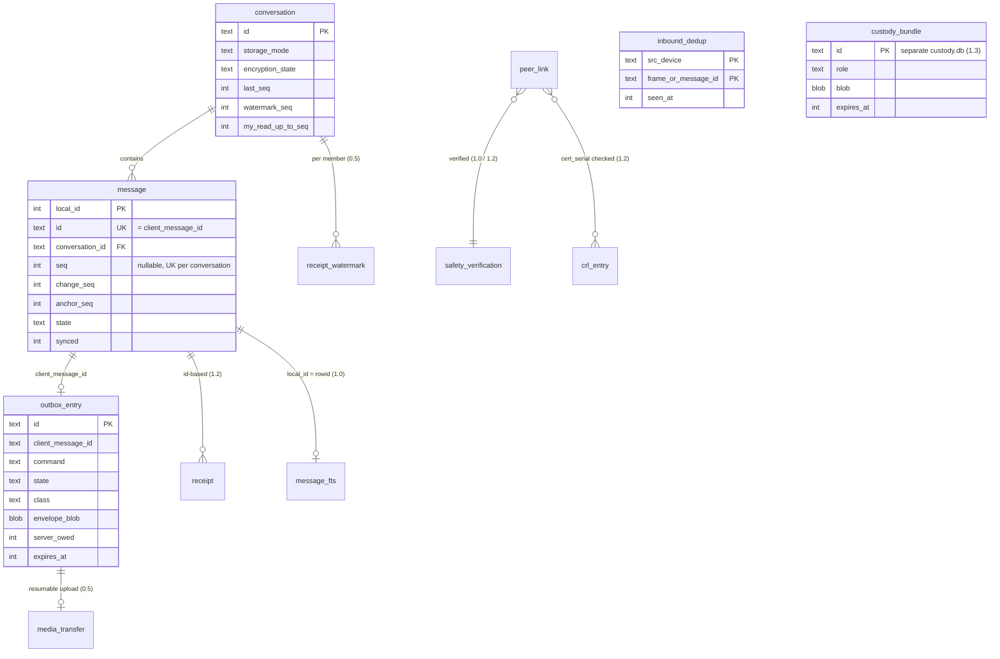

# Muhabbet multi-transport delivery — Data model

> **Status: Proposed — pending owner approval.** No migration, schema file or driver change may be
> written for any scope in this document until the owner records approval for that scope in
> [`APPROVAL.md`](APPROVAL.md). This document is derived from, and must agree with, the
> [decision brief](decision-brief-2026-11-12.md) §11 (the single source of truth). Where they
> disagree, the brief wins and the disagreement is recorded as a `> **Reviewer note (open):**`
> callout.

| | |
|---|---|
| **Date** | 2026-11-12 |
| **Base** | `dev` @ 2434324 (branch `claude/muhabbet-p2p-architecture-wdan5r`); latest applied Flyway migration on `dev` is `V27__two_step_login_gate.sql` |
| **Owning ADRs** | [0013](../../adr/0013-delivery-semantics-and-ticks.md), [0014](../../adr/0014-ordering-seq-change-feed.md), [0018](../../adr/0018-identity-keys-device-certificates.md), [0020](../../adr/0020-data-at-rest-and-erasure.md), [0021](../../adr/0021-adr0008-amendment-storage-modes-e2e.md), [0025](../../adr/0025-store-and-forward-custody.md), [0028](../../adr/0028-kmp-module-structure.md), [0029](../../adr/0029-compliance-boundary.md) |
| **Companion** | [`icd-wire-protocol.md`](icd-wire-protocol.md) (the interfaces these tables serve) |
| **Evidence** | [Findings register](../../reviews/2026-11-12-findings-register.md): BE-02, BE-03, BE-06, BE-07, BE-14, BE-15, BE-18, BEV-M1, BEV-M2, CICD-09, C7, C8, M1, M2, M3, MOB-01, MOB-03, MOB-04, MOB-05, MOB-10, KMP-05 |
| **Conventions** | DDL below is a **sketch**: column names, types, constraints and indexes are normative; formatting, constraint names and batch sizes are not. Milestone names are the ROADMAP names (brief naming note). Every literal limit marked *(config)* lives in `application.yml` or a companion object |

---

## 1. Principles

| # | Principle | Source |
|---|---|---|
| D-1 | The **server** owns identity, device registry, key directory, per-conversation order and the mailbox. The mobile DB is the **device's** source of truth for what it has seen and what it owes (outbox), never an ordering authority | ADR-0010, ADR-0011 |
| D-2 | One cursor model in every era: a per-(device, conversation) watermark over `messages.change_seq` | ADR-0014, ADR-0021 |
| D-3 | There is **no backend outbox table**. Pull-by-seq makes hint loss harmless | brief §3 judge disagreements |
| D-4 | Domain models ≠ JPA entities; JPA adapters implement out-ports; nothing here is read by a controller directly | CLAUDE.md hexagonal rules |
| D-5 | No key material that a server must not hold is ever stored server-side (private keys of devices, the device-CA intermediate, the uplink private key) | ADR-0018, ADR-0025, ADR-0031 |
| D-6 | No stable recipient identifier in any custody or relay store (mobile or server) | C7, ADR-0025 |
| D-7 | Schema change is **expand → migrate → contract**, never in one release | CICD-09 |

---

## 2. Backend migration discipline (Flyway)

### 2.1 Rules

1. **One version, one release.** A Flyway version ships in exactly one release, and versions ascend in
   release order. `outOfOrder` stays `false`, so a lower version shipped after a higher one would
   fail validation in production.
2. **Dotted versions** (`V31.1`, `V33.1`) carry a later-release follow-up of a family — the contract
   step of an earlier expand, or a split forced by rule 1. They sort between the integers.
3. **Expand / contract** (CICD-09). Release N may add nullable columns, tables, indexes, `NOT VALID`
   constraints and dual writes. Only release N+1 or later may set `NOT NULL`, `VALIDATE CONSTRAINT`,
   drop columns or tables, or stop dual writes. Every migration below names its contract step.
4. **N-1 on N.** CI applies release N's migrations to a database built by N-1's migrations, starts the
   N-1 image against it and runs a smoke suite (CICD-09). A migration that breaks N-1 is not mergeable.
5. **Lint.** Migrations are linted with a Postgres DDL linter (squawk, per CICD-09) for
   table-rewriting and lock-heavy statements.
6. **Lock hygiene on a co-tenant database.** `shared-postgres` serves other projects (SAD TC-9).
   Every migration starts with `SET lock_timeout` and `SET statement_timeout` sized for that
   migration; constraints are added `NOT VALID` and validated separately; large indexes use
   `CREATE INDEX CONCURRENTLY` in their own non-transactional dotted version (Flyway cannot mix
   transactional and non-transactional statements in one script).
7. **Backfills** are idempotent (`WHERE col IS NULL`), batched by primary key when the table's
   measured row count exceeds a threshold *(decided per PR from a production row count recorded in
   the PR)*, and never run inside the request path.
8. **Immutability.** An applied migration is never edited; `validate-on-migrate` stays on in
   production (#429). Rollback = previous image on the expanded schema (rules 3–4). Flyway undo is
   not used; each PR states its manual reverse SQL in the description, never auto-run.
9. **Docker on.** Every migration is exercised by Testcontainers with Docker running before merge
   (CLAUDE.md, #598); a migration that touches Spring configuration indirectly is exactly what the
   integration suite catches.
10. **Domain mapping.** A column added to `users` must be mapped in the domain model:
    `UserJpaEntity.fromDomain` rebuilds the whole row on every save and silently resets unmapped
    columns (documented in `V27__two_step_login_gate.sql`).

### 2.2 Release map

| Version | Release | Content | Expand / contract | Brief ref |
|---|---|---|---|---|
| **V28** | 0.4 | `conversations.last_seq`; `messages.seq`, `messages.change_seq`; backfill; unique indexes | expand | §11.1 V28 |
| **V29** | 0.4 | `messages.sender_device_id`, `messages.client_message_id`; device-scoped idempotency key | expand | §11.1 V29 |
| **V30** | 0.4 | Age gate storage | expand | §11.1 V30 |
| **V31** | 0.4 | Contact-lookup daily quota | expand | §11.1 V31 (0.4 part) |
| **V31.1** | 0.5.0 | Contract of V28/V29: seq presence check, identity-rule check | contract | (this doc) |
| **V31.2** | 0.6.0 | `users.discoverable_by_phone` | expand | §11.1 V31 (0.6 part) |
| **V32** | 0.6.0 | Per-device delivery | expand (dual write) | §11.1 V32 |
| **V33** | 0.6.0 | Device-scoped key directory | expand | §11.1 V33 |
| **V33.1** | 0.7.0 | Contract: drop legacy `message_delivery_status`, `encryption_keys`, `one_time_pre_keys` | contract | (this doc) |
| **V34** | 1.0.0 | Mailbox `message_envelopes`; encryption state; nullable `content` | expand | §11.1 V34 |
| **V35** | 1.2 (gated) | Link keys, device certificates, CRL deltas | expand | §11.1 V35 |
| **V36** | 1.3 (gated) | Uplink keys and quotas | expand | §11.1 V36 |

> **Reviewer note (open):** brief §11.1 assigns V29 to "0.4/0.5" and V31 to "0.4 (cap) / 0.6".
> Under rule 1 a version cannot straddle two releases. This document resolves V29 to **0.4** (brief
> §13 lists V28/V29 under the 0.4 "EARLY ENGINE" scope) and splits V31 into V31 (0.4, cap) and
> V31.2 (0.6, discoverability). The dotted contract steps V31.1 and V33.1 are additions required by
> CICD-09's expand/contract rule; the brief names no contract migrations.

---

## 3. Backend migrations

Current tables these migrations touch (from `V1`, `V6`, `V11`, `V16`, `V17`, `V18`, `V24`):
`messages(id UUID PK — client-generated UUIDv7, conversation_id, sender_id, content TEXT NOT NULL,
server_timestamp, client_timestamp, is_deleted, deleted_at, edited_at, expires_at, is_scheduled,
scheduled_at, view_once, media_id, forwarded_from, …)`, `conversations(id, type, …, max_members,
updated_at + trigger)`, `devices(id, user_id, platform, push_token, is_primary, revoked_at,
linked_by_device_id, locale, …)`, `message_delivery_status(message_id, user_id, status)` (per
**user**, BE-18), `encryption_keys` / `one_time_pre_keys` (per **user**, BE-14, M2).

### 3.1 V28 — per-conversation sequence and change sequence (0.4)

**Purpose.** BE-06/C13: total, gap-detectable order; BEV-M2: a cursor that is not a timestamp.

```sql
SET lock_timeout = '5s';
ALTER TABLE conversations ADD COLUMN last_seq   BIGINT NOT NULL DEFAULT 0;  -- constant default: no rewrite (PG ≥ 11)
ALTER TABLE messages      ADD COLUMN seq        BIGINT;                     -- NULL = unreleased scheduled
ALTER TABLE messages      ADD COLUMN change_seq BIGINT;                     -- last change to the row

-- Backfill (idempotent; batch by conversation if large): released rows ordered by (server_timestamp, id)
WITH ordered AS (
  SELECT id, row_number() OVER (PARTITION BY conversation_id ORDER BY server_timestamp, id) AS n
  FROM messages WHERE is_scheduled = false AND seq IS NULL)
UPDATE messages m SET seq = o.n, change_seq = o.n FROM ordered o WHERE m.id = o.id;

UPDATE conversations c SET last_seq = s.max_seq
FROM (SELECT conversation_id, max(change_seq) AS max_seq FROM messages GROUP BY conversation_id) s
WHERE c.id = s.conversation_id AND c.last_seq < s.max_seq;

CREATE UNIQUE INDEX ux_messages_conv_seq        ON messages (conversation_id, seq);
CREATE UNIQUE INDEX ux_messages_conv_change_seq ON messages (conversation_id, change_seq);
```

| Item | Rule |
|---|---|
| Allocation | `ConversationSequencePort.next(conv)` = `UPDATE conversations SET last_seq = last_seq + :n WHERE id = :conv RETURNING last_seq`, inside the caller's transaction. A single insert uses `n = 1` and sets `seq = change_seq = value`. A bulk operation (expiry sweep) allocates a contiguous range `[v − n + 1, v]` and stamps one value per row |
| What bumps `change_seq` | insert, edit, delete, reaction add/remove (on the target message), expiry soft-delete, scheduled release. **Not** receipts (they would make every read a hot-row write; receipts have their own cursor, V32) |
| Invariants | `UNIQUE (conversation_id, seq)` and `UNIQUE (conversation_id, change_seq)` (a double allocation is a constraint violation, not silent corruption); `change_seq ≥ seq`; `last_seq ≥ max(change_seq)` per conversation |
| Backfill semantics | Existing edits/deletes get `change_seq = seq`: a client's first pull sees the current row state, which is all a first pull needs |
| `updated_at` trigger | `update_conversations_updated_at` fires on every allocation. Decide at implementation: accept it as "last activity", or redefine the trigger as `BEFORE UPDATE OF <metadata columns>`. Recommended: restrict it, so `updated_at` keeps meaning "metadata changed" |
| Indexes kept | `idx_messages_conversation_time` / `idx_messages_conversation_latest` stay until `/messages/since` is removed (one release after `/changes`, ADR-0014) |
| N-1 safety | N-1 code ignores the new columns. Rows it inserts during a rollback window get `seq IS NULL`; edits it makes do not bump `change_seq` |
| Repair job (ships with V28's code) | `SeqSweeper`: assigns `seq`/`change_seq` to rows with `seq IS NULL AND is_scheduled = false`, oldest first, one conversation per transaction; and after a roll-forward, bumps `change_seq` for rows with `edited_at`/`deleted_at` inside the rollback window. Idempotent; reports a count |
| Contract | V31.1 (0.5) |
| Verification | RQ-04: 50 concurrent senders → gapless unique `seq` (Testcontainers); backfill test on a fixture with equal `server_timestamp`s |

### 3.2 V29 — sender device and device-scoped idempotency (0.4)

**Purpose.** BE-07 (check-then-insert on a client-chosen global PK, error on retry); ADR-0013.

```sql
SET lock_timeout = '5s';
ALTER TABLE messages ADD COLUMN sender_device_id  UUID REFERENCES devices(id) ON DELETE SET NULL;
ALTER TABLE messages ADD COLUMN client_message_id UUID;

UPDATE messages SET client_message_id = id WHERE client_message_id IS NULL;   -- batched by id

CREATE UNIQUE INDEX ux_messages_sender_device_client_id
  ON messages (sender_device_id, client_message_id);
```

| Item | Rule |
|---|---|
| **Identity rule** | `messages.id = client_message_id` for every row. The id is minted by the sender device (UUIDv7), so `Edit`/`Delete`/`Reaction`/`reply_to` inside E2E `Content` can reference a message offline and before it has a `seq` (ICD §6.3) |
| Idempotent insert | `INSERT … ON CONFLICT (sender_device_id, client_message_id) DO NOTHING RETURNING …`; on no row returned, read the original `(seq, server_timestamp)` and replay it (`replay = true`, ICD §3.6) |
| Foreign collision | A conflict on the PK `id` with a **different** `sender_device_id` is `MSG_ID_CONFLICT`; another device's ack is never replayed |
| Historical rows | `sender_device_id` stays `NULL` for rows sent before V29 (the device is not recoverable). NULLs are distinct in the unique index, so they never collide; their idempotency was the global PK |
| `sender_device_id` source | The JWT `deviceId` claim (present today) — never a client-supplied field |
| Scheduled messages | Inserted with `seq = change_seq = NULL`, `is_scheduled = true`. Release (BEV-M1): one transaction per message — claim with `UPDATE … WHERE id = ? AND is_scheduled RETURNING`, allocate, set `seq = change_seq`, `is_scheduled = false`, commit, then hint (BE-02 closed structurally) |
| N-1 safety | N-1 inserts leave both columns NULL; V31.1's checks are written to tolerate pre-cut-over NULLs |
| Contract | V31.1 |

### 3.3 V30 — age gate (0.4)

**Purpose.** Law 7578 / 5651 Ek Md. 4, ADR-0029 rule 1. The design does **not** claim compliance
until counsel confirms that self-declaration is *yaş doğrulama* (Q-L3).

```sql
ALTER TABLE users ADD COLUMN birth_date          DATE;
ALTER TABLE users ADD COLUMN age_assurance_level VARCHAR(16)
  CHECK (age_assurance_level IN ('SELF_DECLARED', 'EDEVLET', 'NFC_ID'));
ALTER TABLE users ADD COLUMN age_assured_at      TIMESTAMPTZ;
ALTER TABLE users ADD CONSTRAINT ck_users_age_assurance
  CHECK ((age_assurance_level IS NULL) = (age_assured_at IS NULL)) NOT VALID;
-- VALIDATE in the same file is safe: every existing row is (NULL, NULL)
ALTER TABLE users VALIDATE CONSTRAINT ck_users_age_assurance;
```

| Item | Rule |
|---|---|
| Registration | Under-15 is refused **before** a `users` row exists (nothing stored for a refused minor) |
| Existing users | `NULL` → the client asks at next sign-in; `AgeAssurancePort.assess` writes all three columns |
| Reader | 0.4: registration and sign-in gate. 1.2: certificate issuance precondition (ADR-0018) |
| Minimisation | `birth_date` is personal data used only for the gate; listed in the KVKK inventory and the data export |
| N-1 safety | Additive; N-1 ignores |

> **Reviewer note (open):** the brief places the age columns on `users`. `V27__two_step_login_gate.sql`
> records that `UserJpaEntity.fromDomain` rebuilds the whole `users` row on every save, so any column
> not carried by the domain `User` is silently reset by an unrelated profile write. Either the domain
> model carries all three fields (rule 2.1-10), or — recommended, following the V27 precedent — the
> data lives in its own table `user_age_assurance(user_id PK FK users ON DELETE CASCADE, birth_date,
> level, assured_at)` that only the age adapter maps. Owner to choose before V30 is written.

### 3.4 V31 — contact-lookup quota (0.4) and V31.2 — discoverability (0.6)

**Purpose.** C8, M3: enumeration throttling with a per-account daily cap on **new** numbers, block
filtering, and a discoverability setting **with a reader** (brief §8.6).

```sql
-- V31 (0.4)
CREATE TABLE contact_lookup_quota (
  user_id      UUID NOT NULL REFERENCES users(id) ON DELETE CASCADE,
  day          DATE NOT NULL,                       -- Europe/Istanbul calendar day
  new_numbers  INT  NOT NULL DEFAULT 0 CHECK (new_numbers >= 0),
  PRIMARY KEY (user_id, day)
);
CREATE TABLE contact_lookup_seen (                  -- what counts as "new"
  user_id      UUID  NOT NULL REFERENCES users(id) ON DELETE CASCADE,
  number_hash  BYTEA NOT NULL,                      -- the hash the client already sends
  first_seen   DATE  NOT NULL,
  PRIMARY KEY (user_id, number_hash)
);
CREATE INDEX ix_contact_lookup_seen_age ON contact_lookup_seen (first_seen);

-- V31.2 (0.6)
ALTER TABLE users ADD COLUMN discoverable_by_phone BOOLEAN NOT NULL DEFAULT TRUE;
```

| Item | Rule |
|---|---|
| Counting | One statement: `INSERT … ON CONFLICT (user_id, day) DO UPDATE SET new_numbers = new_numbers + :k WHERE contact_lookup_quota.new_numbers + :k <= :cap RETURNING` — no row returned means over the cap (`CONTACT_SYNC_LIMIT_EXCEEDED`, existing code) |
| Retention | `contact_lookup_seen` is "who looked up which number" — personal data. Purged after `CONTACT_LOOKUP_SEEN_RETENTION` *(config)*; a DPIA screening item (ADR-0029 rule 6) |
| Reader (0.6) | `ContactLookupService` excludes users with `discoverable_by_phone = false` and users who blocked the requester; the integration test proves enumeration is throttled (RQ-12) |
| Default | `TRUE` keeps today's behaviour; privacy-by-default `FALSE` is an owner choice with a growth cost |
| Domain mapping | `discoverable_by_phone` is a profile setting and is mapped in the domain `User` (rule 2.1-10), like `read_receipts_enabled` |

### 3.5 V31.1 — contract of V28 / V29 (0.5.0)

```sql
-- Precondition: SeqSweeper reports 0 rows with seq IS NULL AND is_scheduled = false.
ALTER TABLE messages ADD CONSTRAINT ck_messages_seq_present
  CHECK (is_scheduled OR seq IS NOT NULL) NOT VALID;
ALTER TABLE messages VALIDATE CONSTRAINT ck_messages_seq_present;
ALTER TABLE messages ADD CONSTRAINT ck_messages_change_after_seq
  CHECK (seq IS NULL OR change_seq >= seq) NOT VALID;
ALTER TABLE messages VALIDATE CONSTRAINT ck_messages_change_after_seq;
ALTER TABLE messages ADD CONSTRAINT ck_messages_identity_rule
  CHECK (client_message_id IS NULL OR client_message_id = id) NOT VALID;
ALTER TABLE messages VALIDATE CONSTRAINT ck_messages_identity_rule;
```

`client_message_id` stays nullable only because N-1 rows may exist; the `SeqSweeper` also fills it
(`= id`). `sender_device_id` stays nullable permanently for historical rows; the "set on every new
row" rule is enforced by the domain and an integration test, not by the database.

### 3.6 V32 — per-device delivery (0.6.0)

**Purpose.** BE-18 (delivery per user, not per device), BE-03 (acks for any message), ADR-0013 §4.

```sql
CREATE TABLE message_device_delivery (
  message_id  UUID NOT NULL REFERENCES messages(id) ON DELETE CASCADE,
  device_id   UUID NOT NULL REFERENCES devices(id)  ON DELETE CASCADE,
  status      VARCHAR(10) NOT NULL CHECK (status IN ('SENT', 'DELIVERED', 'READ')),
  updated_at  TIMESTAMPTZ NOT NULL DEFAULT now(),
  PRIMARY KEY (message_id, device_id)
);
CREATE INDEX ix_mdd_device ON message_device_delivery (device_id, message_id);

-- Addition (see reviewer note): cumulative per-device receipt cursor
CREATE TABLE conversation_device_cursor (
  conversation_id     UUID   NOT NULL REFERENCES conversations(id) ON DELETE CASCADE,
  device_id           UUID   NOT NULL REFERENCES devices(id)       ON DELETE CASCADE,
  delivered_up_to_seq BIGINT NOT NULL DEFAULT 0,
  read_up_to_seq      BIGINT NOT NULL DEFAULT 0,
  updated_at          TIMESTAMPTZ NOT NULL DEFAULT now(),
  PRIMARY KEY (conversation_id, device_id),
  CHECK (read_up_to_seq <= delivered_up_to_seq)
);
```

| Item | Rule |
|---|---|
| Ack write | One conditional statement, monotonic: `UPDATE conversation_device_cursor SET delivered_up_to_seq = :s … WHERE conversation_id = :c AND device_id = :d AND delivered_up_to_seq < :s` (READ also raises `delivered_up_to_seq`). Broadcast only if a row changed (BE-03). Authorisation per ICD §3.8 |
| Per-message rows | Expanded from the cursor delta, `INSERT … SELECT id FROM messages WHERE conversation_id = :c AND seq > :old AND seq <= :new AND sender_device_id IS DISTINCT FROM :d ON CONFLICT DO UPDATE` with the monotonic rank guard, multi-row (BE-18 "batch inserts") |
| User-level aggregate | `max` over a user's devices, the sender's own devices excluded; the #377 `readReceiptsEnabled` downgrade applied at publish (WS) and in `GET …/receipts` (ICD §4.4) |
| Dual write | 0.6 writes both `message_delivery_status` (legacy, per user) and the new tables; reads switch to the new tables in the same release behind the existing aggregate port; the legacy table is dropped in V33.1 |
| Backfill | None. Messages sent before V32 keep their user-level status from the legacy table until V33.1; after that their ticks show the aggregate as of the drop (frozen, historically accurate) |

> **Reviewer note (open):** ADR-0013 makes acks cumulative (`ack{conversationId, uptoSeq, kind}`),
> so per-device delivery state is two integers per (conversation, device). The brief's V32 stores one
> row per (message, device), which is O(messages × devices) writes and is fully derivable from the
> cursor. This document keeps V32 as the brief specifies and **adds** `conversation_device_cursor` as
> the write target and tick source; the owner may drop `message_device_delivery` entirely if no
> consumer needs per-message rows (`GET /messages/{id}/info` is the only candidate today). The same
> reasoning applies to the mobile `receipt` table (§5.4).

### 3.7 V33 — device-scoped key directory (0.6.0)

**Purpose.** BE-14, M1, M2: per-device keys, atomic claim, Kyber and last-resort keys, no silent
identity replacement (ADR-0018). The atomic claim and fetch rate limit ship **in 0.4 on the existing
tables without a migration**:
`DELETE FROM one_time_pre_keys WHERE id = (SELECT id FROM one_time_pre_keys WHERE user_id = ? AND used = false ORDER BY created_at LIMIT 1 FOR UPDATE SKIP LOCKED) RETURNING …`
(the existing `idx_otpk_user_unused` serves it); the rate limit uses Redis token buckets.

```sql
ALTER TABLE devices ADD CONSTRAINT ux_devices_id_user UNIQUE (id, user_id);  -- target of composite FKs

CREATE TABLE identity_keys (
  device_id        UUID PRIMARY KEY,
  user_id          UUID NOT NULL,
  identity_key     BYTEA NOT NULL,
  registration_id  INT   NOT NULL,
  created_at       TIMESTAMPTZ NOT NULL DEFAULT now(),
  FOREIGN KEY (device_id, user_id) REFERENCES devices (id, user_id) ON DELETE CASCADE
);
CREATE INDEX ix_identity_keys_user ON identity_keys (user_id);

CREATE TABLE signed_prekeys (
  device_id   UUID NOT NULL REFERENCES devices(id) ON DELETE CASCADE,
  key_id      INT   NOT NULL,
  public_key  BYTEA NOT NULL,
  signature   BYTEA NOT NULL,
  created_at  TIMESTAMPTZ NOT NULL DEFAULT now(),
  PRIMARY KEY (device_id, key_id)
);

CREATE TABLE one_time_prekeys (
  id          UUID PRIMARY KEY DEFAULT gen_random_uuid(),
  device_id   UUID NOT NULL REFERENCES devices(id) ON DELETE CASCADE,
  key_id      INT   NOT NULL,
  public_key  BYTEA NOT NULL,
  created_at  TIMESTAMPTZ NOT NULL DEFAULT now(),
  UNIQUE (device_id, key_id)
);
CREATE INDEX ix_otpk_claim ON one_time_prekeys (device_id, created_at);

CREATE TABLE kyber_prekeys (
  id           UUID PRIMARY KEY DEFAULT gen_random_uuid(),
  device_id    UUID NOT NULL REFERENCES devices(id) ON DELETE CASCADE,
  key_id       INT   NOT NULL,
  public_key   BYTEA NOT NULL,
  signature    BYTEA NOT NULL,
  last_resort  BOOLEAN NOT NULL DEFAULT false,
  created_at   TIMESTAMPTZ NOT NULL DEFAULT now(),
  UNIQUE (device_id, key_id)
);
CREATE INDEX        ix_kyber_claim       ON kyber_prekeys (device_id, created_at) WHERE NOT last_resort;
CREATE UNIQUE INDEX ux_kyber_last_resort ON kyber_prekeys (device_id)             WHERE last_resort;
```

| Item | Rule |
|---|---|
| Atomic claim | Per key class: `DELETE FROM one_time_prekeys WHERE id = (SELECT id … WHERE device_id = ? ORDER BY created_at LIMIT 1 FOR UPDATE SKIP LOCKED) RETURNING …`; Kyber the same over `NOT last_resort`, falling back to the last-resort key (read, never deleted) |
| Claim scope | `ClaimPreKeyBundleUseCase.claim(requester, target)` returns one bundle per **active** device (`devices.revoked_at IS NULL`) of the target |
| No silent replacement | `identity_keys.device_id` is the PK; the adapter exposes insert only. A different key for an existing device → `ENCRYPTION_IDENTITY_REPLACEMENT_REJECTED`; a new key means a new `devices` row and an `IdentityKeyChanged` event (ICD §3.11) |
| Low water | Counting `one_time_prekeys`/`kyber_prekeys` per device after a claim emits the replenish hint below `PREKEY_LOW_WATER` *(config)* |
| No backfill | Production `encryption_keys` contains NoOp placeholder identities written by every launch (#379). They are **not** copied; the new tables start empty and are populated by real 1.0 clients |
| Contract | V33.1 drops `encryption_keys` and `one_time_pre_keys` once nothing reads them |

### 3.8 V33.1 — contract (0.7.0)

```sql
DROP TABLE message_delivery_status;   -- after V32 reads have switched (0.6)
DROP TABLE one_time_pre_keys;         -- after V33 claim path is the only path (0.6)
DROP TABLE encryption_keys;
```

### 3.9 V34 — mailbox and encryption state (1.0.0)

**Purpose.** ADR-0021 (mailbox as a projection of the same cursor), ADR-0019 / BE-15 (no server
plaintext for E2E conversations).

```sql
SET lock_timeout = '5s';
ALTER TABLE conversations ADD COLUMN encryption_state   VARCHAR(12) NOT NULL DEFAULT 'NONE'
  CHECK (encryption_state IN ('NONE', 'E2E_V1'));
ALTER TABLE conversations ADD COLUMN storage_mode       VARCHAR(12) NOT NULL DEFAULT 'CLOUD'
  CHECK (storage_mode IN ('CLOUD', 'BYO', 'LOCAL_ONLY'));   -- only if the T3 work has not added it
ALTER TABLE conversations ADD COLUMN e2e_since_seq      BIGINT;       -- first seq sent E2E (cutover)
ALTER TABLE conversations ADD COLUMN plaintext_purge_at TIMESTAMPTZ;  -- end of the notified grace period (Q-O4)

ALTER TABLE messages ADD COLUMN encryption_state  VARCHAR(12) NOT NULL DEFAULT 'NONE'
  CHECK (encryption_state IN ('NONE', 'E2E_V1'));
ALTER TABLE messages ADD COLUMN content_purged_at TIMESTAMPTZ;
ALTER TABLE messages ALTER COLUMN content DROP NOT NULL;
ALTER TABLE messages ADD CONSTRAINT ck_messages_e2e_no_content
  CHECK (encryption_state = 'NONE' OR content IS NULL) NOT VALID;
ALTER TABLE messages VALIDATE CONSTRAINT ck_messages_e2e_no_content;

CREATE TABLE message_envelopes (
  message_id          UUID   NOT NULL REFERENCES messages(id) ON DELETE CASCADE,
  recipient_device_id UUID   NOT NULL REFERENCES devices(id)  ON DELETE CASCADE,
  conversation_id     UUID   NOT NULL,      -- denormalised from messages for the ack delete and the feed
  seq                 BIGINT NOT NULL,      -- denormalised (immutable once assigned)
  protocol            VARCHAR(32) NOT NULL
    CHECK (protocol IN ('signal-prekey/1', 'signal-message/1', 'sender-key/1', 'sender-key-distribution/1')),
  ciphertext          BYTEA  NOT NULL,
  expires_at          TIMESTAMPTZ NOT NULL,
  PRIMARY KEY (message_id, recipient_device_id)
);
CREATE INDEX ix_envelopes_device_conv_seq ON message_envelopes (recipient_device_id, conversation_id, seq);
CREATE INDEX ix_envelopes_expiry          ON message_envelopes (expires_at);
```

| Item | Rule |
|---|---|
| E2E row | `messages` keeps the metadata row (`id`, `conversation_id`, `seq`, `change_seq`, `sender_id`, `sender_device_id`, timestamps, `encryption_state = 'E2E_V1'`, `content_type = 'sealed'`), `content = NULL`. One `message_envelopes` row per recipient device, written in the send transaction |
| Edits, deletes, reactions in E2E conversations | Travel as their own E2E messages (`Content.Edit/Delete/Reaction`, own `seq`). The server cannot mutate an E2E row's content; `change_seq` moves for E2E rows only on expiry tombstoning |
| Ack delete | `MailboxPort.deleteUpTo(device, conv, seq)` = `DELETE FROM message_envelopes WHERE recipient_device_id = ? AND conversation_id = ? AND seq <= ?` (index above) |
| TTL purge | `purgeExpired(now)` deletes `expires_at <= now` in batches; default TTL 30 days, `muhabbet.mailbox.ttl` (ADR-0021) |
| Feed projection | `/changes` for an E2E row joins the requesting device's envelope; `envelopeState` is `PRESENT`, `PURGED` (no row, device was a recipient) or `NOT_ADDRESSED` (ICD §4.1). "Was a recipient" is answered from `message_device_delivery`/`conversation_device_cursor` membership at send time — recorded as a `SENT` row per recipient device in V32 |
| Cutover purge (ADR-0021 §4) | After `plaintext_purge_at`, a job sets `content = NULL, content_purged_at = now()` for `seq < e2e_since_seq`, one conversation per transaction. It does **not** bump `change_seq` (clients that hold the content keep it); new devices see `purged = true` (ICD §4.1). The UI labels a conversation E2E only when every row has `content IS NULL` |
| Erasure completeness | `idx_messages_conversation_latest` **INCLUDEs `content`**: the plaintext also lives in the index and in dead tuples until `VACUUM`; the purge job runs `VACUUM (ANALYZE) messages` after each batch window, and backup retention is aligned with the grace period. RQ-13 is asserted on a dump taken after vacuum |
| Contract (1.0.x) | Drop `idx_messages_conversation_latest`'s `INCLUDE (content)` (recreate without it) once `/messages/since` is gone; drop the `server_timestamp` cursor indexes |
| Group storage note | Sender-key ciphertext is identical for all recipient devices of one message; per-device rows duplicate it. Deduplicated storage is a later optimisation if measured storage warrants it |

### 3.10 V35 — link keys, device certificates, CRL (1.2, gated)

**Purpose.** ADR-0018 (4)–(5). Only **public** material is stored; the intermediate's private key
lives in the file-mounted signer, never on a host that runs PR jobs (ADR-0031, Q-O7).

```sql
CREATE TABLE device_link_keys (
  id                  UUID PRIMARY KEY DEFAULT gen_random_uuid(),
  device_id           UUID  NOT NULL REFERENCES devices(id) ON DELETE CASCADE,
  key_type            VARCHAR(8) NOT NULL CHECK (key_type IN ('X25519', 'ED25519')),  -- fixed by the 1.2 spike
  public_key          BYTEA NOT NULL,
  identity_signature  BYTEA NOT NULL,       -- Sign(identityKey, "mbt-linkkey-v1" ‖ …), ADR-0018
  created_at          TIMESTAMPTZ NOT NULL DEFAULT now(),
  expires_at          TIMESTAMPTZ NOT NULL,
  revoked_at          TIMESTAMPTZ
);
CREATE UNIQUE INDEX ux_link_key_current ON device_link_keys (device_id) WHERE revoked_at IS NULL;

CREATE TABLE ca_intermediate_keys (          -- public records only (addition, see §7)
  key_id          VARCHAR(32) PRIMARY KEY,
  public_key      BYTEA NOT NULL,
  root_key_id     VARCHAR(32) NOT NULL,
  root_signature  BYTEA NOT NULL,
  not_before      TIMESTAMPTZ NOT NULL,
  not_after       TIMESTAMPTZ NOT NULL,     -- 90 days (ADR-0018)
  retired_at      TIMESTAMPTZ
);

CREATE TABLE device_certificates (
  serial             BYTEA PRIMARY KEY CHECK (length(serial) = 16),   -- random, not sequential
  device_id          UUID  NOT NULL REFERENCES devices(id) ON DELETE CASCADE,
  link_key_id        UUID  NOT NULL REFERENCES device_link_keys(id),
  issuer_key_id      VARCHAR(32) NOT NULL REFERENCES ca_intermediate_keys(key_id),
  not_before         TIMESTAMPTZ NOT NULL,
  not_after          TIMESTAMPTZ NOT NULL,   -- not_before + 7 days
  certificate        BYTEA NOT NULL,          -- exact protobuf bytes issued (ICD §7.6)
  revoked_at         TIMESTAMPTZ,
  revocation_reason  VARCHAR(24) CHECK (revocation_reason IN
    ('BAN', 'TAKEDOWN', 'AGE', 'DEVICE_REVOKED', 'ACCOUNT_DELETED', 'KEY_ROTATED')),
  CHECK (not_after > not_before)
);
CREATE INDEX ix_devcert_device ON device_certificates (device_id, not_after DESC);
CREATE INDEX ix_devcert_revoked_live ON device_certificates (not_after) WHERE revoked_at IS NOT NULL;

CREATE TABLE crl_deltas (
  delta_id       BIGINT PRIMARY KEY,           -- strictly increasing
  prev_delta_id  BIGINT,
  issuer_key_id  VARCHAR(32) NOT NULL REFERENCES ca_intermediate_keys(key_id),
  issued_at      TIMESTAMPTZ NOT NULL,
  signed_delta   BYTEA NOT NULL                -- exact SignedCrlDelta bytes (ICD §7.6)
);
```

| Item | Rule |
|---|---|
| Issuance | Requires age attestation (V30), no active ban, device not revoked, a current link key with a valid identity signature (ADR-0018). Renewal on every online session |
| Revocation | Sets `revoked_at` + reason, appends a `crl_deltas` row containing the serials whose `not_after` has not passed, publishes `crl.delta`, closes WS sessions (`SessionRevocationPort`) |
| Retention | Certificate rows past `not_after` + `CERT_RETENTION` *(config)* are deleted; CRL deltas older than the longest certificate validity are compacted (an expired serial needs no CRL entry) |
| Signed bytes | `certificate` and `signed_delta` store exactly what was signed and sent; the server never re-encodes them (ICD §9 rule E-4) |

### 3.11 V36 — uplink keys and quotas (1.3, gated)

```sql
CREATE TABLE uplink_keys (                   -- public keys only; the private key is on the non-CI signer host
  key_id      VARCHAR(32) PRIMARY KEY,
  public_key  BYTEA NOT NULL,
  kem_id      SMALLINT NOT NULL,             -- RFC 9180 identifiers (ICD §8.1)
  kdf_id      SMALLINT NOT NULL,
  aead_id     SMALLINT NOT NULL,
  not_before  TIMESTAMPTZ NOT NULL,
  not_after   TIMESTAMPTZ NOT NULL,
  retired_at  TIMESTAMPTZ
);

CREATE TABLE uplink_quota (                  -- per mule
  mule_user_id  UUID NOT NULL REFERENCES users(id) ON DELETE CASCADE,
  day           DATE NOT NULL,
  bytes         BIGINT NOT NULL DEFAULT 0 CHECK (bytes >= 0),
  count         INT    NOT NULL DEFAULT 0 CHECK (count >= 0),
  PRIMARY KEY (mule_user_id, day)
);

CREATE TABLE uplink_sender_quota (           -- per sender device (addition, see §7)
  sender_device_id  UUID NOT NULL REFERENCES devices(id) ON DELETE CASCADE,
  day               DATE NOT NULL,
  bytes             BIGINT NOT NULL DEFAULT 0 CHECK (bytes >= 0),
  count             INT    NOT NULL DEFAULT 0 CHECK (count >= 0),
  PRIMARY KEY (sender_device_id, day)
);
```

| Item | Rule |
|---|---|
| Quota check | Same single-statement conditional upsert as V31; defaults ≤ 50 bundles / 10 MB per mule per 24 h *(config)* (ADR-0025) |
| No relationship log | No table records which mule carried which sender's bundle; ingested messages are indistinguishable from direct sends apart from the quota counters. The mule↔sender pairing would be new relationship metadata (DPIA, LEG-04) |
| Retention | Quota rows older than `UPLINK_QUOTA_RETENTION` *(config)* are deleted |

---

## 4. Backend entity-relationship view (after V36)


---

## 5. Mobile data model (SQLDelight)

### 5.1 Current state (what exists on `dev`)

- One database definition `MuhabbetDatabase` (`mobile/composeApp/src/commonMain/sqldelight/com/muhabbet/app/db/MuhabbetDatabase.sq`),
  plaintext file, schema version 1, **no migrations**, `sqldelight { databases { create("MuhabbetDatabase") { packageName… } } }`
  with no schema output or verification.
- Three tables: `cachedConversation`, `cachedMessage` (ordered by `clientTimestamp`), `pendingMessage`
  (the lossy at-most-once queue, MOB-04). The UI does not observe them (MOB-03); logout leaves them on
  disk (MOB-01).

### 5.2 0.4 — wire migrations before any schema change

```kotlin
// mobile/composeApp/build.gradle.kts (sketch; versions via gradle/libs.versions.toml, KMP-05)
sqldelight {
    databases {
        create("MuhabbetDatabase") {
            packageName.set("com.muhabbet.app.db")
            schemaOutputDirectory.set(file("src/commonMain/sqldelight/databases"))
            verifyMigrations.set(true)
        }
    }
}
```

| Step | Action |
|---|---|
| 1 | Generate the schema snapshot `1.db` from the **currently shipped** `.sq` (the plugin's generate-schema task) and commit it |
| 2 | Every later change is a `<n>.sqm` migration from version *n* to *n+1*; the `.sq` file states the latest schema; CI runs the plugin's verify-migration task beside the compile canary |
| 3 | MOB-01 `SessionTeardown` (0.4) deletes all rows of the three tables and cancels WorkManager — no schema change |
| 4 | MOB-04 stopgap (0.4): `pendingMessage` rows are deleted only on `ServerAck(requestId)` — no schema change |

> **Reviewer note (open):** brief §11.2 says "`1.sqm` represents today's schema … and
> `deriveSchemaFromMigrations`". With SQLDelight, `1.sqm` is the migration **from** version 1, and
> installed databases already report version 1 with today's tables created. A `1.sqm` containing
> today's `CREATE TABLE` statements would re-run on every installed database and fail, unless every
> statement is `IF NOT EXISTS`. This document therefore keeps the `.sq` file as the schema, snapshots
> today's schema as `1.db`, and uses `verifyMigrations` without `deriveSchemaFromMigrations`. If the
> owner prefers migration-derived schemas, `1.sqm` must be written with `IF NOT EXISTS` throughout
> and the version arithmetic verified against a `1.db` taken from the shipped APK before 0.4 ships.

### 5.3 0.5 — the encrypted SSOT store

**Files and keys (ADR-0020).**

| File | Contents | Protection | Lifetime |
|---|---|---|---|
| `muhabbet.db` (legacy) | today's three tables, plaintext | none | Read once at the 0.5 upgrade, then deleted with `-wal`, `-shm`, `-journal` |
| `muhabbet-store.db` | `MuhabbetDatabase` schema version 2 (legacy tables **and** the SSOT tables) | SQLCipher, random 256-bit key wrapped by Android Keystore (StrongBox when present) / iOS Keychain `AfterFirstUnlockThisDeviceOnly`, alias `db-main` | Until `SessionTeardown` |

**Upgrade procedure (once, at first 0.5 launch, before any network I/O).**

1. `SecureKeyStorePort.getOrCreateWrappedKey("db-main")`.
2. Create `muhabbet-store.db` through the SQLCipher driver at the latest schema version.
3. Open the legacy file with a raw driver **without** the generated `Schema` (no create, no migrate)
   and `SELECT * FROM pendingMessage`.
4. In one store transaction: for each pending row, insert the optimistic `message` row and an
   `outbox_entry` (`QUEUED`, `command = SEND`, envelope built from the row) when `engine.enabled`;
   otherwise copy it into the store's `pendingMessage`.
5. Close and delete the legacy file and its sidecars; record `kv_meta('legacy_db_deleted')`.
6. Re-sync from the server: `heads()` then pull every conversation from `afterSeq = 0` (ADR-0020:
   nothing authoritative is lost because the old DB was a cache).

A crash at any step is safe: steps 2–5 are idempotent and the legacy file is deleted only after the
store transaction commits.

**Driver (sketch, `composeApp` androidMain).**

```kotlin
fun createStoreDriver(context: Context, key: ByteArray): SqlDriver =
    AndroidSqliteDriver(
        schema = MuhabbetDatabase.Schema,
        context = context,
        name = "muhabbet-store.db",
        factory = SupportOpenHelperFactory(key),   // sqlcipher-android; exact API verified at 0.5
    )
```

**Key loss.** If the wrapped key cannot be unwrapped (Keystore entry invalidated), the store is
unreadable by design: delete it and re-sync. Before 1.0 nothing is lost; from 1.0, E2E history not in
an encrypted backup is lost and the UI says so.

**SSOT schema (added by `1.sqm`, version 1 → 2).**

```sql
CREATE TABLE conversation (
  id                       TEXT    NOT NULL PRIMARY KEY,
  type                     TEXT    NOT NULL CHECK (type IN ('DIRECT', 'GROUP', 'CHANNEL')),
  title                    TEXT,
  avatar_url               TEXT,
  storage_mode             TEXT    NOT NULL DEFAULT 'CLOUD' CHECK (storage_mode IN ('CLOUD', 'BYO', 'LOCAL_ONLY')),
  encryption_state         TEXT    NOT NULL DEFAULT 'NONE'  CHECK (encryption_state IN ('NONE', 'E2E_V1')),
  last_seq                 INTEGER NOT NULL DEFAULT 0,  -- head last learned (heads, hints, pages)
  watermark_seq            INTEGER NOT NULL DEFAULT 0,  -- applied through, over change_seq (ICD §3.10)
  my_read_up_to_seq        INTEGER NOT NULL DEFAULT 0,  -- own read position; unread = derived
  disappear_after_seconds  INTEGER,
  is_pinned                INTEGER NOT NULL DEFAULT 0,
  muted_until              INTEGER,
  participants_json        TEXT    NOT NULL DEFAULT '[]',
  updated_at               INTEGER NOT NULL
);

CREATE TABLE message (
  local_id           INTEGER PRIMARY KEY AUTOINCREMENT,   -- stable rowid (FTS key); monotonic = receive order
  id                 TEXT    NOT NULL UNIQUE,             -- = client_message_id (backend V29 identity rule)
  conversation_id    TEXT    NOT NULL REFERENCES conversation(id) ON DELETE CASCADE,
  client_message_id  TEXT    NOT NULL UNIQUE,
  sender_user_id     TEXT    NOT NULL,
  sender_device_id   TEXT,
  is_own             INTEGER NOT NULL,
  seq                INTEGER,                              -- NULL until server custody
  change_seq         INTEGER,
  anchor_seq         INTEGER NOT NULL DEFAULT 0,           -- head known when created/received (ADR-0014 lastKnownSeq)
  device_counter     INTEGER,                              -- from CausalHeader (1.0+)
  sender_time        INTEGER,                              -- advisory; clamped at display
  received_at        INTEGER NOT NULL,
  server_ts          INTEGER,
  state              TEXT    NOT NULL CHECK (state IN ('LOCAL', 'ACCEPTED', 'RECEIVED', 'FAILED')),
  content_type       TEXT    NOT NULL,
  body_json          TEXT    NOT NULL,                     -- display model; plaintext exists only inside SQLCipher
  reactions_json     TEXT    NOT NULL DEFAULT '{}',        -- full state, last-writer-wins by change_seq
  reply_to_id        TEXT,
  edit_version       INTEGER NOT NULL DEFAULT 0,
  deleted            INTEGER NOT NULL DEFAULT 0,
  expires_at         INTEGER,
  synced             INTEGER NOT NULL DEFAULT 1,           -- 0 = delivered off-server, "not yet synced"
  UNIQUE (conversation_id, seq)
);
CREATE INDEX ix_message_display
  ON message (conversation_id, coalesce(seq, anchor_seq), seq IS NULL, local_id);

CREATE TABLE outbox_entry (
  id                TEXT    NOT NULL PRIMARY KEY,
  client_message_id TEXT    NOT NULL,
  conversation_id   TEXT    NOT NULL,
  command           TEXT    NOT NULL CHECK (command IN ('SEND', 'EDIT', 'DELETE', 'REACT', 'REPORT')),
  state             TEXT    NOT NULL CHECK (state IN ('PREPARING', 'PENDING_SEAL', 'QUEUED', 'IN_FLIGHT',
                       'RETRY_WAIT', 'HOP_ACKED', 'SERVER_ACCEPTED', 'FAILED_PERMANENT', 'EXPIRED', 'CANCELLED')),
  class             TEXT    NOT NULL CHECK (class IN ('CONTROL', 'INTERACTIVE', 'BULK')),
  envelope_version  INTEGER NOT NULL,
  envelope_blob     BLOB    NOT NULL,                      -- full versioned OutgoingEnvelope (ICD §10 rule 8)
  attempt           INTEGER NOT NULL DEFAULT 0,
  next_attempt_at   INTEGER,
  lease_until       INTEGER,                               -- one worker at a time (engine vs WorkManager)
  link              TEXT,                                  -- scope of the IN_FLIGHT / HOP_ACKED link
  server_owed       INTEGER NOT NULL DEFAULT 0,
  seq               INTEGER,                               -- from SERVER_ACCEPTED
  created_at        INTEGER NOT NULL,
  expires_at        INTEGER NOT NULL,                      -- default created_at + 30 d; CONTROL 60 s
  error_code        TEXT
);
CREATE INDEX ix_outbox_due  ON outbox_entry (state, next_attempt_at);
CREATE INDEX ix_outbox_fifo ON outbox_entry (conversation_id, created_at) WHERE class = 'INTERACTIVE';
CREATE INDEX ix_outbox_msg  ON outbox_entry (client_message_id);

CREATE TABLE media_transfer (                              -- resumable PREPARING (brief §6.7), addition
  entry_id        TEXT    NOT NULL PRIMARY KEY REFERENCES outbox_entry(id) ON DELETE CASCADE,
  local_uri       TEXT    NOT NULL,
  blob_id         TEXT,
  total_bytes     INTEGER NOT NULL,
  uploaded_bytes  INTEGER NOT NULL DEFAULT 0,
  sha256          BLOB,
  updated_at      INTEGER NOT NULL
);

CREATE TABLE inbound_dedup (
  src_device           TEXT    NOT NULL,
  frame_or_message_id  TEXT    NOT NULL,
  seen_at              INTEGER NOT NULL,
  PRIMARY KEY (src_device, frame_or_message_id)
) WITHOUT ROWID;
CREATE INDEX ix_inbound_dedup_age ON inbound_dedup (seen_at);

CREATE TABLE receipt_watermark (                           -- user-level, from message.status / GET …/receipts
  conversation_id      TEXT    NOT NULL REFERENCES conversation(id) ON DELETE CASCADE,
  user_id              TEXT    NOT NULL,
  delivered_up_to_seq  INTEGER NOT NULL DEFAULT 0,
  read_up_to_seq       INTEGER NOT NULL DEFAULT 0,
  updated_at           INTEGER NOT NULL,
  PRIMARY KEY (conversation_id, user_id)
);

CREATE TABLE kv_meta (key TEXT NOT NULL PRIMARY KEY, value TEXT NOT NULL);
```

**Store invariants and transaction rules.**

| # | Rule | Source |
|---|---|---|
| S-1 | Send: the optimistic `message` row (`state = LOCAL`, `seq = NULL`, `anchor_seq = conversation.last_seq`) and its `outbox_entry` are inserted in **one** transaction | ADR-0013, MOB-04 |
| S-2 | Outbox transitions are compare-and-set: `UPDATE outbox_entry SET state = :to … WHERE id = :id AND state = :from`, then `SELECT changes()` in the same transaction; 0 means another worker won | ADR-0013 |
| S-3 | Inbox: one transaction per event or page — insert, or update only if the incoming `change_seq` is newer; advance `watermark_seq` per ICD §3.10 in the same transaction; enqueue DELIVERED only after commit | P4, MOB-03, MOB-05 |
| S-4 | `SERVER_ACCEPTED(seq)` sets `message.seq`, `change_seq`, `state = ACCEPTED` in the same transaction as the outbox transition | ADR-0013 |
| S-5 | Display order: `ORDER BY coalesce(seq, anchor_seq), seq IS NULL, local_id` (uses `ix_message_display`). A provisional row sorts after the last `seq` its creator knew and re-sorts stably when its `seq` arrives | ADR-0014 |
| S-6 | Ticks are derived, never stored: one tick = `seq IS NOT NULL`; two ticks = every other member's `delivered_up_to_seq ≥ seq`; read = every other member's `read_up_to_seq ≥ seq` | ADR-0013 |
| S-7 | Unread count = `COUNT(*) WHERE conversation_id = ? AND is_own = 0 AND seq > my_read_up_to_seq AND deleted = 0` | — |
| S-8 | `inbound_dedup` rows older than `DEDUP_TTL` ≥ the maximum message lifetime (30 d) are purged | ADR-0013 |
| S-9 | Read receipts are **not** persisted (regenerated on chat open); DELIVERED is cumulative and re-derived after every committed page | ADR-0013 |
| S-10 | No wire type (`WsMessage`, DTO) is stored or read by UI code; screens observe flows over these tables | P5, ADR-0011 |

> **Reviewer note (open):** brief §11.2 sketches the message index as
> `(conversation_id, coalesce(seq, ∞), local_order)`, which always puts seq-less rows last. ADR-0014's
> display order places a seq-less row after the last seq **its creator knew** (`lastKnownSeq`), which
> is what keeps an off-server message (1.2) from jumping below later server traffic. This document
> adds `anchor_seq` and uses `coalesce(seq, anchor_seq)`; before 1.2 the only seq-less rows are the
> device's own unsent messages, for which the two orders differ only when server messages arrive
> while one is pending.

### 5.4 0.5.2 or later — drop the legacy tables (`2.sqm`, version 2 → 3)

Runs in the first release after `engine.enabled` became the default and the legacy path was deleted
(brief §13 rollout): `DROP TABLE cachedConversation; DROP TABLE cachedMessage; DROP TABLE pendingMessage;`.
Before dropping, any `pendingMessage` rows still present (flag was off on that install) are converted
into `outbox_entry` rows exactly as in the 0.5 upgrade step 4.

### 5.5 1.0 — local search and E2E state (`3.sqm`, version 3 → 4)

```sql
CREATE VIRTUAL TABLE message_fts USING fts5(
  search_text, content = '', contentless_delete = 1, tokenize = 'unicode61 remove_diacritics 2');
CREATE TRIGGER message_fts_delete AFTER DELETE ON message BEGIN
  DELETE FROM message_fts WHERE rowid = old.local_id;
END;
CREATE TRIGGER message_fts_tombstone AFTER UPDATE OF deleted ON message WHEN new.deleted = 1 BEGIN
  DELETE FROM message_fts WHERE rowid = old.local_id;
END;

ALTER TABLE conversation ADD COLUMN e2e_since_seq      INTEGER;  -- "earlier history still on the server" label
ALTER TABLE conversation ADD COLUMN plaintext_purge_at INTEGER;

CREATE TABLE safety_verification (                     -- static QR verification (brief §12 #43), addition
  peer_user_id   TEXT    NOT NULL,
  peer_device_id TEXT    NOT NULL,
  fingerprint    BLOB    NOT NULL,                      -- the verified identity; a change invalidates it
  verified_at    INTEGER NOT NULL,
  PRIMARY KEY (peer_user_id, peer_device_id)
);
```

| Item | Rule |
|---|---|
| Contentless FTS | The index holds tokens only, inside SQLCipher (ADR-0020, brief §12 #69). Inserts and re-indexing on edit are done by the Inbox in the same transaction as the row (the app, not a JSON-parsing trigger, extracts `search_text`); **deletes** are triggers, so a cascade or teardown can never leave tokens behind |
| `contentless_delete = 1` | Requires the SQLite bundled with the chosen SQLCipher build to support it (SQLite 3.43+). Verify at the 1.0 spike; otherwise use the FTS5 `'delete'` command with the original `search_text` kept in a column |
| Turkish | `unicode61` case folding is not Turkish-locale aware (İ/i, I/ı). The app lower-cases `search_text` and queries with Turkish locale rules before they reach FTS; verified with a fixture of dotted/dotless pairs |
| Rowid | `message.local_id` is an explicit `INTEGER PRIMARY KEY`, so `VACUUM` cannot renumber it and break the FTS mapping |
| Verification state | `safety_verification` is the eligibility input for 1.2 (verified safety number) and is cleared for a device when `security.key_changed` names it |

### 5.6 1.2 — proximity (`4.sqm`, version 4 → 5; gated)

```sql
CREATE TABLE peer_link (
  peer_device_id  TEXT    NOT NULL PRIMARY KEY,
  peer_user_id    TEXT    NOT NULL,
  link_key        BLOB    NOT NULL,
  cert_serial     BLOB    NOT NULL,
  cert_not_after  INTEGER NOT NULL,
  verified_at     INTEGER                       -- copied from safety_verification at eligibility check
);
CREATE TABLE crl_entry (
  serial    BLOB    NOT NULL PRIMARY KEY,
  revoked_at INTEGER NOT NULL,
  delta_id  INTEGER NOT NULL
);
CREATE TABLE receipt (                            -- id-based receipts for seq-less off-server rows
  message_id TEXT    NOT NULL,
  device_id  TEXT    NOT NULL,
  kind       TEXT    NOT NULL CHECK (kind IN ('DELIVERED', 'READ')),
  at         INTEGER NOT NULL,
  PRIMARY KEY (message_id, device_id, kind)
) WITHOUT ROWID;
```

- The last applied CRL `delta_id` is kept in `kv_meta`; deltas are applied in order (ICD §7.6).
- `crl_entry` rows whose certificate would have expired anyway are purged.
- Off-server received rows: `seq = NULL`, `synced = 0`, `anchor_seq = Content.conversation.expected_seq_hint`;
  matched to the later server copy by `client_message_id` (ICD §3.7).
- `receipt` rows for a message are folded into `receipt_watermark` semantics once the message has a
  `seq`, then deleted.

> **Reviewer note (open):** brief §11.2 lists `receipt(message_id, device_id, kind, at)` in the 0.5
> schema. At 0.5 every acknowledgement is cumulative over `seq` (ICD §3.8), so the 0.5 producer of
> per-message receipt rows does not exist; per P7 the table arrives with its first consumer, 1.2
> off-server receipts for seq-less rows. 0.5 uses `receipt_watermark` instead. Same reasoning as the
> V32 note in §3.6.

### 5.7 1.3 — custody store (separate database, gated)

A second SQLDelight database definition `CustodyDatabase` in `custody.db`, SQLCipher with its own
key alias `db-custody` and its own quota (ADR-0020, ADR-0025).

```sql
CREATE TABLE custody_bundle (
  id            TEXT    NOT NULL PRIMARY KEY,     -- random per bundle; never a message or device id
  role          TEXT    NOT NULL CHECK (role IN ('OWN_DEVICE', 'UPLINK_MULE')),
  blob          BLOB    NOT NULL,                 -- opaque: SealedFrame (own device) or UplinkSubmission (mule)
  size_bucket   INTEGER NOT NULL,
  received_at   INTEGER NOT NULL,
  expires_at    INTEGER NOT NULL,                 -- mule: received_at + 24 h; own device: bundle lifetime
  state         TEXT    NOT NULL CHECK (state IN ('IN_CUSTODY', 'OFFERED', 'RELEASED')),
  attempts      INTEGER NOT NULL DEFAULT 0
);
CREATE INDEX ix_custody_expiry ON custody_bundle (expires_at);
CREATE TABLE custody_quota (day TEXT NOT NULL PRIMARY KEY, bytes INTEGER NOT NULL, count INTEGER NOT NULL);
```

| Rule | Statement |
|---|---|
| No identifiers | No sender, recipient, conversation or tag column for `UPLINK_MULE` rows (C7, D-6). `OWN_DEVICE` rows belong to the same user; routing is read from inside the blob when handing over |
| Eviction | FIFO by `expires_at` when the quota is full; expired rows deleted on every open and by a periodic job |
| Release | Mule: delete on any 2xx/400/413/422 from `/uplink` (ICD §8.4). Own device: delete on an authenticated DELIVERED |
| Erasure | Leaving relay mode deletes `custody.db` and destroys `db-custody` immediately; `SessionTeardown` does the same |

### 5.8 `SessionTeardown` (data view, ADR-0020)

Order: (1) queue best-effort server revoke; (2) cancel WorkManager/BGTask; (3) close links; (4)
destroy the wrapped keys `db-main` and `db-custody`; (5) delete `muhabbet-store.db`, `custody.db`,
their `-wal`/`-shm`/`-journal` sidecars, the media cache and any legacy `muhabbet.db`; delete
libsignal identity and session state; (6) verify that none of the files exists and the key aliases are
gone. Destroying the key first makes any file that survives step 5 unreadable (crypto-erase).

### 5.9 Mobile entity-relationship view (after 1.3)



### 5.10 Backend ↔ mobile field mapping

| Concept | Backend | Wire (ICD) | Mobile |
|---|---|---|---|
| Message identity | `messages.id = client_message_id` | `messageId`, `clientMessageId` | `message.id`, `message.client_message_id` |
| Order | `messages.seq` | `seq` | `message.seq` |
| Change | `messages.change_seq` | `changeSeq` | `message.change_seq`, `conversation.watermark_seq` |
| Head | `conversations.last_seq` | `lastSeq`, `sync.hint.seq`, wake `seq` | `conversation.last_seq` |
| Receipts | `conversation_device_cursor` → user aggregate | `message.status.uptoSeq`, `GET …/receipts` | `receipt_watermark` |
| E2E payload | `message_envelopes` row for the device | `envelope`, `envelopeState` | decrypted into `message.body_json` |
| Purged history | `messages.content_purged_at` | `purged` | keeps local content |

---

## 6. Verification

| Req | Check | Method | When |
|---|---|---|---|
| RQ-04 | 50 concurrent senders → gapless, unique `seq`; double allocation impossible (`UNIQUE (conversation_id, change_seq)`) | Testcontainers, Docker running | 0.4 exit |
| — | V28 backfill orders equal-timestamp rows by `id`; unreleased scheduled rows keep `seq = NULL` | Migration test on fixture | 0.4 |
| — | N-1 image runs against the V28–V31 schema; `SeqSweeper` repairs N-1 inserts | N-1-on-N CI job (CICD-09) | 0.4 |
| RQ-02 | Duplicate send replays the original `seq`; foreign PK collision rejected | Testcontainers | 0.4 |
| RQ-10 | Under-15 registration creates no `users` row | Integration test | 0.4 |
| RQ-12 | Lookup cap enforced in one statement under concurrency | Testcontainers | 0.4 / 0.6 |
| RQ-11 | Concurrent claims never return the same one-time or Kyber prekey; last-resort fallback; identity replacement rejected | Testcontainers concurrency test | 0.4 (old tables) / 0.6 |
| RQ-13 | No `content` for `encryption_state = 'E2E_V1'`; after cutover purge and `VACUUM`, no plaintext in a dump for purged conversations | SQL assertion + dump inspection | 1.0 exit, cutover + 30 d |
| — | Mailbox: device ack deletes exactly that device's envelopes `≤ seq`; TTL purge with `TestClock` | Testcontainers | 1.0 |
| — | SQLDelight migrations verify from `1.db` through the latest version | Plugin verify task in CI | 0.4 onward |
| RQ-01, RQ-02 | 0.5 upgrade: pending rows become outbox entries exactly once across a crash at every step | Instrumented test + owner on emulator (P13) | 0.5 exit |
| RQ-08 | After logout no readable store, custody DB or legacy file; key aliases gone | Forensic check (owner) + instrumented test | 0.5 exit |
| — | Display order and re-sort on `seq` arrival (S-5) | `:mobile:messaging` jvmTest with `InMemoryMessageStore` and the SQLDelight store | 0.5 |
| — | FTS: delete trigger leaves no tokens; Turkish dotted/dotless fixture | Instrumented test | 1.0 |

---

## 7. Additions beyond the brief's column lists (for review)

The brief's §11 lists are minimums. Each addition below is needed by a rule the brief itself states;
none changes a decision.

| Addition | Needed by |
|---|---|
| `UNIQUE (conversation_id, change_seq)` | ADR-0014 invariant; detects double allocation |
| `SeqSweeper` repair job | CICD-09 rollback window with N-1 inserts |
| `CHECK (client_message_id = id)` identity rule (V31.1) | Offline references inside E2E `Content`; ICD §6.3 |
| `contact_lookup_seen` | "Daily cap on **new** numbers" (brief §8.6) |
| `conversation_device_cursor` (V32) | Cumulative acks (ADR-0013); receipts pull (ICD §4.4) |
| `devices UNIQUE (id, user_id)` (V33) | Composite FK keeping `identity_keys.user_id` consistent |
| `message_envelopes.conversation_id`, `.seq` | Efficient `deleteUpTo(device, conv, seq)` |
| `conversations.e2e_since_seq`, `.plaintext_purge_at`; `messages.content_purged_at` | ADR-0021 §4 cutover and its labelling rule |
| `ca_intermediate_keys` (V35) | ADR-0018 intermediate record delivered with each renewal |
| `uplink_sender_quota` (V36) | ADR-0025 "per-sender upload quota on `/uplink`" |
| `media_transfer`, `kv_meta`, `receipt_watermark`, `conversation.my_read_up_to_seq`, `message.anchor_seq` / `local_id` (mobile) | Resumable upload (§6.7), ADR-0014 display order, derived ticks/unread, FTS rowid stability |
| `safety_verification` (mobile 1.0) | Brief §12 #43 (QR at 1.0) and 1.2 eligibility |

## 8. Open items

| # | Item | Status |
|---|---|---|
| 1 | Migration numbering vs. release order (V29, V31 split, dotted contract steps) | Reviewer note (open), §2.2 |
| 2 | Age columns on `users` vs. a separate table (V27 precedent) | Reviewer note (open), §3.3 |
| 3 | Per-message delivery rows vs. cumulative cursors (server V32, mobile `receipt`) | Reviewer notes (open), §3.6, §5.6 |
| 4 | SQLDelight `1.sqm` / `deriveSchemaFromMigrations` vs. installed version-1 databases | Reviewer note (open), §5.2 |
| 5 | Mobile display index (`anchor_seq`) vs. brief sketch | Reviewer note (open), §5.3 |
| 6 | `discoverable_by_phone` default (`TRUE` today's behaviour vs. privacy-by-default) | Owner choice |
| 7 | `conversations.updated_at` trigger on seq allocation | Decide at implementation (recommended: restrict trigger) |
| 8 | SQLCipher build: FTS5 `contentless_delete` support, exact `SupportOpenHelperFactory` API | Verify at 0.5 / 1.0 |
| 9 | Retention values for `contact_lookup_seen`, quotas, certificates | *(config)*; DPIA screening |
