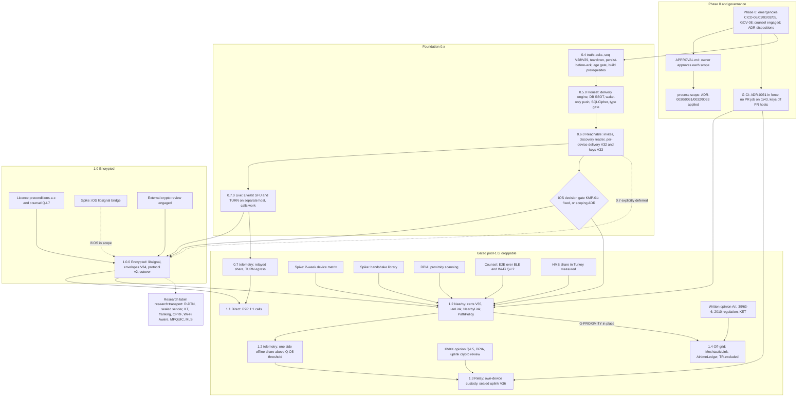

# Muhabbet multi-transport roadmap

> **Status: Proposed — pending owner approval.** Nothing in this roadmap is accepted until the owner
> records it in [`APPROVAL.md`](APPROVAL.md). No code may be written, no GitHub milestone or issue
> created, and no GitHub restructuring or hook applied for any scope until approval for that scope is
> recorded there (owner decisions 3 and 4). Product milestones 1.1–1.4 are **Proposed (gated)**: even
> once approved, each starts only when its admission gate is met.

| | |
|---|---|
| **Date** | 2026-11-12 |
| **Base** | `dev` @ 2434324, branch `claude/muhabbet-p2p-architecture-wdan5r` |
| **Source of truth** | [decision brief](decision-brief-2026-11-12.md) §13 (phased roadmap), §14 (prerequisite fixes), §15 (risks), §16 (V&V), §17 (open questions). Where this document and the brief disagree, the brief wins; the disagreement is recorded as a `> **Reviewer note (open):**` callout (§13). |
| **Evidence** | [findings register](../../reviews/2026-11-12-findings-register.md) (IDs such as `BE-06`, `MOB-03`, `CICD-01`); open-issue snapshot from the governance review digest (issue numbers below are **candidates** to re-verify at filing time, GOV-03) |
| **Companions** | [`vv-plan.md`](vv-plan.md) (requirements RQ-01…RQ-81, harness, environments), [`risk-register.md`](risk-register.md) (R1…R40), [`transport-capability-matrix.md`](transport-capability-matrix.md) §13 (1.2 spike protocol), [`dpia-screening.md`](dpia-screening.md) |
| **Replaces nothing yet** | [`ROADMAP.md`](../../../ROADMAP.md) stays canonical for the method and the 0.x milestone questions. §11 says how this file merges into it after approval. |

---

## 1. Conventions

1. **Milestone names follow ROADMAP.md** (brief naming note): `0.4` "the app tells the truth" (live),
   `0.5.0` Honest, `0.6.0` Reachable, `0.7.0` Live, `1.0.0` Encrypted. New, post-1.0 and gated:
   `1.1` Direct, `1.2` Nearby, `1.3` Relay, `1.4` Off-grid hardware. "0.4.0 — Installable" and
   Tier 1/2/3 are retired framings and receive nothing.
2. **Phase 0 is not a version.** It is tracked as one epic issue, not a milestone (ROADMAP: "milestones
   are versions").
3. **Each milestone section has the same fields:** question · scope · APPROVAL scope and ADRs ·
   entry · exit · evidence · owner-observed items · kill / fallback criteria · issues.
4. **Owner-observed (P13, ADR-0032).** A criterion marked **[O]** is device-dependent and is signed off
   only by the owner's own observation on `emulator-5554` or a physical phone, recorded as
   "observed by / where / date" in the milestone's tracking issue. An agent may run the steps and
   attach logs; it may never report an [O] criterion as passed. Criteria marked **[CI]** are proven by
   a test report; **[A]** by analysis; **[I]** by inspection of a filed artefact.
5. **Exit is not "issue list empty".** A version ships when its exit criteria are met (ROADMAP). The
   requirement IDs (`RQ-nn`) in exit tables are defined in [`vv-plan.md`](vv-plan.md) §6.
6. **Issues are created only after approval** (owner decision 3) **and after the one-time tracker
   cleanup** of ADR-0030 / GOV-03. Lists below are *plans*. "Existing" numbers come from the
   2026-11-12 open-issue snapshot and must be re-verified before they are moved (GOV-03: several open
   issues are stale or already fixed on `dev`).
7. **Droppable** milestones (1.1, 1.3, 1.4) carry kill criteria whose thresholds are owner decisions
   (Q-O5). A dropped milestone is closed with a dated ADR amendment, not left open.

---

## 2. Milestone overview

| Milestone | Question it answers (ROADMAP) | Question it answers for multi-transport | APPROVAL scope | Droppable | Gate beyond approval |
|---|---|---|---|---|---|
| Phase 0 | — | Are the emergencies contained and is the design approved? | `phase-0`, `process` | no | none (incident response) |
| 0.4 | Can a person use the app without being lied to by it? | Does the one existing path stop losing, duplicating and mis-reporting messages, and is the seq foundation in place? | `0.4` | no | Phase 0 exit |
| 0.5.0 Honest | Does every control the app shows either work or not get shown? | Does every message go through one durable engine into one local SSOT, with content-free push and an encrypted DB? | `0.5` | no | ADRs 0011/12/13/14/16/19/20/22/28 Accepted |
| 0.6.0 Reachable | Can an existing user bring a new one in, and can a new user find someone to talk to? | Is the per-device key/delivery model in place, and is iOS in or out? | `0.6` | no | **iOS decision (blocking)** |
| 0.7.0 Live | Does a call connect, carry audio both ways, and appear in history? | Does the DIRECT live-session path work over SFU/TURN, privately? | `0.7` | deferrable (1.0 may proceed with 0.7 "explicitly deferred") | ADR 0009 accepted; separate host |
| 1.0.0 Encrypted | Are all of the app's privacy claims true? | Is E2E real and fail-closed, so non-server paths become *possible*? | `1.0` | no (Android-only fallback) | Licence (a)–(c), crypto reviewer, iOS spike or Android-only |
| 1.1 Direct | — (new) | Do P2P 1:1 calls buy E2E media and latency worth their cost? | `1.1` | **yes** | 0.7 telemetry; TURN budget |
| 1.2 Nearby | — (new) | Can verified contacts exchange E2E messages with no internet, honestly? | `1.2` | partially (iOS cell) | **G-PROXIMITY** |
| 1.3 Relay | — (new) | Is INDIRECT delivery beyond the mailbox (own devices, one contact hop) used and safe? | `1.3` | **yes** | telemetry threshold, crypto review, KVKK opinion, DPIA |
| 1.4 Off-grid hardware | — (new) | Can certified LoRa nodes carry text legally, within duty cycle? | `1.4` | **yes**; may never ship in TR | written Art. 39/63(6) opinion |
| Research | — | Should any rejected-for-now topic open a milestone? | none | n/a | an ADR per topic |

---

## 3. Dependency graph

Gantt-free by design: no dates, only "cannot start / cannot exit before". Solid arrows are hard
dependencies from the brief; dashed arrows are conditional ("or explicitly deferred", "if iOS is in
scope").

Reading the graph:

| Edge | Why it is hard |
|---|---|
| Phase 0 → 0.4 | Brief §13 0.4 entry. Secrets rotation precedes any new auth/session work (R1). |
| 0.4 → 0.5 | 0.5 builds the engine on V28/V29 seq and device-scoped idempotency, and on the migration tooling wired in 0.4 (ADR-0028 prerequisites). |
| 0.5 → 0.6 → 0.7 | Linear release train; each "entry = previous exit" in the brief. |
| 0.6 iOS gate → 1.0, 1.2 | Every cross-platform claim in 1.0 and 1.2 depends on it (ADR-0028). |
| 0.7 → 1.0 (or deferred) | Brief 1.0 entry: "0.7 shipped or explicitly deferred". |
| 0.7 telemetry → 1.1 | 1.1 entry needs measured benefit and a TURN budget. **If 0.7 is deferred, 1.1 is blocked too** (reviewer note RN-R5). |
| 1.0 → 1.1, 1.2 | No non-server path and no P2P E2E claim before E2E is real (brief §1.2, ADR-0016). |
| G-CI → 1.2, 1.3 | Device-CA and uplink keys must never live on a host that runs PR jobs (ADR-0018, ADR-0025, ADR-0031). |
| 1.2 → 1.3, 1.4 | Certificates, link keys, `PathPolicy` and the `SealedLink` contract arrive in 1.2. |

---

## 4. Cross-cutting gates

Gates are signed artefacts, filed and referenced from the scope's `Conditions:` line in
`APPROVAL.md` (APPROVAL §1 rule 3). An agent can prepare a gate artefact; only the owner (or counsel,
or the external reviewer) can sign it.

| Gate | Artefact | Required by | Signer | Source |
|---|---|---|---|---|
| G-SECRETS | Rotation log for all four `.env.prod` values (incident record §6) with verification evidence | Phase 0 exit | Owner | CICD-06, ADR-0031 F7 |
| G-CI | ADR-0031 checks F1–F8 all green | 1.2 entry, 1.3 entry; before any long-lived signing, device-CA, uplink or crypto key is created | Owner | ADR-0031 |
| G-ADR | ADR disposition row filled in `APPROVAL.md` §3 | entry of every milestone that cites the ADR | Owner | brief §13 |
| G-iOS | KMP-01 fixed (entry point, Xcode project, DI, iOS CI build) **or** an accepted ADR scoping iOS out of 1.0 | 0.6 exit; 1.0 and 1.2 entry | Owner | ADR-0028, Q-O2 |
| G-LICENCE | (a) owner approval Q-O1, (b) contributor audit, (c) written counsel opinion on AGPL via Play and App Store | 1.0 entry (before libsignal is restored) | Owner, counsel | ADR-0017, Q-L7 |
| G-XREVIEW | External crypto review engaged (1.0); findings closed (1.0 exit); uplink sealing reviewed (1.3 entry) | 1.0, 1.3 | Reviewer | ADR-0017, ADR-0025 |
| G-PROXIMITY | All eight items of brief §13 1.2 entry | 1.2 entry; 1.4 entry | Owner, counsel | brief §13, ADR-0024 |
| G-DPIA-*n* | Signed DPIA per ADR-0029 §6 trigger (proximity scanning, uplink relay, TURN/ICE logging, contact-discovery change, new processor or foreign host) | signed before the milestone that ships the trigger is released (ADR-0029 verification): 0.6 (contact discovery), 0.7 (TURN/ICE logging, new host), 1.2 and 1.3 (also entry criteria there, brief §13) | Owner (counsel advises) | ADR-0029, `dpia-screening.md` |
| G-LEGAL-*n* | Written counsel opinions Q-L1…Q-L9 relevant to the milestone | 1.0 licence step; 1.1, 1.2, 1.3, 1.4 gates (not 0.x, ADR-0029 consequences) | Counsel | brief §17 |
| G-RELEASE | Release APK/AAB installed and launched on `emulator-5554`; same artefact promoted (ADR-0030) | every milestone exit | Owner [O] | ROADMAP release step 6, CICD-07/10 |

---

## 5. Phase 0 — emergencies and design approval (now; no product code)

| Field | Content |
|---|---|
| **Question** | Are the live security emergencies contained, and has the owner dispositioned the design? |
| **Scope** | (1) Security emergencies, brief §14 items 1–6: rotate every value ever in `.env.prod` (CICD-06), stop `pull_request` jobs on `muhabbet-cx43` (CICD-01; CICD-04 billing lock), identify or deregister `muhabbet-mordecai` (CICD-03), protected `release`/`production` environments (CICD-02), SHA-pin actions and remove `trivy-action@master` (CICD-05), correct SECURITY.md phone-hash claim on both branches (GOV-08, MISS-03 governance). (2) Owner reviews brief and ADRs. (3) Counsel engaged with Q-L1…Q-L9 ([`counsel-questions-2026-11.md`](../../legal/counsel-questions-2026-11.md)). (4) Threat model and DPIA screening written (delivered in this package). (5) Licence decision opened (Q-O1). |
| **APPROVAL scope / ADRs** | `phase-0` (the brief recommends the owner authorise items 1–6 now, independent of design approval); dispositions for ADR-0010…0033 recorded in `APPROVAL.md` §3; `process` for ADR-0030…0033. |
| **Entry** | This brief delivered (met 2026-11-12). |
| **Exit** | See table. |
| **Evidence** | Incident record rotation log; workflow inspection notes; test-PR run showing no cx43 job; `APPROVAL.md` §3 filled; engagement letter or email to counsel (filed privately, referenced only). |
| **Kill / fallback** | Not droppable. If the GitHub-hosted billing lock (CICD-04) is not resolved, ADR-0031 allows PR workflows to be **disabled** rather than run on cx43 — that is the fallback, and R37 records its cost. |

| # | Exit criterion | Method | Signed |
|---|---|---|---|
| P0-1 | Every `.env.prod` value rotated; an old JWT fails to authenticate | [I] rotation log + [CI/O] login attempt with a token minted from the old secret | Owner |
| P0-2 | DB, Redis and MinIO credentials rotated (not proven by P0-1) | [I] ADR-0031 F7 rotation log | Owner |
| P0-3 | No PR job runs on `muhabbet-cx43` | [I] workflow inspection + a test PR (ADR-0031 F1) | Owner |
| P0-4 | `muhabbet-mordecai` identified or deregistered | [I] runner list (F2) | Owner |
| P0-5 | Every ADR 0010–0033 has a disposition | [I] `APPROVAL.md` §3 | Owner |
| P0-6 | Then, and only then, ADR-0030/0031/0032 GitHub restructuring applied | [I] ADR-0030 V1–V4, ADR-0032 A1–A3 | Owner |

**Issues (after approval).** One epic "Phase 0 — emergencies and approval" with sub-issues:

| Kind | Item | Findings |
|---|---|---|
| New | Rotate all `.env.prod` values; commit-scoped gitleaks allowlist; secret scanning + push protection | CICD-06 |
| New | Remove PR jobs from cx43 (or disable) | CICD-01, MISS-01 (CI/CD) deploy-trigger guard |
| New | Identify/deregister `muhabbet-mordecai` | CICD-03 |
| New | `release` and `production` environments with reviewer | CICD-02, MISS-02 (CI/CD) |
| New | Correct SECURITY.md on `main` and `dev` | GOV-08, MISS-03 (governance), MISS-03 (product) |
| New | Engage counsel; file Q-L1…Q-L9 | LEG-01…04, MISS-01 (legal) |
| Existing (candidate) | #319 unpinned third-party action on the production host | CICD-05 |
| Existing (candidate) | #108 GitHub Actions billing lock | CICD-04 |
| Existing (candidate) | #419 CI red for environmental reasons; #286 service-container port clash; #722 single-runner queue | CICD-04, R19, R37 |
| Existing (candidate) | #448 Redis password visible on the command line (adjacent to rotation) | CICD-06 |
| Existing (candidate) | #314 legal surface unowned, false public claims | SSOT-09, brief §14 item 8 |
| Existing (candidate, process) | #332, #434 tracker cleanup and triage | GOV-02, GOV-03 |

---

## 6. 0.4 — the app tells the truth (live; contains the early engine start)

| Field | Content |
|---|---|
| **Question** | ROADMAP: can a person use the app without being lied to by it? Multi-transport: does the one existing path stop losing, duplicating and mis-reporting messages, and is the seq foundation laid without rewriting what 0.5 replaces? |
| **Scope — backend** | BE-03 per-device ack authorisation · BE-02 scheduled-message visibility and one transaction per release (BEV-M1) · BE-07 replayed `ServerAck` · BE-12 sessions close on expiry, logout, revoke, delete, and JWT out of the query string (BE-16) · BE-13 refresh-reuse detection · atomic prekey claim and fetch rate limit (BE-14 part 1, C10, M1) · contact-lookup daily cap and block filter (C8, M3) · **age gate** V30 behind `AgeAssurancePort` (ADR-0029) · **early engine:** V28/V29 additive seq and device-scoped idempotency · BE-08 ArchUnit boundary rules for messaging. |
| **Scope — mobile** | MOB-01 `SessionTeardown` (tables, queues, WorkManager; MISS-02 mobile) · MOB-03 persist incoming `message.new` before DELIVERED and remove the duplicate ack in `ConversationListScreen` · MOB-05 edit dedup key includes `editedAt` · MOB-04 stopgap **limited to** "delete `PendingMessage` only on `ServerAck(requestId)`" · group receipt aggregation (MISS-01 mobile) · **early engine:** version catalog, one convention plugin (KMP-05), SQLDelight `.sqm` migrations + `verifyMigrations`, `:shared:jvmTest` in CI (KMP-03). |
| **Also retained** | ROADMAP's four existing 0.4 conditions: search actually searches; the notification and the tick tell the truth; a community has somewhere to talk; nothing looks like it works and does not (RN-R1). |
| **APPROVAL scope / ADRs** | `0.4`; ADR-0013, 0014, 0018 (parts 1–3), 0020 (teardown), 0022 (plane A auth only), 0028 (prerequisites), 0029 accepted. |
| **Entry** | Phase 0 exit. |
| **Evidence** | Backend JUnit XML with Docker running, on base commit and on branch (CLAUDE.md rule); `verifyMigrations` and `:shared:jvmTest` reports; owner emulator notes per [O] row; logcat `FATAL` grep of the release APK. |
| **Kill / fallback** | Not droppable. Fallback for schedule pressure: the trimmed list is already the minimum (judge disagreement "size of 0.4"); anything else moves to 0.5 visibly. |

| # | Exit criterion | RQ | Method | Signed |
|---|---|---|---|---|
| 04-1 | Kill mid-send: no loss and no duplicate after relaunch | RQ-01, RQ-02 | [O] emulator, two test numbers | Owner |
| 04-2 | Double tick only after the recipient DB holds the row | RQ-03 | [CI] crash-point test + [O] emulator | Owner |
| 04-3 | Logout then login as another number shows no prior data | RQ-08 | [O] emulator | Owner |
| 04-4 | A revoked device's socket closes within 5 s | RQ-09 | [CI] integration test + [O] | Owner |
| 04-5 | Under-15 registration refused; nothing persisted | RQ-10 | [CI] + [O] | Owner |
| 04-6 | 50 concurrent senders → gapless unique seq | RQ-04 | [CI] Testcontainers | CI |
| 04-7 | Concurrent prekey claims never return the same key; fetch limits enforced | RQ-11, RQ-45 | [CI] Testcontainers | CI |
| 04-8 | Acks from non-members or for non-existent ids rejected and not broadcast; duplicate submit replays original seq | RQ-31, RQ-02 | [CI] integration | CI |
| 04-9 | Unreleased scheduled message never readable by recipients | RQ-32 | [CI] integration | CI |
| 04-10 | Enumeration cap enforced | RQ-12 (cap part) | [CI] integration | CI |
| 04-11 | `verifyMigrations` and `:shared:jvmTest` run in CI; catalog in use | RQ-27, RQ-30, RQ-71 | [CI] + [I] | CI |
| 04-12 | Backend suite measured with Docker running, base vs branch, no new failures | — | [CI] | CI |
| 04-13 | ROADMAP's four 0.4 conditions each seen working | — | [O] | Owner |
| 04-14 | Release APK installed and launched on `emulator-5554` | G-RELEASE | [O] | Owner |

**Owner-observed items:** 04-1, 04-2, 04-3, 04-4, 04-5, 04-13, 04-14.

**Issues (after approval).** Epic "0.4 — truth: delivery correctness and compliance" with sub-issues:

| Kind | Item | Findings |
|---|---|---|
| Existing (candidate) | #299 delivery-status acks accept any message id | BE-03 |
| Existing (candidate) | #346 every WS frame refetches the list; DELIVERED acked twice | MOB-03 |
| Existing (candidate) | #354 revoked token polls forever (refresh-rejected path → `SessionTeardown`) | MOB-01, BE-12 |
| Existing (candidate) | #726 a deletion over the same socket is dropped as a duplicate (dedup key) | MOB-05 class |
| Existing (candidate) | #322 ArchUnit rules pass on code that breaks the architecture | BE-08 |
| Existing (candidate) | #324 shared and mobile test suites never run in CI | KMP-03 |
| Existing (candidate) | #295 rollback after a migration is impossible (expand/contract for V28/V29) | CICD-09 |
| Existing (candidate) | #342 `WsClient` loop untested (keep its tests through the 0.5 strangling, R3) | MOB-12 |
| Existing (related, owner to place) | #725 rate-limited send gets no ack (tick honesty) · #352 typing indicator accepted for any conversation id | MOB-04 class, BE-03 class |
| Stays open, outside design | #327 erasure leaves media | MISS-02 (governance) |
| New | Scheduled-message visibility + per-message release transaction | BE-02, BEV-M1 |
| New | Replay original `ServerAck` on duplicate submit | BE-07 |
| New | Session close on exp/logout/revoke/delete; first-frame or header auth | BE-12, BE-16 |
| New | Refresh reuse detection | BE-13 |
| New | Atomic prekey claim + per-requester/per-pair rate limit | BE-14, C10, M1 |
| New | Contact-lookup daily cap + block filter | C8, M3 |
| New | Age gate (V30, `AgeAssurancePort`, no compliance claim) | LEG-02, MISS-04 (legal) |
| New | V28/V29 seq and device-scoped idempotency (additive) | BE-06, C13, BE-07 |
| New | `SessionTeardown` | MOB-01, MISS-02 (mobile) |
| New | MOB-04 stopgap: delete only on `ServerAck` | MOB-04 |
| New | Group receipt aggregation | MISS-01 (mobile) |
| New | Version catalog + `muhabbet.kmp.library` + `.sqm` migrations | KMP-05 |

---

## 7. 0.5.0 — Honest (delivery engine, wake-only push, encrypted DB)

| Field | Content |
|---|---|
| **Question** | ROADMAP: does every control the app shows either work or not get shown? Multi-transport: does every message go through one durable, idempotent engine into one encrypted local SSOT, with content-free push? |
| **Scope** | `:mobile:crypto` (type gate; no `SealedFrame` producer), `:mobile:messaging`, `:mobile:crypto-testkit` · `WsClient` strangled into `WsServerLink`/`WsInboundSource` · `RestChangeFeedSource`, `FcmHintSource`, `SyncCoordinator` · UI observes DB flows; `verifyUi` ratchet for `WsMessage`/`wsClient` in `ui/` to 0 (from 17 sites) · SQLCipher via fresh DB + resync (ADR-0020) · backend `/changes`, seq/changeSeq on frames, `hello`/version and `Unknown` (KMP-11), KMP-07 DTO de-duplication, `MessageService` split (BE-11), wake-only FCM with OEM fallback (ADR-0019, BE-15) · MOB-07, MOB-10, MOB-11 · plaintext fallback code deleted (C9). |
| **Rollout** | `engine.enabled` remote flag: 0.5.0 ships both paths, engine on for internal testers; 0.5.1 flips the default after emulator parity; legacy path deleted in 0.5.2 or later. |
| **APPROVAL scope / ADRs** | `0.5`; ADR-0011, 0012, 0013, 0014, 0016, 0019, 0020, 0022, 0028 Accepted. |
| **Entry** | 0.4 shipped. ADRs above Accepted. Docker available for Spring-config changes (#598 class). |
| **Evidence** | `:mobile:messaging:jvmTest` property-suite report (10 000 seeds, seed list attached); build-dependency check output; FCM payload capture; forensic file pull after logout; owner emulator notes. |
| **Kill / fallback** | Not droppable. **Rollback criterion (R3):** any loss or duplicate in the property suite or in the owner's emulator script keeps (or returns) `engine.enabled` default to off; the legacy path is not deleted until parity is shown twice (0.5.1 flip, then 0.5.2 deletion). |

| # | Exit criterion | RQ | Method | Signed |
|---|---|---|---|---|
| 05-1 | 10 000 seeded runs (loss, duplication, reorder, partition, process death, 24 h offline, token expiry): each message exactly once in sender and receiver stores, in seq order, with `TestClock` | RQ-01, RQ-02, RQ-05 | [CI] property suite | CI |
| 05-2 | `:mobile:messaging` has no Compose, Koin-annotation or `WsMessage` dependency; `ui/` count = 0 | RQ-24, RQ-25 | [CI] build-enforced + `verifyUi` | CI |
| 05-3 | Only `:mobile:crypto` constructs `SealedFrame`; no testkit on a release classpath; fallback deleted | RQ-06, RQ-39 | [CI] + [I] | CI |
| 05-4 | Captured FCM payload has no content | RQ-07 | [CI] adapter test + [O/I] capture | Owner |
| 05-5 | Forensic check after logout: no readable DB, no `-wal`/`-shm` remnant | RQ-08, RQ-52 | [O] | Owner |
| 05-6 | Airplane-mode toggling script recovers with no manual refresh | RQ-05, RQ-29 | [O] emulator | Owner |
| 05-7 | Notification arrives with the app killed, text from local DB; p90 within the agreed bound on an aggressive-OEM device | RQ-49 | [O] emulator + Xiaomi/Oppo-class | Owner |
| 05-8 | 0.5 migration loses no unsent message | RQ-51 | [CI] + [O] | Owner |
| 05-9 | Protocol negotiation: no frame before `hello`; `UNSUPPORTED_FRAME`; `PROTOCOL_TOO_OLD` | RQ-55 | [CI] | CI |
| 05-10 | Every controller response decodes with the shared DTO | RQ-56 | [CI] contract test | CI |
| 05-11 | No head-of-line blocking across lanes, links or conversations | RQ-28 | [CI] | CI |
| 05-12 | Golden vectors (plane A) and fuzz targets for every parser exist and pass | RQ-48, RQ-58 | [CI] | CI |
| 05-13 | ROADMAP 0.5.0 exit criteria (controls work or are not shown) | — | [O] | Owner (RN-R2) |
| 05-14 | Release launch on `emulator-5554` | G-RELEASE | [O] | Owner |

**Owner-observed items:** 05-4 (capture), 05-5, 05-6, 05-7, 05-8 (emulator script), 05-13, 05-14, and the 0.5.1 parity sign-off before the default flip.

**Issues (after approval).** Epic "0.5.0 — one engine, one store" with sub-issues:

| Kind | Item | Findings |
|---|---|---|
| Existing (candidate) | #502 data-only push; fetch and compose locally | BE-15 |
| Existing (candidate) | #344 chat list rebuilt wholesale on every WS frame (→ DB flows) | MOB-03, MOB-08 |
| Existing (candidate) | #343 offline cache untested, silent swallows | MOB-12, MOB-09 |
| Existing (candidate) | #351 WS message types without serialization tests (→ golden vectors) | KMP-11 |
| Existing (candidate) | #330 REST contract pinned by a hand-copied snapshot (→ shared DTOs) | KMP-07 |
| Existing (candidate) | #347 mobile crypto tests run a configuration that never ships (→ testkit) | C9 |
| New | `:mobile:messaging` + `:mobile:crypto` + testkit modules | ADR-0028, MOB-11 |
| New | Outbox/Inbox state machines, `SyncCoordinator`, `SimulatedLink` harness | MOB-03, MOB-04, MOB-11 |
| New | Strangle `WsClient` (17 call sites inventory) | MOB-11, MOB-13 |
| New | SQLCipher fresh DB + resync | MOB-01, GEM-14 |
| New | `/changes`, seq on frames, `hello`/`Unknown` | BE-06, KMP-11 |
| New | Split `MessageService` | BE-11 |
| New | Seq-based background-sync watermark | MOB-10 |
| New | Delete plaintext fallback | C9 |

---

## 8. 0.6.0 — Reachable

| Field | Content |
|---|---|
| **Question** | ROADMAP: can an existing user bring a new one in, and can a new user find someone to talk to? Multi-transport: is the per-device delivery and key model in place, and is iOS in or out? |
| **Scope** | Invite flow (existing ROADMAP scope) · contact discovery with a "discoverable by phone" setting **and a server-side reader** (§8.6, C8, M3) · background sync on seq · per-device delivery rows V32 (BE-18) · per-device key schema V33 and `IdentityKeyChanged` (BE-14 part 2, M2) · **iOS decision as a blocking gate** (KMP-01): either entry point, Xcode project, DI and iOS CI build exist, or an ADR scopes iOS out of 1.0. |
| **APPROVAL scope / ADRs** | `0.6`; ADR-0018 (per-device directory), ADR-0028 (iOS gate); owner question Q-O2. |
| **Entry** | 0.5 exit. |
| **Evidence** | Integration-test reports; iOS simulator launch note or accepted scoping ADR; owner emulator note. |
| **Kill / fallback** | Not droppable. **iOS fallback:** the scoping ADR (Android-only 1.0) is a legitimate exit for the gate; it must name the honest-UI consequences (ADR-0017). |

| # | Exit criterion | RQ | Method | Signed |
|---|---|---|---|---|
| 06-1 | A message received while the app is killed is in the DB before the notification is tapped | RQ-26 | [O] emulator | Owner |
| 06-2 | Enumeration throttling integration test | RQ-12 | [CI] | CI |
| 06-3 | iOS launches on a simulator, or the scoping ADR is accepted | RQ-42 | [O] or [I] | Owner |
| 06-4 | Identity replacement for an existing `device_id` returns an error and emits nothing | RQ-11 | [CI] | CI |
| 06-5 | Relationship check on bundle fetch; last-resort Kyber fallback | RQ-45 | [CI] | CI |
| 06-6 | Per-device delivery rows drive aggregate status | RQ-31 | [CI] | CI |
| 06-7 | ROADMAP 0.6.0 exit criteria (invite, find someone) | — | [O] | Owner |
| 06-9 | DPIA for the contact-discovery change signed before release (ADR-0029 §6) | RQ-40 | [I] | Owner |
| 06-8 | Release launch on `emulator-5554` | G-RELEASE | [O] | Owner |

**Owner-observed items:** 06-1, 06-3 (simulator launch, if iOS is kept), 06-7, 06-8.

**Issues (after approval).** Epic "0.6.0 — reachable, per-device":

| Kind | Item | Findings |
|---|---|---|
| Existing (candidate) | #413 no way to invite anyone · #387 community invite the recipient accepts · #416 communities cannot gain a second member | ROADMAP 0.6 question |
| Existing (candidate) | #334 no consent at signup; address book uploads on permission grant (discovery change, DPIA) | C8, LEG-04 |
| Existing (candidate) | #79 verify iOS compiles · #729 iOS test target does not compile · #735 iOS tests never execute · #74 APNs · #75 iOS phone auth | KMP-01, KMP-02, KMP-14 |
| Existing (candidate) | #83 multi-device remainder (per-device schema prerequisite) | M2, ADR 0007 |
| New | Discoverability setting with reader; enumeration test | C8, M3 |
| New | V32 per-device delivery | BE-18 |
| New | V33 per-device keys; `IdentityKeyChanged` | BE-14, M2 |
| New | iOS decision: fix KMP-01 or scoping ADR | KMP-01, FT-04, MOB-14 |

> The 0.6.0 milestone currently holds ~96 open issues, 56 of them UI/UX review findings unrelated to
> its exit question (GOV-05). Moving those out is part of the tracker cleanup, not of this roadmap.

---

## 9. 0.7.0 — Live (DIRECT live sessions)

| Field | Content |
|---|---|
| **Question** | ROADMAP: does a call connect, carry audio both ways, and appear in history? Multi-transport: does the DIRECT live-session path work over SFU/TURN without exposing IPs to non-contacts? |
| **Scope** | ADR 0009 resolved: LiveKit on a **separate host**, embedded TURN/TLS on 443, `LIVEKIT_*` in `.env.prod` (MISS-1 networking) · client sends `call.initiate` and publishes the mic track (#367–#373) · `LiveSessionPort`/`LiveKitSession`; signalling as CONTROL frames through the engine · relay-only ICE for non-contacts, "always relay" setting, SFU media-access disclosure · ICE telemetry without IPs (NAT-3). |
| **APPROVAL scope / ADRs** | `0.7`; ADR 0009, ADR-0023 (0.7 part); owner question Q-O8 (host, budget, TURN egress). |
| **Entry** | ADR 0009 accepted; host provisioned; 0.6 exit. |
| **Evidence** | ICE stats captures; a week of telemetry (relayed share, egress); owner call log on two operators. |
| **Kill / fallback** | Deferrable, not droppable as a goal: brief 1.0 entry allows "0.7 explicitly deferred". If deferred, call entry points stay hidden behind a build flag (FT-01 recommendation) so the app does not show a control that does not work (0.4/0.5 question), and **1.1 is blocked** until 0.7 ships. |

| # | Exit criterion | RQ | Method | Signed |
|---|---|---|---|---|
| 07-1 | A call connects, carries audio both ways and appears in history on **two physical devices on two operators, one of them TT Mobil** | RQ-14 | [O] | Owner |
| 07-2 | A non-contact call uses only relay candidates | RQ-15 | [CI] policy test + [I] ICE stats | Owner |
| 07-3 | TURN credentials ≤ 10 min, per device and session | RQ-59 | [CI] | CI |
| 07-4 | Stored ICE telemetry rows contain no IP | RQ-60 | [CI] + [I] | CI |
| 07-5 | One week of relayed share and TURN egress measured | RQ-61 | [A] | Owner |
| 07-6 | Release launch on `emulator-5554` | G-RELEASE | [O] | Owner |
| 07-7 | DPIA for TURN/ICE logging and the new host signed before release (ADR-0029 §6) | RQ-40 | [I] | Owner |

**Owner-observed items:** 07-1, 07-2 (ICE stats capture), 07-6.

**Issues (after approval).** The calls epic already exists: **#715** as parent, with sub-issues
#367 (no `call.initiate`), #368 (no mic track), #369 (LiveKit unconfigured, NoOp live), #370 (callee
never sees the call), #371 (iOS stub reports success), #372 (RECORD_AUDIO not requested), #373
(group calls without a path), #606 (no history row), #84 (iOS LiveKit bridge, only if iOS is in
scope). New: `LiveSessionPort` + CONTROL routing; relay-only policy + "always relay"; SFU disclosure;
ICE telemetry without IPs; `TurnCredentialService`. Findings: FT-01, LIB-1, ICE-1, MISS-1/MISS-2
(networking), P2P-2. #86 (group calls) is outside this roadmap unless the owner adds it.

---

## 10. 1.0.0 — Encrypted

| Field | Content |
|---|---|
| **Question** | ROADMAP: are all of the app's privacy claims true? Multi-transport: is E2E real and fail-closed by type, so non-server paths become possible at all? |
| **Scope** | ADR-0017 preconditions (licence approved and executed for `mobile/`, contributor audit, counsel opinion on Play and App Store) · iOS bridge spike (Android-only 1.0 by decision if not ready) · libsignal adapters behind `SessionCryptoPort`, PQXDH + Kyber, per-device fan-out, sender-key groups, media E2E · safety-number QR, `IdentityKeyChanged` UX · `message_envelopes` mailbox V34, protocol v2, on-device FTS, sender-side link previews · ADR 0007 `DeviceLinkCrypto` real · ADR-0021 plaintext-history cutover (Q-O4) · external crypto review · LOCAL_ONLY only if Q-O3 is decided. |
| **APPROVAL scope / ADRs** | `1.0`; ADR-0016, 0017, 0018, 0019, 0021, 0022; owner questions Q-O1…Q-O4; ADR-003 closed as superseded at exit. |
| **Entry** | 0.7 shipped or explicitly deferred · crypto reviewer engaged · two-device Android round trip on real builds · G-LICENCE · G-iOS honoured. |
| **Evidence** | Claims register (RQ-20) with a test or device observation per claim; SQL assertion report; contract-suite report per adapter; external review report and closure notes; owner device notes. |
| **Kill / fallback** | Not droppable (1.0 *is* "E2E on", ROADMAP versioning rule). Fallbacks: **Android-only 1.0** if the iOS bridge or KMP-01 is not ready (iOS E2E follows as 1.0.x); **vodozemac (Apache-2.0) core** if counsel's AGPL opinion is negative — needs its own ADR and loses PQXDH. |

| # | Exit criterion | RQ | Method | Signed |
|---|---|---|---|---|
| 10-1 | Claims register: every privacy claim maps to a test or a device observation | RQ-20 | [I] | Owner |
| 10-2 | No plaintext content for E2E conversations on the server (messages, search, preview caches) | RQ-13 | [CI] SQL assertion + [I] DB dump | Owner |
| 10-3 | Injected seal failure → `PENDING_SEAL` or `FAILED`, never plaintext | RQ-39 | [CI] with libsignal adapters | CI |
| 10-4 | No `SealedLink` receives a non-`SealedFrame`; testkit absent from release classpath | RQ-06 | [CI] | CI |
| 10-5 | Erasure leaves no readable data | RQ-08 | [CI] + [O] | Owner |
| 10-6 | External review findings closed | — | [I] | Owner, reviewer |
| 10-7 | Two-device round trip on physical Android (and Android↔iOS if iOS is in scope) | RQ-41 | [O] | Owner |
| 10-8 | `/changes` per-device isolation; ack-delete; TTL purge | RQ-53 | [CI] | CI |
| 10-9 | #377 read-receipt downgrade still holds for E2E conversations | RQ-50 | [CI] | CI |
| 10-10 | No conversation labelled E2E while a readable server copy exists | RQ-20 | [CI] + [I] | Owner |
| 10-11 | Crypto confined; AGPL distribution obligations met | RQ-43, RQ-44 | [CI] + [I] | Owner |
| 10-12 | Release launch on `emulator-5554` | G-RELEASE | [O] | Owner |

**Owner-observed items:** 10-5 (forensic part), 10-7, 10-12, plus sign-off of 10-1, 10-2 and 10-10.

**Issues (after approval).** Epic "1.0.0 — Encrypted (privacy claims true)":

| Kind | Item | Findings |
|---|---|---|
| Existing (candidate) | #68 re-integrate libsignal · #76 iOS E2E decision · #93 group E2E (sender keys) · #94 safety numbers · #95 backups at scale (T3 step 5) | KMP-13, KMP-M3, SSOT-05, C1 |
| Existing (candidate) | #423 Kargo Modu / LOCAL_ONLY (gated on Q-O3) | ADR 0008 |
| Existing (candidate) | #72 penetration test before public launch | — |
| Existing (candidate) | #313 `messages.content` btree key column (content nullable for E2E) | BE-15 |
| Existing (candidate) | #314 public claims (claims register) · #328 disappearing messages do not disappear (claim) | SSOT-09, MISS-03/04 (product) |
| Existing (candidate, likely stale) | #67 device-verify honest-E2E UI | GOV-03 |
| New | Licence (a)–(c) and relicence of `mobile/` | KMP-13 |
| New | iOS libsignal bridge spike | MISS-3 (networking) analogue, KMP-01 |
| New | `message_envelopes` + protocol v2 + cutover plan | BE-15, ADR-0021 |
| New | On-device FTS inside SQLCipher (FTS5 `contentless_delete` spike) | GEM-14 |
| New | Claims register | SSOT-09 |
| New | External crypto review engagement | C1, C9 |

---

## 11. 1.1 — Direct (new; P2P 1:1 calls) — Proposed (gated), droppable

| Field | Content |
|---|---|
| **Question** | Do P2P 1:1 calls buy end-to-end media and better latency than the SFU, at an acceptable TURN cost and without IP exposure? |
| **Scope** | `WebRtcP2PSession` for 1:1 calls (DTLS-SRTP end to end) · ICE over our own TURN, relay-only for non-contacts · TURN capacity sized from 0.7 data · an RFC 5780 probe per ASN **only if** the data shows a need (NAT-2, NAT-3). No messaging over data channels (ADR-0023). |
| **APPROVAL scope / ADRs** | `1.1`; ADR-0023 (1.1 part). |
| **Entry** | 1.0 exit · 0.7 telemetry shows benefit (latency or SFU egress) · TURN egress budgeted (Q-O8) · iOS WebRTC bridge spiked if iOS is in scope · counsel opinion relevant to 1.1 (ADR-0029: the counsel checklist blocks 1.1). |
| **Exit** | Per-ASN setup success and latency A/B vs SFU [A] (RQ-61) · no IP exposure to non-contacts, by candidate inspection [I] (RQ-15) · two-operator physical-device P2P call [O] (RQ-14) · release launch [O]. |
| **Evidence** | A/B analysis note; candidate captures; owner call log. |
| **Owner-observed items** | Two-operator P2P call; candidate capture. |
| **Kill criterion** | If the SFU satisfies the need and the "E2E 1:1 calls" claim is not wanted, drop 1.1 (brief). Numeric threshold: Q-O5. |
| **Issues** | New only: epic "1.1 — Direct" with `WebRtcP2PSession`, TURN sizing analysis, relay-only policy reuse, A/B instrumentation. Findings: NAT-1, NAT-4, P2P-2, ICE-1, LIB-1, MISS-2 (networking). |

---

## 12. 1.2 — Nearby (new; LAN + Nearby Connections) — Proposed (gated)

| Field | Content |
|---|---|
| **Question** | Can two verified contacts exchange E2E text and photos with no internet, and does every claim about it hold on a measured device matrix? |
| **Scope** | Device certificates and CRL V35 (ADR-0018), signer **not** on a PR-job host · link keys and vetted `LinkAuthenticator` · rotating tags (§8.5) · `LanLink`, `NearbyLink`, `PathPolicy` and rules, Happy-Eyeballs establishment · Nearby-mode screen with consent matrix and 15-min auto-off · 1:1, verified, E2E only · `serverOwed` obligation · telemetry needed by the 1.3 entry gate (RN-R7). |
| **APPROVAL scope / ADRs** | `1.2`; ADR-0015, 0018 (items 4–5), 0024, 0029; owner questions Q-O6, Q-O7. Spike harness code needs its own approval condition (RN-R4). |
| **Entry gate (G-PROXIMITY), all of** | 1.0 exit · 0.6 iOS decision honoured · **2-week device-matrix spike** published (Pixel, Samsung A, Xiaomi, iPhone 12, iPhone 15+; A↔A, i↔i, A↔i; discovery time, backgrounded behaviour, text RTT, 5 MB goodput, prompts; protocol in [`transport-capability-matrix.md`](transport-capability-matrix.md) §13) · handshake library chosen by spike · DPIA for proximity scanning signed · counsel opinion covering E2E over BLE/Wi-Fi (Q-L2) · ADR-0031 in force (G-CI) · HMS share in Turkey measured (RN-R6). |
| **Evidence** | Spike report + CSV; DPIA; opinion reference; OTA capture files; owner device notes; `SimulatedSealedLink` multi-node report. |
| **Kill criterion** | If the spike fails on iOS: ship Android plus LAN-only cross-platform and say so (brief). If counsel's BLE/Wi-Fi opinion is negative, 1.2 does not start in TR (R6). |

| # | Exit criterion | RQ | Method | Signed |
|---|---|---|---|---|
| 12-1 | Two Android phones in airplane mode exchange E2E text and a photo via `LanLink` on shared (non-isolating) Wi-Fi, and via `NearbyLink` with Wi-Fi off | RQ-16 | [O] | Owner |
| 12-2 | On reconnect each message appears once, in seq order, on both devices and a linked companion | RQ-02, RQ-04, RQ-22 | [CI] multi-node + [O] | Owner |
| 12-3 | OTA capture shows no stable (per-user or per-device) identifiers | RQ-17 | [CI] golden vectors + [O] capture | Owner |
| 12-4 | A revoked device is refused after certificate expiry or a CRL update | RQ-18 | [CI] `TestClock` + [O] | Owner |
| 12-5 | Each admission rule denies its case; channels/communities/groups never off-server | RQ-35, RQ-36 | [CI] | CI |
| 12-6 | Nearby mode auto-off at 15 min; no discovery outside it | RQ-62 | [CI] + [O] | Owner |
| 12-7 | Tampered `TransportFrame` header fails AEAD; replay dropped | RQ-57 | [CI] | CI |
| 12-8 | Certificate issuance refused without age attestation or with a ban | RQ-46 | [CI] | CI |
| 12-9 | Signing key absent from every PR-job host | RQ-47 | [I] | Owner |
| 12-10 | UI claims nothing beyond the published matrix | RQ-20, RQ-63 | [I] | Owner |
| 12-11 | Release launch on `emulator-5554` | G-RELEASE | [O] | Owner |

**Owner-observed items:** 12-1, 12-2 (devices), 12-3 (capture), 12-4 (device half), 12-6 (device half), 12-11, and the spike matrix itself.

**Issues (after approval).** New only: epic "1.2 — Nearby" with sub-issues: device-matrix spike;
handshake-library spike; V35 certificates + CRL + `DeviceCertificateAuthority`; signer placement
(Q-O7); link keys; `LinkAuthenticator`; rotating tags; `LanLink`; `NearbyLink`; `PathPolicy` + rules;
Nearby-mode screen + consent matrix; proximity DPIA; counsel Q-L2; minSdk 29 runtime gate; telemetry
for the 1.3 gate. Findings: PROX-01…11, LAN-1, C7, C11, MISS-01 (proximity consent matrix), PROX-08
(no unmeasured cell claimed).

---

## 13. 1.3 — Relay (new; INDIRECT beyond the mailbox) — Proposed (gated), droppable

| Field | Content |
|---|---|
| **Question** | Is INDIRECT delivery through the user's own devices, then one verified contact's online phone, used often enough and safe enough to keep? |
| **Scope** | `OwnDeviceCustody` first. Then the single-hop sealed uplink: `UplinkBundle`, `/api/v1/uplink`, quotas (V36), uplink key on a non-CI host with published rotation and pinned current/next keys. Multi-hop mules stay research (R-DTN). |
| **APPROVAL scope / ADRs** | `1.3`; ADR-0025; owner questions Q-O5, Q-O7; uplink signing key fixed by an ADR-0018 amendment (ADR-0025 reviewer note). |
| **Entry** | 1.2 shipped · telemetry shows Nearby sessions where one side lacked internet above the owner's threshold (Q-O5) · external crypto review of the uplink sealing (and the HPKE library choice) · written KVKK opinion on contacts transiently holding ciphertext (Q-L5) · DPIA · G-CI. |
| **Evidence** | Multi-node simulation report; `custody.db` inspection test; server attribution test; quota tests; owner device notes; opinion and review references. |
| **Kill criteria** | Telemetry below threshold, or any negative opinion or review (brief). Own-device custody may ship alone if the uplink is killed. |

| # | Exit criterion | RQ | Method | Signed |
|---|---|---|---|---|
| 13-1 | Phone offline, tablet online: a message reaches the phone through the tablet over LAN and is E2E-acked | RQ-65 | [O] | Owner |
| 13-2 | A phone with no connectivity delivers through a contact's online phone; the server attributes it to the true sender device | RQ-66 | [O] + [CI] | Owner |
| 13-3 | The mule store holds only opaque blobs | RQ-67 | [CI] | CI |
| 13-4 | Quota abuse stays bounded (mule and server) | RQ-68 | [CI] | CI |
| 13-5 | No bundle lost across crash points; custody released only on authenticated delivery or expiry | RQ-01, RQ-64 | [CI] | CI |
| 13-6 | An uplinked and a later direct copy produce one row | RQ-02 | [CI] | CI |
| 13-7 | Uplink key absent from every PR-job host | RQ-47 | [I] | Owner |
| 13-8 | Release launch on `emulator-5554` | G-RELEASE | [O] | Owner |

**Owner-observed items:** 13-1, 13-2 (device half), 13-8.

**Issues (after approval).** New only: epic "1.3 — Relay": `OwnDeviceCustody`; custody store
(`custody.db`); `UplinkBundle` + `/uplink` + V36; uplink key service and rotation runbook; uplink
signing-key ADR amendment; HPKE library selection; KVKK opinion; DPIA. Findings: C6, C7, GEM-09,
LEG-04, PROX-03.

---

## 14. 1.4 — Off-grid hardware (new) — Proposed (gated), droppable, TR-excluded until cleared

| Field | Content |
|---|---|
| **Question** | Can certified Meshtastic nodes carry Muhabbet text and receipts lawfully and within duty cycle? |
| **Scope** | `:mobile:transport-meshtastic` `MeshtasticLink`, `AirtimeLedger` (sliding hour per sub-band), constrained policy, certified hardware list. Text and receipts only, ≤ ~200 B, contacts only. Excluded from TR release flavours **by Gradle** until counsel signs off. |
| **APPROVAL scope / ADRs** | `1.4`; ADR-0026; owner question Q-O5 (and the flavour-distribution question in ADR-0026's reviewer note). |
| **Entry** | Written opinion on Law 5809 Art. 39/63(6), the 2010 coded/encrypted communications regulation and KET conformity · G-PROXIMITY in place. **No line of the adapter is written before the opinion exists** (ADR-0026). |
| **Exit** | Ledger tests (time-on-air golden vectors) [CI] (RQ-19) · one-hour field log within the duty cycle [O] (RQ-19) · text and receipts delivered between two certified nodes [O] (RQ-69) · module absent from every TR release classpath; `RegulatoryRule` denies `EXTERNAL_RF` in TR [CI] (RQ-37) · TR flavour includes the module only after counsel signs off [I]. |
| **Evidence** | Ledger test report; field log; Gradle classpath check output; opinion reference. |
| **Owner-observed items** | Field log; two-node delivery. |
| **Kill criterion** | Negative opinion. This may never ship in TR (brief). |
| **Issues** | New only: epic "1.4 — Off-grid hardware" with opinion request, ledger, adapter, flavour exclusion, hardware list. Findings: RF-07, RF-08, RF-09, LEG-03, GEM-19, GEM-20. |

---

## 15. Research (unscheduled; label `research:transport`)

| Topic | Exits only through | Precondition before it may even be scheduled | Findings |
|---|---|---|---|
| R-DTN multi-hop contact mules (Spray-and-Wait, anonymous rate tokens) | ADR opening a milestone, or closing the topic | 1.3 shipped and measured; DPIA; counsel; DTN spec doc (brief §12 row 77) | C6, C7, GEM-09, LEG-04 |
| Sealed sender + anonymous tokens | ADR | 1.0 shipped | C7 |
| Key transparency | ADR | Independent auditors available (ADR-0018 (7)) | C2 |
| Message franking | ADR | Counsel input on 5651 reporting under E2E (R18) | LEG-02 |
| OPRF/PSI contact discovery | ADR | 0.6 discovery fix measured | C8 |
| Wi-Fi Aware (Android↔iOS) | ADR-0027 watch-list re-check | NAN pairing interop shown | PROX-05, MISS-04 (proximity) |
| Multipath QUIC, QUIC NAT traversal | ADR-0027 watch-list | OS stacks expose it; NAT traversal a WG document | QUIC-2 |
| MLS with server Delivery Service | ADR | Post-1.x; sender-key groups in production | C3 |
| Cross-chunk erasure coding (RF only) | ADR | Field loss data from 1.4 | C12, GEM-07 |

## 16. Spikes (code before the scope that needs it)

Spikes produce evidence for a gate; their code is throwaway, lives outside product modules and is
deleted or archived after the report. Each needs an explicit approval condition (RN-R4).

| Spike | Gate it feeds | Output | Proposed approval vehicle |
|---|---|---|---|
| iOS libsignal bridge (`@objc` wrapper + cinterop, golden-vector round trip) | 0.6 G-iOS / 1.0 entry | Pass/fail note + vectors | `1.0` condition "spike harness only" (or `0.6`) |
| FTS5 `contentless_delete` under the chosen SQLCipher build | 1.0 on-device FTS | Version check + fallback decision | `1.0` condition |
| iOS WebRTC bridge | 1.1 entry (if iOS in scope) | Pass/fail note | `1.1` condition |
| Device matrix (2 weeks) | 1.2 G-PROXIMITY | Published pass/fail/prompt matrix (capability matrix §13) | `1.2` condition "harness code only, outside product modules" |
| Handshake library (vetted Noise vs TLS 1.3 pinned raw key) | 1.2 G-PROXIMITY | Library decision + golden vectors | `1.2` condition |
| HPKE library availability (Android, iOS, JVM) | 1.3 entry | Selection note for the crypto review | `1.3` condition |

---

## 17. Issue filing plan (after approval only)

1. **Precondition:** `process` scope approved; ADR-0030 applied (trunk on `main`); the one-time
   tracker cleanup done (GOV-03): stale P0s re-verified, duplicate pairs closed, the 56 UI/UX items
   moved out of 0.6.0 (GOV-05), retired milestones closed (SSOT-07).
2. **Milestones:** create `1.1`, `1.2`, `1.3`, `1.4` only when their scope is approved; titles per
   the milestone policy adopted in the `process` scope (GOV-05 proposes "title = SemVer tag").
   Each description = the exit table of this document, as a checklist, plus a link to the epic.
3. **One epic per milestone**, as a parent issue with native sub-issues (GOV-10). Calls reuse #715.
4. **Each new issue** carries: the finding IDs it fixes, the RQ IDs it must satisfy, the evidence
   it must attach, and for device criteria an "observed by / where" field (ADR-0032).
5. **Existing issues** are moved into a milestone only after their current state is re-verified on
   the trunk (GOV-03; several are fixed on `dev` or stale). An issue enters a milestone only if it
   blocks one of that milestone's exit criteria (ROADMAP rule).
6. **Research** items get the `research:transport` label and no milestone.
7. **Status axis** (ADR-0030, GOV-02): merged → needs verification → released → verified on device.
   An issue with an [O] criterion is closed only by the owner.

---

## 18. Merging into ROADMAP.md (after approval)

ROADMAP.md stays the **method**; GitHub milestone descriptions become the **schedule** (SSOT-07);
this file becomes the **rationale and gate record**. To avoid three sources of truth, the merge is:

| Step | Change to ROADMAP.md | Applied with scope |
|---|---|---|
| M1 | "Milestones are versions" table: add rows `1.1 — Direct`, `1.2 — Nearby`, `1.3 — Relay`, `1.4 — Off-grid hardware` with the questions in §2, marked *gated* and (1.1/1.3/1.4) *droppable* | the first of `1.1`…`1.4` approved |
| M2 | Add a short "Admission gates" paragraph: gated milestones start only when their gate artefacts are filed; link to this file §4 | `0.4` |
| M3 | Restate the 0.5.0 question to include the engine (or record the scope split decided in RN-R2) | `0.5` |
| M4 | Definition of done: add "device criteria record observed by / where; only the owner ticks them" (ADR-0032) and "every privacy claim maps to a test or observation" (RQ-20) | `process`, `1.0` |
| M5 | Release process: build once, launch the exact signed artefact on `emulator-5554`, promote the same bytes; deploy by artefact (ADR-0030); replace the "manual until #419" note | `process` |
| M6 | Versioning: note that 1.0.0 may be Android-only by recorded decision (ADR-0017), and that the CHANGELOG must say so | `1.0` |
| M7 | "Where the keys live": add device-CA intermediate and uplink key placement once Q-O7 is answered | `1.2` / `1.3` |
| M8 | Update "Last revised"; add a link to this package's README | each merge |
| M9 | This file gets a banner: "Schedule lives in GitHub milestones; this file records rationale and gates" | after M1 |

The merge is a docs-only PR, reviewed by the owner (ADR-0032).

---

## 19. Change control

- A change to a milestone's scope, entry or exit is an amendment to the brief (or to the ADR that
  owns it), recorded in `APPROVAL.md` §5, then reflected here and in the milestone description.
- Moving an item between milestones at release time is allowed and visible (ROADMAP rule); moving a
  gate is not — it needs an ADR amendment.
- Kill decisions for 1.1, 1.3, 1.4 are recorded as dated ADR amendments with the measured value
  against the Q-O5 threshold.

## 20. Evidence

| Claim in this roadmap | Evidence |
|---|---|
| Milestone names and questions | ROADMAP.md "Milestones are versions"; brief naming note |
| Scope, entry, exit, kill criteria | brief §13; ADR-0010…0029 Verification sections |
| Prerequisite fixes and order | brief §14; findings BE-*, MOB-*, KMP-*, CICD-*, GOV-* |
| Existing issue numbers | 2026-11-12 open-issue snapshot (governance digest); to re-verify (GOV-03) |
| Tracker state problems | GOV-02, GOV-03, GOV-05, GOV-10, SSOT-07 |
| Calls epic structure | GOV-10 recommendation (#715 parent) |
| Spike approval gap | `transport-capability-matrix.md` reviewer note SP-1 |

## 21. Verification of this roadmap

| Check | Method |
|---|---|
| Every milestone of brief §13 appears with scope, entry, exit, owner-observed items and kill/fallback | Inspection against brief §13 |
| Every exit criterion of brief §13 maps to an RQ in `vv-plan.md` or a gate in §4 | Inspection (vv-plan §7 table) |
| Every [O] item is device-dependent and every device-dependent item is [O] | Inspection against P13 |
| No milestone or issue was created in GitHub before approval | `gh api` milestone list unchanged; inspection |
| Mermaid graph renders and matches §3 edge table | Render check |

---

## 22. Reviewer notes

> **Reviewer note (open) RN-R1 — 0.4 conditions placed under "Entry".** Brief §13 lists "ROADMAP's
> four existing 0.4 conditions remain" under 0.4 **Entry**. In ROADMAP.md they are the milestone's
> **exit** conditions ("Each closes only after being *seen* working on a device"). This roadmap treats
> them as exit criteria (04-13). The owner should confirm.

> **Reviewer note (open) RN-R2 — 0.5.0 has two scopes.** ROADMAP's 0.5.0 "Honest" question is "does
> every control the app shows either work or not get shown?" (App Lock #378, wallpaper #380, server-only
> features FT-02, sticker picker FT-03). The brief re-uses the name for the delivery engine, wake-only
> push and SQLCipher, and does not mention the existing question. Both are kept here (05-13), which
> enlarges 0.5.0 for a solo engineer (R4). The owner should decide whether the "controls" work stays
> in 0.5.0, moves to 0.5.x patch releases, or moves to 0.6.0.

> **Reviewer note (open) RN-R3 — Phase 0 rotation check proves only the JWT.** Brief §13 verifies
> "every `.env.prod` value is rotated" by "login with the old JWT failing". That proves only
> `JWT_SECRET`; the DB, Redis and MinIO credentials need their own evidence. Exit P0-2 adds ADR-0031
> F7 (rotation log) for them.

> **Reviewer note (open) RN-R4 — spikes need code before their scope can be approved.** The 1.2
> device-matrix and handshake spikes are *entry* artefacts, the iOS bridge spike precedes 1.0, and
> owner decision 4 forbids code before approval. `APPROVAL.md` has no spike scope (also raised as SP-1
> in the capability matrix). Proposed: each spike is approved as a `Conditions:` line ("harness code
> only, outside product modules, deleted after the report") in the scope it feeds (§16).

> **Reviewer note (open) RN-R5 — deferring 0.7 also blocks 1.1.** The brief lets 1.0 start with 0.7
> "explicitly deferred", but 1.1's entry needs 0.7 telemetry. A deferral of 0.7 therefore defers 1.1
> as well; the graph shows this. Not a contradiction, but the owner should see it before deferring.

> **Reviewer note (open) RN-R6 — "HMS share in Turkey measured" has no method.** G-PROXIMITY requires
> it, but no source or method is named and no finding supplies one. The owner should name the data
> source before 1.2 entry; the capability matrix (SP-2) also recommends one Huawei device in the
> spike for the "HMS gets LAN only" claim.

> **Reviewer note (open) RN-R7 — the 1.3 gate needs telemetry that 1.2 does not schedule.** 1.3 entry
> needs "Nearby sessions where one side lacked internet" above a threshold, but the brief's 1.2 scope
> does not list collecting it. That telemetry is a DPIA input (screening S-09) and must be in the 1.2
> DPIA and scope, otherwise 1.3 can never enter. Added to 1.2 scope here.

> **Reviewer note (open) RN-R8 — milestone naming.** The brief keeps ROADMAP's names ("0.4", "0.5.0
> — Honest"); GOV-05 recommends titles equal to the SemVer tag ("v0.5.0 — Honest"). This roadmap does
> not decide; the milestone policy belongs to the `process` scope.
