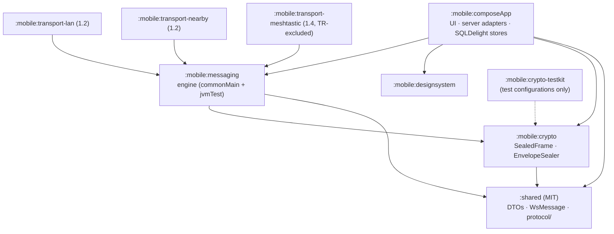

# Muhabbet multi-transport delivery — Software Architecture Document (arc42)

> **Status: Proposed — pending owner approval.** No code may be written for any scope described here
> until the owner records approval for that scope in
> [`APPROVAL.md`](APPROVAL.md). This document is derived from, and must agree with, the
> [decision brief](decision-brief-2026-11-12.md) (the single source of truth). Where this SAD and the
> brief disagree, the brief wins and the disagreement is a defect in this SAD.

| | |
|---|---|
| **Date** | 2026-11-12 |
| **Base** | `dev` @ 2434324 (branch `claude/muhabbet-p2p-architecture-wdan5r`) |
| **Template** | arc42 (sections 1–12) |
| **Audience** | Owner (architect, sole approver); implementing agents; external counsel and crypto reviewer for §2.3, §8.1–8.2 |
| **Evidence** | [Findings register](../../reviews/2026-11-12-findings-register.md) — IDs such as `BE-06`, `MOB-03`, `CICD-01`, `PROX-02` refer to it |
| **ADRs** | [ADR-0010 … ADR-0033](#9-architecture-decisions) (all *Proposed*; 1.1+ product ADRs *Proposed (gated)*) |
| **Package index** | [README.md](README.md) |

Conventions: "brief §N" refers to a section of the decision brief. Milestone names are the ROADMAP
names: **0.4** "the app tells the truth", **0.5.0** Honest, **0.6.0** Reachable, **0.7.0** Live,
**1.0.0** Encrypted, **1.1** Direct, **1.2** Nearby, **1.3** Relay, **1.4** Off-grid hardware
(brief, naming note). "Today" means `dev` @ 2434324.

---

## 1. Introduction and goals

### 1.1 Requirements overview

The owner's ask is that users "communicate always and everywhere, somehow". The brief reframes it
(brief §1.1): most of that promise is a **reliability problem on the one path that already exists**,
and only a small part is a radio problem. The architecture therefore delivers, in order:

| # | Capability | First milestone | Driving findings |
|---|---|---|---|
| F1 | A sent message is never silently lost, never shown twice, and its tick tells the truth | 0.4 (stopgaps) / 0.5.0 (engine) | MOB-03, MOB-04, MOB-05, BE-03, BE-07 |
| F2 | Total order per conversation with gap detection and self-healing pull | 0.4 (V28) / 0.5.0 | BE-06, C13, MOB-10 |
| F3 | Logout, deletion and revocation take effect on the device and on live sockets | 0.4 | MOB-01, BE-12, BE-13, MISS-02 (mobile) |
| F4 | Push carries no content (wake-only) | 0.5.0 | BE-15 |
| F5 | Encrypted local store with crypto-erase | 0.5.0 | MOB-01, GEM-14 |
| F6 | Working 1:1 calls (DIRECT live session via SFU/TURN) | 0.7.0 | FT-01, MISS-1 (networking) |
| F7 | Real end-to-end encryption, fail-closed | 1.0.0 | C9, KMP-13, BE-14, M1, M2 |
| F8 | P2P 1:1 calls (E2E media) | 1.1 (gated) | NAT-1, P2P-2, ICE-1 |
| F9 | Messaging between verified contacts without internet (LAN, Nearby Connections) | 1.2 (gated) | PROX-02, PROX-06, LAN-1 |
| F10 | INDIRECT delivery beyond the server mailbox (own devices; single-hop sealed uplink) | 1.3 (gated, droppable) | C7, LEG-04, GEM-09 |
| F11 | Off-grid text through certified LoRa hardware | 1.4 (gated, droppable, TR-excluded) | RF-07, LEG-03 |

What is explicitly **not** promised (brief §1.2) is part of the requirements, because the UI must say
it: no messaging without any infrastructure and without a nearby contact; no first contact off-server;
no background proximity discovery; nothing off-server before 1.0 E2E; 1:1 only off-server in 1.2; no
total order for LOCAL_ONLY; no "relayed to mesh" tick; nothing claimed that was not measured on a
device; and the rejected-technology list of [ADR-0027](../../adr/0027-rejected-transports.md).

### 1.2 Quality goals (ISO/IEC 25010)

Ordered by priority. The quality tree and measurable scenarios are in §10.

| Prio | ISO/IEC 25010 characteristic (sub-characteristic) | Goal | Principle (brief §2) |
|---|---|---|---|
| Q1 | **Reliability** (fault tolerance, recoverability) | Effectively-once delivery to the user across loss, duplication, reorder, partition and process death | P3, P4, P6 |
| Q2 | **Security** (confidentiality, integrity, authenticity) | No plaintext on any non-server path, by type; device-level mutual authentication off-server; bounded revocation | P2, P11, P12 |
| Q3 | **Functional suitability** (correctness) | Ticks and labels mean exactly one thing on every path; nothing claimed that is not measured | P4, P13, ADR-0013 |
| Q4 | **Security** (accountability) vs **privacy** | Server attributes messages to a sender device (Law 5651) while carrying no long-term signatures on content (deniability, erasure) and no stable identifiers outside TLS-to-server | P1, P9, ADR-0014 rationale (C5) |
| Q5 | **Maintainability** (modularity, testability) | Compiler-enforced module boundaries; deterministic engine tests with injected `Clock`/`IdGenerator` | P5, P7, P10 |
| Q6 | **Usability / interaction capability** (user error protection, appropriateness recognisability) | Honest states ("waiting for secure session", "not yet synced", "handed to …"), retry instead of silent loss | ADR-0013, ADR-0016 |
| Q7 | **Performance efficiency** (time behaviour, resource utilisation) | No head-of-line blocking; wake-to-notification latency measured on aggressive OEMs; battery bounded by foreground-only proximity | ADR-0019, brief §6.6 |
| Q8 | **Compatibility / portability** | Same envelope, ids and order across server, LAN, Nearby, uplink; Android first, iOS only behind the 0.6 gate | ADR-0022, ADR-0028 |

### 1.3 Stakeholders

| Stakeholder | Role / interest | Expectation of the architecture | Concern → addressed in |
|---|---|---|---|
| Owner | Solo engineer, architect, sole approver of ADRs and device criteria | Small enough to build alone; every gate explicit; nothing marked done that was not observed (P13) | §4, §9, §11, [APPROVAL.md](APPROVAL.md) |
| End users (Turkey) | Send and receive messages, calls; privacy | Messages are not lost; ticks are honest; content not readable by the server from 1.0 | §6.1–6.4, §8.6, §10 |
| Contacts acting as custodians (1.3) | Hold opaque ciphertext for someone else | Bounded storage and battery; nothing readable; no legal exposure (Q-L5) | §6.5, §8.5, §2.3 |
| Implementing AI agents | Write code against approved scopes | Unambiguous ports, state tables and acceptance criteria; a mechanical gate (ADR-0033) | §5, §6, §8.7 |
| Turkish telecom/KVKK counsel | Opinions Q-L1…Q-L9 (brief §17) | Clear statement of what is transmitted, stored and by whom, per path | §2.3, §7.2, §8.5 |
| External crypto reviewer | Review of libsignal integration, link handshake, uplink sealing | No hand-written primitives (P12); test vectors; a defined TCB | §8.1–8.2 |
| Regulators: BTK, Siber Güvenlik Başkanlığı, KVKK Kurumu | Laws 5809, 5651/7590/7578, 6698 | A reachable controller for takedown and the under-15 ban; data-transfer basis | §2.3, §8.8 |
| App stores (Google Play, Apple App Store) | Distribution | Licence compatibility (ADR-0017 precondition c), permission disclosures | §2.3, §9 (ADR-0017) |
| Processors: Google (FCM, Nearby/Play services), Apple (APNs), Twilio (Verify), Hetzner (hosting) | Process data on Muhabbet's behalf | Minimal data: content-free push from 0.5 (ADR-0019) | §6.3, §7.1 |
| Signal (libsignal licensor, AGPL-3.0) | Licence terms | `mobile/` relicensed to AGPL-3.0-or-later; `shared/` and `backend/` stay MIT (ADR-0017) | §9 (ADR-0017) |

---

## 2. Constraints

### 2.1 Technical constraints

| ID | Constraint | Source | Consequence for the design |
|---|---|---|---|
| TC-1 | Kotlin everywhere; Spring Boot 4.1.0 backend, KMP `shared/`, Compose Multiplatform mobile, Gradle Kotlin DSL | `build.gradle.kts`, CLAUDE.md, ADR-002 | Protocol types live once in `:shared` (ADR-0022) |
| TC-2 | One production host (Hetzner CX43) at ~92% disk; one self-hosted runner, one job at a time, on the same host | CLAUDE.md, CICD-01, CICD-04 | No linuxX64 target, no AGP 9 app split, few modules (ADR-0028); LiveKit and signer off-host |
| TC-3 | No KVM on the CI host; the only emulator is `emulator-5554` on the owner's Windows PC | CLAUDE.md, brief §16.3 | Device criteria are owner-observed only (P13, ADR-0032) |
| TC-4 | iOS cannot launch: no entry point, no Xcode project, DI not wired; no iOS compilation in CI | KMP-01, KMP-02, FT-04 | Blocking iOS decision at 0.6 (ADR-0028); 1.0 may ship Android-only (ADR-0017) |
| TC-5 | libsignal is not a dependency; the disabled Signal code does not compile; E2E is NoOp with a silent plaintext fallback | KMP-M3, SSOT-05, C9 | Type gate before any producer (ADR-0016); libsignal adapters at 1.0 (ADR-0017) |
| TC-6 | Android `minSdk` 26 | PROX-11, CLAUDE.md | Proximity features runtime-gated to API 29+ (ADR-0024) |
| TC-7 | Google Nearby Connections requires Play services; its LAN medium is not available to HMS or iPhone↔Android | PROX-06, brief ADR-0024 | `LanLink` is built; `NearbyLink` is bought |
| TC-8 | iOS forbids cross-OS background BLE discovery (overflow area) | PROX-02 | Proximity is foreground "Nearby mode" only |
| TC-9 | Postgres 16, Redis 7 and MinIO are *shared* containers (`shared-postgres`, `shared-redis`, `shared-minio`) used by other projects | CLAUDE.md deployment | Additive Flyway migrations only; expand/contract (CICD-09) |
| TC-10 | Integration tests need Docker (Postgres and Redis); without it ten classes do not run | CLAUDE.md, #598 | Every Spring-config or migration change is verified with Docker running |
| TC-11 | The mobile app has a hard-coded `BASE_URL` and no cleartext | MOB-15, CLAUDE.md | Non-prod verification through the UI requires a temporary build change |

### 2.2 Organisational constraints

| ID | Constraint | Source |
|---|---|---|
| OC-1 | Owner decision 1: the server is the backbone; every other path is an additional pipe | brief ADR-0010 |
| OC-2 | Owner decision 2: foundation first; the delivery engine is the early exception | brief §12 #79 |
| OC-3 | Owner decision 3: no GitHub restructuring or hooks before design approval | brief header, ADR-0030 |
| OC-4 | Owner decision 4: nothing is accepted until the owner approves; no code before approval; hooks "both" (design gate and environment bootstrap) | brief header, ADR-0033 |
| OC-5 | Solo engineer plus agents; 231 merged PRs with zero reviews; agents act under the owner's identity today | GOV-06 |
| OC-6 | Device-dependent exit criteria are signed off only by the owner's observation | P13, ADR-0032 |
| OC-7 | Product ADRs for 1.1+ stay *Proposed (gated)* until their spikes and legal opinions exist; process ADRs are separate | P14 |
| OC-8 | Default-branch drift: `main` is behind `dev`; templates, Dependabot and schedules on `main` are inert until the merge | GOV-01, SSOT-01 |
| OC-9 | Hard project rules: hexagonal modules, no hard-coded user-visible strings, `ErrorCode` for business errors, no `!!`, Flyway-only DB changes | CLAUDE.md |

### 2.3 Legal and regulatory constraints (Turkey)

Nothing in this table is a legal conclusion. Each row names the question that counsel must answer
(brief §17, Q-L1…Q-L9) and the design element that depends on it. Statute text sources are those
cited in the fact-check digests: Law 5651 —
<https://www.mevzuat.gov.tr/MevzuatMetin/1.5.5651.pdf>; KVKK (Law 6698) —
<https://www.mevzuat.gov.tr/MevzuatMetin/1.5.6698.pdf>.

| ID | Instrument | What it bears on | Design response | Finding / question |
|---|---|---|---|---|
| LC-1 | Law 5809 Art. 3(ççç), 9(14) — OTT provider may be treated as *işletmeci* | Retention, interception cooperation, local entity | Server stays authoritative and reachable (ADR-0010); metadata kept server-side (ADR-0019) | LEG-01, MISS-01 (legal), R5, Q-L1 |
| LC-2 | Law 5809 Art. 39 / 63(6); 2010 coded/encrypted communications regulation | Encrypted communication over *telsiz* (radio) | Meshtastic compiled out of TR builds (ADR-0026); counsel request names BLE and Wi-Fi too (ADR-0029 §7) | LEG-03, RF-07, R6, Q-L2 |
| LC-3 | Law 5651 as amended by Law 7590 (authority now the Siber Güvenlik Başkanlığı) | Takedown, social-network-provider duties | Channels, communities and large groups are server-only (ADR-0029 §2); reports are durable outbox commands | LEG-02, MISS-02 (legal), Q-L4 |
| LC-4 | Law 5651 Ek Md. 4(7) as amended by Law 7578 — no service to under-15s; *yaş doğrulama* | Registration and every off-server path | Age gate at registration in 0.4 behind `AgeAssurancePort`; valid attestation is a precondition for a device certificate from 1.2; no compliance claim until counsel confirms (effective date per brief, unverified, see reviewer note below; Q-L3) | LEG-02, MISS-04 (legal), R7, Q-L3 |
| LC-5 | KVKK Art. 7, 12 (erasure, security), Art. 9 (transfer abroad) | Device erasure, processors abroad, DPIA triggers | `SessionTeardown` crypto-erase (ADR-0020); wake-only push (ADR-0019); DPIA triggers (ADR-0029 §6); consent not the systematic Art. 9 basis | LEG-04, MOB-01, BE-15, Q-L5, Q-L6 |
| LC-6 | Licence-exempt RF rules (KET; EU868 duty cycle per sub-band) | LoRa airtime | `AirtimeLedger` sliding hour per sub-band (ADR-0026) | RF-07, RF-09 |
| LC-7 | AGPL-3.0 (libsignal) distributed through Google Play and the App Store | Relicensing `mobile/` | ADR-0017 preconditions (a)–(c); vodozemac fallback | KMP-13, R8, Q-L7 |

> **Reviewer note (open):** ADR-0029 §1 states the under-15 rule is "in force 2026-11-01". The
> verified evidence (fact-check digest, LEG-02) records the amendment as `Değişik: 22/4/2026-7578/22`
> and the consolidated text's *yürürlük* table gives 1/11/2026 (counsel-questions S-14; read, not
> separately verified). Confirm with counsel (Q-L3) before quoting it in user-facing or transparency
> text.

---

## 3. Context and scope

Diagram: [`docs/diagrams/c4-context.mmd`](../../diagrams/c4-context.mmd) (C4 level 1).

### 3.1 Business context

| Partner | Exchanges with Muhabbet | Direction | Milestone |
|---|---|---|---|
| User (sender/recipient) | Messages, media, receipts, calls, settings, reports | ↔ | existing |
| User's other devices (companions, ADR 0007) | Fan-out copies; from 1.3 own-device custody | ↔ | 1.0 / 1.3 |
| Verified contact's phone (mule) | Opaque, padded `UplinkBundle` carried to the server | → | 1.3 (gated) |
| Nearby verified contact (Nearby mode) | `SealedFrame`s over LAN or Nearby Connections | ↔ | 1.2 (gated) |
| Phone-OTP provider (Twilio Verify in prod) | E.164 number, OTP verification | ↔ | existing |
| Push processors (FCM; APNs once iOS exists) | Content-free wake hint `{type: "wake", conversationId, seq}` | → | 0.5 |
| Regulators / prosecutors | Takedown, legal requests, transparency counters | ↔ | existing (process) |
| Counsel, crypto reviewer | Opinions, reviews | ↔ | Phase 0 → 1.4 |
| App stores | Signed artefacts | → | existing |
| Meshtastic node (user hardware) | ≤ ~200 B frames over BLE/serial | ↔ | 1.4 (gated, TR-excluded) |

**System boundary.** Inside: the mobile app (all its modules), the backend modular monolith, its
data stores, the device-CA/uplink signer (1.2/1.3) and the LiveKit host (0.7). Outside: OS radios and
network stacks, Google Play services (Nearby, FCM), APNs, Twilio, Meshtastic firmware, GitHub.

### 3.2 Technical context

| Interface | Protocol / encoding | Endpoints | Auth | Milestone | Reference |
|---|---|---|---|---|---|
| Server control plane | WSS, JSON `WsMessage`; first frame `hello` → `welcome` | `/ws` (JWT out of query string) | First-frame or header auth, device-bound session | 0.4 (auth), 0.5 (hello) | ADR-0022, BE-12, KMP-11 |
| Change feed | HTTPS REST JSON | `GET /api/v1/conversations/{id}/changes?afterSeq&limit` | JWT | 0.5 | ADR-0014 |
| REST API | HTTPS JSON envelope `{data, timestamp}` or `{error{code, message}, timestamp}` | `/api/v1/**` | JWT | existing | CLAUDE.md API convention |
| Wake push | FCM high-priority data message, collapse key | Google | Server credential | 0.5 | ADR-0019 |
| Media | HTTPS presigned URLs via Traefik → `shared-minio`; resumable 1 MiB ranges; ciphertext from 1.0 | `cdn-…` host | Presigned SigV4 | existing / 1.0 | brief §6.7 |
| Calls | WebRTC (DTLS-SRTP), ICE, LiveKit SFU, embedded TURN/TLS 443 | Separate host | Backend-minted credentials ≤ 10 min | 0.7 / 1.1 | ADR-0009, ADR-0023 |
| LAN | mDNS/DNS-SD (`NsdManager`, Bonjour), length-prefixed TCP, vetted link handshake, `TransportFrame` | Same subnet | Device certificate + link key | 1.2 | ADR-0024, LAN-1 |
| Nearby | Google Nearby Connections (BLE discovery → Wi-Fi upgrade), BYTES/FILE/STREAM payloads | Peer | Our link handshake over the Nearby channel; UKEY2 hygiene only | 1.2 | ADR-0024, PROX-06 |
| Uplink | HTTPS `POST /api/v1/uplink`, HPKE-sealed `UplinkBundle` | Server | Mule's own JWT; server verifies sender-device signature | 1.3 | ADR-0025 |
| Meshtastic | BLE or serial, Meshtastic protobuf API | User's node | As LAN | 1.4 | ADR-0026 |

Public facts behind the technical context (cited in the digests): Nearby Connections —
<https://developers.google.com/nearby/connections/overview>; QUIC migration is client-side and
UDP-only — <https://www.rfc-editor.org/rfc/rfc9000.html>; NAT behaviour terminology —
<https://www.rfc-editor.org/rfc/rfc4787.html>; LiveKit self-hosting —
<https://docs.livekit.io/home/self-hosting/deployment/>; Turkish IPv6 share —
<https://stats.labs.apnic.net/ipv6/TR>.

---

## 4. Solution strategy

| Quality goal / driver | Strategy | Decided in |
|---|---|---|
| Server authority (OC-1, LC-1, LC-3) | Hybrid backbone: identity, device registry, key directory, order, mailbox, wake-up, TURN credentials and moderation are server-side; every other path moves bytes only | ADR-0010 |
| Q1 reliability | Durable outbox (CAS state machine) → at-least-once on every hop → idempotent receivers (server `UNIQUE(sender_device_id, client_message_id)`, client upsert by `change_seq`) → persist before ack | ADR-0013 |
| Q1 / F2 ordering | One sequencer: per-conversation `seq` and `change_seq`, pull-by-seq change feed; push and WS frames are hints only; client `CausalHeader` inside E2E for provisional order | ADR-0014 |
| Q5 maintainability | Local DB is the mobile SSOT; screens observe DB flows; a transport-agnostic engine in `:mobile:messaging` with ISP-split ports; no ViewModel layer added | ADR-0011, ADR-0012, ADR-0028 |
| Q2 security (content) | E2E as a type: non-server ports accept only `SealedFrame`, constructible only in `:mobile:crypto`; plaintext fallback deleted; libsignal at the platform edge | ADR-0016, ADR-0017 |
| Q2 security (peers) | Per-device identity, separate link key, short-lived server-attested device certificates under an offline root, signed CRL deltas | ADR-0018 |
| Privacy (Q4) | Wake-only push; random outer ids; rotating pairwise tags; padding; relay-only ICE for non-contacts; no server plaintext for E2E conversations from 1.0 | ADR-0019, ADR-0022, ADR-0023 |
| Data at rest | SQLCipher from 0.5 via fresh DB + resync; `SessionTeardown` is crypto-erase | ADR-0020 |
| Path choice | Classify by **scope**, not medium; rule chain (Admission → CloudPersistence → Preference), no fitness score; racing only at link establishment; see [`path-scopes.mmd`](../../diagrams/path-scopes.mmd) | ADR-0015 |
| Buy, don't build (P12) | libsignal, Nearby Connections, LiveKit/WebRTC ICE, Meshtastic firmware; build only `LanLink` and the engine | ADR-0017, ADR-0023, ADR-0024, ADR-0026 |
| Compliance survives offline (P11) | Age gate → device certificate; block lists on every inbound path; ≤ 7-day revocation window; server-only for broadcast surfaces | ADR-0029 |
| Delivery risk for a solo engineer (R3, R4) | Ship reliability first (0.4/0.5) on the existing path; every post-1.0 path is gated by a written admission gate and droppable with kill criteria | brief §13, P8 |
| Supply-chain trust | CI trust boundary before any long-lived key; build once, promote the same artefact | ADR-0030, ADR-0031 |
| Verification honesty | Owner-observed device criteria; agents on their own identity; design gate hook | ADR-0032, ADR-0033 |

Key technology choices and their rejected counterparts are tabulated in brief §12 (80 items) and
[ADR-0027](../../adr/0027-rejected-transports.md).

---

## 5. Building block view

Diagrams: [`c4-container.mmd`](../../diagrams/c4-container.mmd) (level 1),
[`c4-component-backend.mmd`](../../diagrams/c4-component-backend.mmd) and
[`c4-component-mobile.mmd`](../../diagrams/c4-component-mobile.mmd) (level 2).

### 5.1 Level 1 — containers

| Container | Technology | Responsibility | Milestone |
|---|---|---|---|
| Mobile app (Android; iOS behind the 0.6 gate) | CMP, Koin, Decompose, SQLDelight + SQLCipher, Ktor | UI, delivery engine, local SSOT, crypto edge, transports | existing → 0.5 engine |
| Backend modular monolith | Spring Boot 4.1, Kotlin, hexagonal modules | Identity, devices, keys, conversations, seq, change feed, mailbox, push hints, moderation/compliance, call signalling, TURN credentials | existing |
| PostgreSQL 16 (`shared-postgres`) | — | Authoritative metadata, seq, envelopes (1.0), key directory | existing |
| Redis 7 (`shared-redis`) | — | Cross-instance WS fan-out; rate limits (in-process limits move to Redis on scale-out, BE-17) | existing |
| MinIO (`shared-minio`) | S3 API | Media blobs (ciphertext from 1.0) | existing |
| LiveKit + embedded TURN/TLS | Separate host (ADR 0009) | SFU and TURN for calls | 0.7 |
| Device-CA / uplink-key signer | File-mounted signer, **not on a host running PR jobs** | Online intermediate (certificates, CRL); uplink unseal key | 1.2 / 1.3 |
| FCM / APNs | External processors | Content-free wake hints | 0.5 / iOS |
| Meshtastic node | Certified LoRa hardware | RF carrier | 1.4 (gated) |

### 5.2 Level 2 — backend components

Today the backend has five top-level packages (`auth`, `media`, `messaging`, `moderation`,
`shared`); presence and notification live inside them. The table shows the target components per
bounded context (brief §4.2). "New" contexts are packages inside the monolith, not services.

| Context | Component | Responsibility | In-ports implemented / out-ports used | Milestone | Findings |
|---|---|---|---|---|---|
| messaging | `SendMessageService` | Idempotent send on `(sender_device_id, client_message_id)`; assigns seq; publishes `MessageAccepted` after commit via `TransactionRunner` | `SendMessageUseCase` / `ConversationSequencePort`, `DeliveryHintPort` | 0.4–0.5 | BE-07, BE-04 |
| messaging | `MessageMutationService` | Edit, delete, reaction; bumps `change_seq` (split from `MessageService`) | mutation use cases | 0.5 | BE-11 |
| messaging | `ConversationSequencer` | `UPDATE conversations SET last_seq = last_seq + 1 … RETURNING` inside the caller's transaction | `ConversationSequencePort` | 0.4 | BE-06, C13 |
| messaging | `ChangeFeedService` | `/changes` page; hides unreleased scheduled messages; per-device envelopes from 1.0 | `GetConversationChangesUseCase` | 0.5 | BE-02 |
| messaging | `DeliveryAckPolicy` | Per-device `uptoSeq`; only non-sender members; only existing seqs; applies `ReadReceiptPolicyPort` (#377) | `AcknowledgeDeliveryUseCase` | 0.4 / 0.6 | BE-03, BE-18 |
| messaging | `DeliveryHintPublisher` | WS hint + FCM wake, best effort (loss repaired by pull) | `DeliveryHintPort`, `WakePushPort` | 0.5 | BE-05 (resolved by pull-by-seq) |
| messaging | `ScheduledReleaseJob` | Releases each scheduled message in its own transaction; seq assigned at release | — | 0.4 | BE-02, BEV-M1 |
| messaging | `Mailbox` | `message_envelopes` projection; delete on device ack; TTL purge | `MailboxPort` | 1.0 | BE-15 |
| messaging | `UplinkIngress` | Unseal HPKE bundle, verify sender-device signature, ingest via `SendMessageUseCase` | reuses `SendMessageUseCase` | 1.3 (gated) | C7 |
| keys (new, from messaging's `EncryptionService`) | `PrekeyDirectory`, `LinkKeyRegistry` | Atomic per-device claim (SKIP LOCKED), rate limit, relationship check, no silent identity replacement → `IdentityKeyChanged` | `ClaimPreKeyBundleUseCase` / `PrekeyDirectoryPort` | 0.4 (claim, limit) / 0.6 (per-device) / 1.2 (link keys) | BE-14, C10, M1, M2 |
| auth | `AuthService`, `AgeAssurance`, `DeviceRegistry` | OTP identity; age gate; device rows (ADR 0007) | `AgeAssurancePort` | existing / 0.4 | MISS-04 (legal), BE-11 |
| auth | `SessionRevocation` | Emits `SessionRevoked`/`DeviceRevoked`; WS adapter closes sessions on expiry, logout, revoke, deletion; refresh-token reuse detection | `SessionRevocationPort` | 0.4 | BE-12, BE-13 |
| auth | `DeviceCertificateAuthority` | Issues 7-day certificates; CRL deltas | `IssueDeviceCertificateUseCase` / `CertificateSignerPort` | 1.2 | — |
| shared/websocket | `WsGateway`, `WsSessionRegistry` | `hello`/version, first-frame auth, `ConcurrentWebSocketSessionDecorator`, dispatch to in-ports only; registry bound to `(deviceId, jti, exp)` | — | 0.4 / 0.5 | BE-12, BE-16, KMP-11 |
| notification | `WakePushService` | Data-only pushes with collapse keys | `WakePushPort` | 0.5 | BE-15 |
| calls/session | `CallSignalingService`, `TurnCredentialService` | Signalling; ≤ 10-min credentials; relay-only policy | `TurnCredentialPort` | 0.7 | FT-01 |
| moderation → compliance | Report, takedown and legal-request handling | Reports; takedown → revocation; legal-request log; transparency counters; `AccountBanned` → revoke devices and close sessions | — / `SessionRevocationPort` | 0.4+ | LEG-02 |
| contacts | `ContactLookupService` | Rate-limited, block-filtered, discoverability enforced with a reader | `ContactLookupUseCase` | 0.4 (cap) / 0.6 | C8, M3, GOV-08 |
| cross-cutting | ArchUnit/Konsist boundary rules; `AbuseRateLimiter` (Redis token buckets) | Enforce module boundaries before new ports | — | 0.4 | BE-08, BE-09 |

There is **no backend transactional outbox table** (brief §3, judge disagreement): pull-by-seq makes
a lost hint harmless.

### 5.3 Level 2 — mobile modules and components

Module dependency (compiler-enforced; introduced only when the milestone needs them, ADR-0028):



| Module | Since | Contents | Must not depend on |
|---|---|---|---|
| `:shared` (MIT) | existing | DTOs, `WsMessage`, `protocol/` envelope types and golden vectors | libsignal, Android/iOS APIs |
| `:mobile:crypto` | 0.5 | `SealedFrame` (`internal` constructor), `EnvelopeSealer`, `SessionCryptoPort`, `DeviceCertificateVerifier` (1.2), `LinkAuthenticator` (1.2); libsignal Android/iOS adapters at 1.0 | Compose, Koin annotations, `WsMessage` |
| `:mobile:crypto-testkit` | 0.5 | `FakeSealer`, golden vectors, the crypto contract suite | Any release runtime classpath (build check) |
| `:mobile:messaging` | 0.5 | Engine: domain, services, use cases, ports; `SimulatedLink` in testFixtures | Compose, Koin annotations, `WsMessage` (guardrail ratchet) |
| `:mobile:composeApp` | existing | UI on DB flows; `WsServerLink`, `WsInboundSource`, `RestChangeFeedSource`, `FcmHintSource`; `SqlDelightMessageStore`/`SqlDelightOutboxStore`; `SecureKeyStore`; `BackgroundSyncManager`; Nearby-mode screen (1.2) | `WsMessage`/`wsClient` in `ui/` (ratchet to 0 from 17 sites) |
| `:mobile:designsystem` | existing | Visual language | `composeApp` |
| `:mobile:transport-lan`, `:mobile:transport-nearby` | 1.2 | `LanLink`, `NearbyLink`, rotating-tag advertiser/scanner | Each other |
| `:mobile:transport-meshtastic` | 1.4 | `MeshtasticLink`, `AirtimeLedger` | Excluded from TR flavours by Gradle |

Components of `:mobile:messaging` (brief §4.3):

| Component | Pattern | Responsibility | Milestone |
|---|---|---|---|
| `MessagingEngine` | Facade, Koin single | Single command entry; exposes flows | 0.5 |
| `Outbox` | State machine; Command = persisted entry | §6.1 of the brief; CAS transitions | 0.5 |
| `Inbox` | Observer over all `InboundSource`s | Upsert by `change_seq`, advance watermark, then enqueue DELIVERED | 0.5 |
| `SyncCoordinator` | — | Seq-gap pulls on reconnect, wake, foreground, WorkManager | 0.5 |
| `ReceiptService` | — | L2/L3 receipts, aggregation from server rows | 0.5 |
| `SessionTeardown` | — | Ordered crypto-erase (§8.8) | 0.4 (minimal) / 0.5 |
| `PathPolicy` + rules | Strategy over Chain of Responsibility | Admission, CloudPersistence, Preference | 1.2 |
| `CustodyPolicy` | — | Offer bundles to custodians in hierarchy order | 1.3 |
| `LiveSessionCoordinator` | — | Call signalling as CONTROL frames | 0.7 |
| `ProtocolCodec` | Adapter | `OutgoingEnvelope` ↔ `ServerFrame` (pre-1.0) | 0.5 |

Key port signatures (full catalogue: brief §5; implementer detail:
[delivery-engine-spec.md](delivery-engine-spec.md)):

```kotlin
interface ServerLink { val state: StateFlow<LinkState>; suspend fun submit(f: ServerFrame): SubmitResult }
interface SealedLink {
    val scope: PathScope; val caps: LinkCapabilities; val state: StateFlow<LinkState>
    suspend fun send(to: PeerRoute, f: SealedFrame): SubmitResult
}
interface InboundSource { val events: Flow<InboundEvent> }
interface EnvelopeSealer {
    suspend fun seal(conv: ConversationCrypto, to: List<DeviceAddress>, plain: ByteArray): SealResult
    suspend fun open(f: SealedFrame): OpenResult
}
interface CustodyTarget { val kind: CustodianKind; suspend fun offer(b: Bundle): CustodyResult }
```

P7 check (every abstraction names a scheduled second implementation): `ServerLink` —
`SimulatedLink` plus its type-level counterpart `SealedLink` (real at 1.2); `InboundSource` — three
today; `CustodyTarget` — second at 1.3, not routed through before then; `LinkSelector`/`PathPolicy` —
not built until the second outbound link (1.2).

---

## 6. Runtime view

State machines: [`outbox-state-machine.mmd`](../../diagrams/outbox-state-machine.mmd),
[`link-state-machine.mmd`](../../diagrams/link-state-machine.mmd),
[`custody-state-machine.mmd`](../../diagrams/custody-state-machine.mmd). The authoritative state
tables are brief §6.1–6.3.

### 6.1 R1 — Send and receive over the server (0.5 engine; 1.0 differences marked)

Sequence: [`seq-send-receive.mmd`](../../diagrams/seq-send-receive.mmd).

| # | Actor | Step | Invariant |
|---|---|---|---|
| 1 | Sender UI | Calls `MessagingEngine.send(...)` | UI never builds wire frames (P5) |
| 2 | Outbox | One transaction: optimistic `message` row + `outbox_entry` (QUEUED; PREPARING for media; PENDING_SEAL for E2E without a session, 1.0) | No loss after enqueue (RQ-01) |
| 3 | Outbox | When `ServerLink` is Ready and the lane has capacity: CAS QUEUED → IN_FLIGHT, submit `message.send{clientMessageId, …}` (1.0: per-device `envelopes`) | At most one in-flight attempt per entry |
| 4 | Backend `SendMessageService` | Idempotency check on `(sender_device_id, client_message_id)`; allocate `seq`; insert; commit | Duplicate → replay original ack (BE-07) |
| 5 | Backend | Reply `ack{clientMessageId, seq, serverTs, replay}` | L1 hop ack |
| 6 | Sender Outbox | CAS IN_FLIGHT → SERVER_ACCEPTED(seq); message row gets `seq` → **one tick** | One tick = server custody |
| 7 | Backend `DeliveryHintPublisher` | After commit: `message.new{…seq, changeSeq}` on live sockets; wake push for others | Hints may be lost (P6) |
| 8 | Recipient Inbox | Upsert row (insert, or update iff incoming `change_seq` is newer) and advance watermark in one transaction | Exactly-once display (RQ-02) |
| 9 | Recipient ReceiptService | After commit: `message.ack{conversationId, uptoSeq, DELIVERED}` | Persist before ack (P4) |
| 10 | Backend `DeliveryAckPolicy` | Accept only from a non-sender member's device for existing seqs; 1.0: delete mailbox rows ≤ `uptoSeq` for that device | BE-03, BE-18 |
| 11 | Sender | `message.status` → **two ticks** once every recipient user has ≥ 1 device committed | Aggregation from server rows only |
| 12 | Recipient | Chat visible → `ack{…, READ}`; server applies `readReceiptsEnabled` downgrade when publishing | #377 stays server-enforced (ADR-0019) |

Failure branches: timeout or link loss → RETRY_WAIT (1 s→30 s, full jitter, injected `Clock`);
`Rejected(code)` → FAILED_PERMANENT with "tap to retry"; IN_FLIGHT at process start → QUEUED (safe:
server idempotent); lifetime exceeded → EXPIRED (default 30 d).

### 6.2 R2 — Gap detection and pull

| # | Trigger | Step |
|---|---|---|
| 1 | Any of: WS reconnect (`Syncing(heads)`), wake push, app foreground, WorkManager/BGTask, a hint with `seq > watermark + 1`, a `deviceCounter` gap in a provisional off-server message | `SyncCoordinator` schedules a pull for the conversation |
| 2 | `SyncCoordinator` | `GET /changes?afterSeq=<watermark>&limit=N` (1.0: envelopes addressed to the requesting device) |
| 3 | Inbox | Upserts each item and advances the watermark in the same transaction; repeats while `hasMore` |
| 4 | ReceiptService | Enqueues `ack{uptoSeq, DELIVERED}` after commit |

Property: dropping 100% of hints still converges (RQ-05). Background sync uses the server seq, never
the device clock (MOB-10). The conversation list returns `lastSeq` per conversation, so one request
detects every stale conversation.

### 6.3 R3 — Wake-only push (from 0.5)

Sequence: [`seq-wake-push-sync.mmd`](../../diagrams/seq-wake-push-sync.mmd). This step table and the
diagram must agree; the brief (ADR-0019, §9) is authoritative.

| # | Actor | Step | Data |
|---|---|---|---|
| 1 | Backend `DeliveryHintPublisher` | After commit, for each recipient device without a live socket: `WakePushPort.wake(device, hint, collapseKey)` | `{type: "wake", conversationId, seq}` only; high-priority data message; collapse key per conversation |
| 2 | FCM | Delivers (best effort; may be throttled on aggressive OEMs) | No content, no sender name |
| 3 | `FcmHintSource` | Emits `InboundEvent.Hint(conv, seq)` | — |
| 4 | `SyncCoordinator` | Pull as R2 over TLS | — |
| 5 | Inbox | Commit; then ReceiptService acks DELIVERED | P4 |
| 6 | App | Composes the notification text locally from the DB | Text never leaves the device |
| — | Fallback | Foreground pull; seq-driven WorkManager; battery-optimisation notice on known aggressive OEMs; iOS Notification Service Extension when iOS exists | R11 |

Verification: captured FCM payload contains no content (RQ-07); owner observes a notification with
the app killed (0.5 exit) and the message present in the DB before tap (0.6 exit).

### 6.4 R4 — Nearby delivery and server reconciliation (1.2, gated)

Sequence: [`seq-nearby-reconcile.mmd`](../../diagrams/seq-nearby-reconcile.mmd).

| # | Actor | Step | Gate / invariant |
|---|---|---|---|
| 1 | Both users | Open Nearby mode (foreground; Android `connectedDevice` FGS, auto-off 15 min) | ConsentRule; OS permissions per consent matrix |
| 2 | Advertiser / scanner | Advertise and match rotating pairwise tags `HMAC-SHA256(pairKey, "mbt-prox-v1" ‖ epoch15m)[0..8]`; random instance and endpoint names | No stable identifiers (P9, RQ-17) |
| 3 | Link establishment | Happy-Eyeballs-style: `LanLink` first if same network, `NearbyLink` 250 ms later; first UP wins | Racing at establishment, never per message |
| 4 | `LinkAuthenticator` | Vetted handshake against the peer's **certified link key**; verify device certificate and CRL | CertificateRule; ≤ 7-day revocation |
| 5 | `PathPolicy` | Admission chain: AssuranceRule, RelationshipRule (verified safety number), CertificateRule, ConversationModeRule, ScopeRule (1:1 only), ConsentRule, RegulatoryRule, QuotaRule, SizeRule, ConstrainedRule; then CloudPersistence, Preference | Any Deny removes the candidate; content is never downgraded |
| 6 | Sender Outbox | `SealedLink.send(route, SealedFrame)` inside a `TransportFrame` (random 16-byte id, AEAD header, padded) | Type gate (RQ-06) |
| 7 | Recipient Inbox | Dedup on `(src_device, frame_or_message_id)`; commit with **no seq**; sealed DELIVERED receipt back over the link | P4 |
| 8a | Sender | Receives `HopAck{frameId}` (L1) → CAS `IN_FLIGHT → HOP_ACKED(serverOwed = mode ≠ LOCAL_ONLY)`; UI still shows the **clock** | A hop ack is not delivery; no "relayed" tick |
| 8b | Sender | Receives the sealed L2 DELIVERED receipt from step 7 → receipt row written; UI shows **two ticks + "not yet synced"** until a seq exists | Brief ADR-0013 ticks; brief §6.4: "L2 … Off-server it is a sealed receipt frame, also uploaded to the server when the server is reachable" |
| 9 | Either side, when internet returns | `serverOwed` entries re-QUEUED to the server only; server dedups by `(sender_device_id, client_message_id)` and assigns `seq` | Server is the only sequencer |
| 10 | Both devices and companions | Pull by seq; provisional row receives its seq; stable re-sort once; "not yet synced" cleared | Each message once, in seq order (1.2 exit) |

Provisional display order without a seq: `(lastKnownSeq, senderDeviceId-local receive order,
deviceCounter)`, sender time clamped to `[receivedAt − 5 min, receivedAt]` for display only.

### 6.5 R5 — Single-hop sealed uplink through a verified contact (1.3, gated, droppable)

No dedicated sequence diagram is planned; this step table is normative for the SAD.

| # | Actor | Step | Control |
|---|---|---|---|
| 1 | Sender (no connectivity) | Outbox entry has no eligible server path; `CustodyPolicy` offers in order: server mailbox (unavailable) → own linked device (`OwnDeviceCustody`) → verified contact (`ContactUplinkCustody`) | Strict hierarchy; mutual verified contacts only |
| 2 | Sender | Builds `UplinkBundle = HPKE-Seal(serverUplinkPk, info="mbt-uplink-v1", aad=bucketSize, pt = senderDeviceSignature ‖ routing ‖ DeviceEnvelopes)`, padded to a bucket | Mule cannot read or route |
| 3 | Sender → mule | Over an authenticated `SealedLink` (LAN/Nearby); mule replies `HopAck` → `HOP_ACKED(serverOwed=true)`, UI: clock + "handed to <contact>" | No relayed tick |
| 4 | Mule | Stores the opaque blob in its separate encrypted custody store (quota ≤ 50 bundles / 10 MB, 24 h, FIFO-by-expiry eviction) | Quota enforced by mule and server |
| 5 | Mule (online) | `POST /api/v1/uplink` under its own auth within per-mule daily quota; deletes the blob on 2xx or after 24 h | `uplink_quota` (V36) |
| 6 | Backend `UplinkIngress` | Unseal with the uplink private key (non-CI host); verify the sender-device signature (5651 attribution); ingest through `SendMessageUseCase` (idempotent) | Same path as R1 step 4 |
| 7 | Recipient | Normal R1/R2 delivery; sender learns server acceptance on its next connection and the entry reaches SERVER_ACCEPTED | — |

Kill criteria (ADR-0025): telemetry below the owner's threshold (Q-O5), or any negative counsel or
crypto-review opinion.

### 6.6 R6 — Revocation and teardown (0.4)

| Trigger | Server effect | Device effect |
|---|---|---|
| JWT expiry | Socket closed at `exp`; client refreshes (`AuthExpired`) | — |
| Logout / refresh rejected | `SessionRevoked`; sockets closed within 5 s (RQ-09) | `SessionTeardown(reason)` §8.8 |
| Device revoke / account deletion / ban | `DeviceRevoked` / `AccountBanned`; sessions closed; from 1.2 certificate non-renewal + CRL delta over WS | Teardown on the revoked device when reachable; peers refuse after expiry/CRL (≤ 7 d, RQ-18) |
| Refresh-token reuse | Family revoked (BE-13) | Re-login |

---

## 7. Deployment view

### 7.1 Infrastructure (target, by milestone)

Deployment diagram: the node placement is shown in [`c4-container.mmd`](../../diagrams/c4-container.mmd);
a dedicated deployment diagram is deferred until Q-O7/Q-O8 fix the LiveKit and signer hosts.

| Node | Hosts | Notes | Milestone |
|---|---|---|---|
| Hetzner CX43 production host (8 vCPU / 16 GB, ~92% disk) | `muhabbet-backend` container (Traefik-routed, deployed from repo-root `docker-compose.prod.yml` with `--env-file .env.prod`); shared `shared-postgres`, `shared-redis`, `shared-minio` used by other projects | Today it also runs the self-hosted runner `muhabbet-cx43`; ADR-0031 removes PR jobs from it | existing |
| CI | GitHub-hosted runners once the billing lock is cleared (public repo), or a separate non-production box; `muhabbet-mordecai` identified or deregistered | No `pull_request` job on the production host | Phase 0 (ADR-0031) |
| LiveKit host | LiveKit SFU + embedded TURN/TLS 443, UDP range; `LIVEKIT_*` in `.env.prod` | Separate host; placement and budget open (ADR 0009, Q-O8) | 0.7 |
| Signer host or hardware token | Online intermediate (90-day) for device certificates and CRL; uplink unseal key | Never on a host running PR jobs; placement open (Q-O7) | 1.2 / 1.3 |
| Offline root | Root signing key; public key pinned in the app with a rotation list | Offline; runbook required | 1.2 |
| Owner's Windows PC | `emulator-5554`; release APK install and launch before every Play promotion | The only emulator (TC-3) | existing |
| User devices | Android (minSdk 26; proximity API 29+); iOS behind the 0.6 gate | — | — |
| External processors | FCM, APNs, Twilio Verify, Google Play, App Store, GitHub | DPIA trigger on any new processor or foreign host (ADR-0029 §6) | — |

### 7.2 Trust boundaries

| TB | Boundary | Crossing data | Control |
|---|---|---|---|
| TB-1 | Device ↔ backend | All server-plane traffic | TLS + JWT (out of query string), device-bound sessions, session close on revoke |
| TB-2 | Backend ↔ processors (FCM/APNs) | Wake hints | Content-free from 0.5 (ADR-0019) |
| TB-3 | Device ↔ device (LAN/Nearby/Meshtastic) | `TransportFrame`s | Device certificate + link key handshake; `SealedFrame` only; rotating tags; padding |
| TB-4 | Mule ↔ backend | `UplinkBundle` | HPKE to the server; mule quota; sender-device signature |
| TB-5 | CI ↔ production host and secrets | Build jobs, signing and Play credentials | ADR-0031: no PR jobs on prod; `release` environment restricted to tags on `main` with reviewer; SHA-pinned actions; rotation of every `.env.prod` value (CICD-06) |
| TB-6 | Signer ↔ everything else | Certificate and CRL signatures; uplink unseal | Not on a PR-job host; offline root; rotation runbook (R14) |
| TB-7 | Backend ↔ LiveKit host | Room creation, credentials | Short-TTL credentials; SFU media disclosure in UI |

### 7.3 Release and deploy flow (ADR-0030)

Tag → build **once** → install that exact signed APK/AAB on `emulator-5554` and launch it → promote
the **same artefact** to Play (no rebuild, no `--clobber`). Backend deploy deploys the CI-built image
or SHA, never `git pull` on the host (CICD-07). Flyway migrations are additive first; destructive
changes one release later (CICD-09).

---

## 8. Cross-cutting concepts

### 8.1 Identity and trust

| Layer | Artefact | Issued / held by | Used for | Milestone |
|---|---|---|---|---|
| Account | E.164 + OTP; age attestation | Server (Twilio Verify in prod) | Legal subscriber identity | existing / 0.4 (age) |
| Device | `devices` row (primary + ≤ 4 companions, ADR 0007) | Server registry | Session binding, fan-out | existing |
| Crypto identity | libsignal `IdentityKeyPair` per device | Device; public part in the per-device directory | Content E2E | 1.0 (schema 0.6) |
| Link key | Separate static key, signed by the identity key (`device_link_keys`); type follows the 1.2 spike (X25519 for Noise, Ed25519 for TLS 1.3 pinned raw key) | Device | Link-layer auth on off-server hops only (domain separation) | 1.2 |
| Device certificate | `{v, serial, userId, deviceId, identityKey, linkKey, notBefore, notAfter = 7 d, issuerKeyId}`, Ed25519, online intermediate under offline root | Server CA | Offline peer authentication; revocation by non-renewal + CRL delta | 1.2 |
| Safety number | Static single-scan QR (libsignal fingerprints) | Users | Human verification; eligibility for 1.2/1.3 | 1.0 |

Rules: no silent identity replacement — a new key means a new device and an `IdentityKeyChanged`
system message (blocking interstitial for verified contacts). No key derivation from libsignal
ratchet internals. No self-certifying identifiers. Key transparency is research only.

### 8.2 The E2E type gate

| Element | Rule | Verified by |
|---|---|---|
| `SealedFrame` | Constructor `internal` to `:mobile:crypto`; only `EnvelopeSealer` produces it | Compile error; architecture test |
| `SealedLink` | Accepts only `SealedFrame` | Compile; contract test (1.0 exit) |
| `ServerLink` | Accepts `ServerFrame`; may carry TLS-only plaintext only for `encryptionState = NONE` conversations before 1.0 | Inspection; 1.0 SQL assertion |
| Plaintext fallback | **Deleted** in 0.5 (not flag-gated); seal failure → `PENDING_SEAL` with "waiting for secure session" | Injected seal-failure test (1.0 exit) |
| `SealResult` | `Sealed \| NoSession \| UntrustedIdentity \| Failed`; `UntrustedIdentity` parks the entry and asks the user | Unit tests |
| `:mobile:crypto-testkit` | Allowed only on test configurations; build check fails if on any release runtime classpath | CI classpath check |
| `E2EConfig` flags | Retired at 1.0 in favour of the type gate plus a server-side minimum protocol version | Inspection |
| Scope of the claim | "No plaintext on sealed paths and in E2E conversations"; channels and communities stay server-plaintext by design and are labelled so | UI copy review |

```kotlin
// :mobile:crypto
class SealedFrame internal constructor(val protocol: ProtocolTag, val bytes: Bytes)
sealed interface SealResult {
    data class Sealed(val frames: List<SealedFrame>) : SealResult
    data object NoSession : SealResult
    data class UntrustedIdentity(val device: DeviceAddress) : SealResult
    data class Failed(val code: String) : SealResult
}
```
(`Bytes` is a value class with content equality, GEM-16; `ProtocolTag` per ADR-0016/0022.)

### 8.3 Persistence and single source of truth

| Data | Authority (SSOT) | Copies | Erasure |
|---|---|---|---|
| Identity, devices, keys directory, age attestation | Backend Postgres | — | Account deletion |
| Message metadata (`id, conversation, seq, change_seq, sender_device_id, timestamps, encryptionState`) | Backend `messages` | Mobile `message` rows | Account deletion; TTL for LOCAL_ONLY envelopes |
| Message content pre-1.0 | Backend `messages.content` | Mobile encrypted DB | Account deletion; #327 media still open |
| Message content 1.0+ (E2E conversations) | **Devices only** (mobile encrypted DB); server holds per-device envelopes until ack or TTL (30 d) | Encrypted backup under user-held key (T3 step 5) | Mailbox delete on ack; teardown |
| Conversation order | Server `seq` | Mobile watermark per (device, conversation) | — |
| Outbox, inbound dedup, receipts | Mobile encrypted DB | — | `SessionTeardown` |
| Custody blobs (1.3) | Separate encrypted `custody.db` with own key and quota | — | Expiry; leaving relay mode; teardown |

Rules: one cursor model in every era (per-(device, conversation) seq watermark over `/changes`); the
mailbox is a projection, not a second cursor (ADR-0021). SQLDelight migrations (`.sqm` +
`verifyMigrations`) before any schema change. Flyway next version is V28 (brief §11.1); additive
first. Screens read only DB flows (ADR-0011).

### 8.4 Error model

| Layer | Mechanism | Rule |
|---|---|---|
| Backend domain | `BusinessException(ErrorCode)` at the domain boundary; sealed results where callers branch (`SendOutcome = Accepted(id, seq, ts, replay) \| Rejected(ErrorCode)`, `AckOutcome`) | Every business error is an `ErrorCode` value; no inline TR/EN text (CLAUDE.md; BE-20 records the rule amendment) |
| REST | Envelope `{ "error": { "code", "message" }, "timestamp" }` | `code` is the `ErrorCode` name |
| WS | `error{code}`; new codes named in the brief: `UNSUPPORTED_FRAME`, `PROTOCOL_TOO_OLD` | Unknown frame types decode to `Unknown` and are answered, never silently dropped (KMP-11) |
| Idempotency | A duplicate submit replays `ServerAck(seq, serverTs, replay=true)` | `MSG_DUPLICATE` is no longer returned for a retry (BE-07) |
| Validation | Reject with `VALIDATION_ERROR`; no silent coercion | BE-19 |
| Mobile engine | `SubmitResult` (`ServerAccepted`, `HopAcked`, `Retry`, `Backpressure`, `Rejected(code)`), `SealResult`, `CustodyResult` | `Rejected.code` carries the server `ErrorCode` name; the UI maps codes to localised strings |
| Mobile data layer | Error-code strings `DOMAIN_ACTION_RESULT` | No hard-coded messages (CLAUDE.md) |
| Coroutines | `CancellationException` is rethrown | MOB-09 |

### 8.5 Observability without PII

| Rule | Source |
|---|---|
| No message content, safety numbers, keys, tokens or OTPs in logs, metrics, crash reports or analytics | ADR-0019, ADR-0016 |
| Phone numbers are never logged in full outside the documented test-number path | CLAUDE.md (test-number OTP log), C8 |
| ICE telemetry: candidate type, IP family and ASN only — never IPs — and carried under a KVKK notice | ADR-0023, Q-L8 |
| No stable or timestamp-bearing identifiers outside TLS-to-server; outer ids 16 random bytes | P9, ADR-0022 |
| Engine telemetry for gates (e.g. share of Nearby sessions where one side lacked internet, 1.3 entry) is aggregate and counted, not per-user traces | ADR-0025, Q-O5 |
| Server correlation uses internal pseudonymous ids (`conversationId`, `seq`, `deviceId`) | brief §4.2 |
| Every new telemetry field that leaves the device is a DPIA input (ADR-0029 §6) | ADR-0029 |
| Deployed commit SHA is exposed so evidence can be tied to a build | MISS-01 (product-state) |

### 8.6 Internationalisation and honest UI copy

- All user-visible text through `stringResource(Res.string.*)`; Turkish default
  (`composeResources/values/`), English in `values-en/` (CLAUDE.md).
- No localised text on the wire: media types send null/empty content plus an optional caption; the
  receiver renders the label (MOB-07, fixed on dev).
- New honest states need strings in both locales: "waiting for secure session" (PENDING_SEAL), "tap
  to retry" (FAILED_PERMANENT), "not yet synced", "handed to <device/contact>", "server can access
  call media" (SFU), Nearby-mode consent and auto-off, causal-order notice for LOCAL_ONLY. Turkish
  wording is owner-confirmed (Q-O11).
- Server error codes are mapped to strings on the client; the server never sends display text.

### 8.7 Testing and verification harness

| Layer | Tooling | What it proves | Runs where |
|---|---|---|---|
| Engine | `SimulatedLink` / `SimulatedSealedLink` (seeded RNG: latency, loss, duplication, reorder, MTU, partitions, flapping, crash points, token expiry), `TestClock`, `SequentialIdGenerator`, `InMemory*` stores | Global invariants: no acked-but-unpersisted row; no lost outbound; seq strictly increasing; exactly-once display; no non-sealed frame on sealed links; custody released only on authenticated delivery | `:mobile:messaging:jvmTest` in CI from day one |
| Backend | JUnit 5 + MockK; Testcontainers (Postgres + Redis) **with Docker running**; ArchUnit/Konsist boundary rules | Seq gaplessness under 50 concurrent senders; idempotency; ack authorisation; atomic prekey claim; change feed | CI; locally only with Docker (TC-10) |
| Protocol | Golden vectors for every JSON and protobuf frame on JVM, backend and (when present) iOS; fuzz targets for every parser | Wire compatibility across versions | CI |
| Crypto | Contract suite in `:mobile:crypto-testkit` against Android adapter, iOS adapter and fake | Adapter interchangeability (LSP) | CI (iOS when a macOS runner exists) |
| Build guardrails | `verifyUi` ratchet (`WsMessage`/`wsClient` in `ui/` → 0); module dependency checks; release-classpath check for `*-testkit`; detekt | Structural rules hold | CI |
| Device | Owner-observed criteria on `emulator-5554` and physical phones (device matrix, OTA capture, calls on two operators) | What CI cannot see (brief §16.3) | Owner only (P13) |

Counts are measured per run, never quoted from documents (CLAUDE.md). The V&V plan with full
traceability is [vv-plan.md](vv-plan.md).

### 8.8 KVKK erasure

`SessionTeardown(reason)` runs on logout, account deletion and refresh rejection, strictly in order:

| # | Step | Purpose |
|---|---|---|
| 1 | Best-effort server revoke (queued) | Close sessions, stop pushes |
| 2 | Cancel WorkManager / BGTask | No background job re-creates data (MISS-02 mobile) |
| 3 | Close links | No inbound after wipe |
| 4 | Destroy the wrapped DB key (Keystore/Keychain) | Crypto-erase: the DB file is unreadable even if deletion fails |
| 5 | Delete DB, media cache, outbox, identity keys, relay/custody store | Remove ciphertext |
| 6 | Verify | Forensic check is a 0.5 exit criterion |

Server side: soft delete is not erasure (MISS-04 product-state); E2E envelopes expire at TTL; media
erasure in MinIO stays open as #327 and is outside this design. No long-term signatures on messages
(ADR-0014 rationale, C5), so erasure is not defeated by a hash chain.

---

## 9. Architecture decisions

All new ADRs are *Proposed*; 1.1+ product ADRs are *Proposed (gated)* (P14): 0024, 0025, 0026,
0015, the 1.1 part of 0023, items (4)–(5) of 0018, and plane C of 0022. Owner disposition is recorded in [`APPROVAL.md`](APPROVAL.md).

| ADR | Title | Kind | Milestone(s) | Status | Affects existing |
|---|---|---|---|---|---|
| [0010](../../adr/0010-hybrid-server-backbone.md) | Hybrid backbone | Product | all | Proposed | ARCHITECTURE.md §8 seams |
| [0011](../../adr/0011-local-db-ssot-no-viewmodels.md) | Local DB is the SSOT | Product | 0.5 | Proposed | Supersedes ARCHITECTURE.md §4 "cache, not SSOT"; rewrites §5 |
| [0012](../../adr/0012-delivery-engine-and-link-ports.md) | Delivery engine and link ports | Product | 0.5 | Proposed | ARCHITECTURE.md §8 |
| [0013](../../adr/0013-delivery-semantics-and-ticks.md) | Delivery semantics and ticks | Product | 0.4 / 0.5 | Proposed | — |
| [0014](../../adr/0014-ordering-seq-change-feed.md) | Ordering | Product | 0.4 / 0.5 | Proposed | — |
| [0015](../../adr/0015-path-scopes-and-policy.md) | Path scopes and policy | Product | 1.2 | Proposed (gated: `PathPolicy` built at 1.2) | — |
| [0016](../../adr/0016-e2e-fail-closed-type-gate.md) | E2E fail-closed type gate | Product | 0.5 / 1.0 | Proposed | Supersedes ADR-003 |
| [0017](../../adr/0017-e2e-library-and-licence.md) | E2E library and licence | Product | 1.0 | Proposed | Realises ADR 0007 crypto (with 0018) |
| [0018](../../adr/0018-identity-keys-device-certificates.md) | Identity, keys, certificates | Product | 0.4 / 0.6 / 1.2 | Proposed (items 4–5 gated, 1.2) | ADR 0007 |
| [0019](../../adr/0019-wake-only-push-and-server-plaintext.md) | Wake-only push | Product | 0.5 / 1.0 | Proposed | #377 enforcement kept |
| [0020](../../adr/0020-data-at-rest-and-erasure.md) | Data at rest and erasure | Product | 0.4 / 0.5 | Proposed | — |
| [0021](../../adr/0021-adr0008-amendment-storage-modes-e2e.md) | Amendment to ADR 0008 | Product | 1.0 | Proposed | Amends ADR 0008 |
| [0022](../../adr/0022-wire-protocol-envelope.md) | Wire protocol | Product | 0.4 / 0.5 / 1.0 / 1.2 | Proposed (plane C + UplinkBundle gated, 1.2/1.3) | — |
| [0023](../../adr/0023-internet-direct-ice-turn.md) | Internet-direct | Product | 0.7 / 1.1 (gated) | Proposed | Builds on ADR 0009 |
| [0024](../../adr/0024-proximity-lan-and-nearby.md) | Proximity | Product | 1.2 | Proposed (gated) | — |
| [0025](../../adr/0025-store-and-forward-custody.md) | Store-and-forward | Product | 1.0 / 1.3 | Proposed (gated) | ADR 0008 relation |
| [0026](../../adr/0026-meshtastic-legal-gate.md) | Meshtastic | Product | 1.4 | Proposed (gated) | — |
| [0027](../../adr/0027-rejected-transports.md) | Rejected transports | Product | — | Proposed | — |
| [0028](../../adr/0028-kmp-module-structure.md) | KMP module structure | Product | 0.4 / 0.5 / 1.2 | Proposed | — |
| [0029](../../adr/0029-compliance-boundary.md) | Compliance boundary | Product | 0.4 → 1.4 | Proposed | — |
| [0030](../../adr/0030-trunk-and-release-flow.md) | Trunk and release flow | Process | Phase 0 | Proposed | — |
| [0031](../../adr/0031-ci-trust-boundary.md) | CI trust boundary | Process | Phase 0 | Proposed | — |
| [0032](../../adr/0032-agent-identity-verification-gate.md) | Agent identity and verification gate | Process | Phase 0 | Proposed | — |
| [0033](../../adr/0033-claude-code-hooks.md) | Claude Code hooks | Process | Phase 0 | Proposed | Reads `APPROVAL.md` |

Existing ADRs in force or affected:

| ADR | Status today | Effect of this package |
|---|---|---|
| [001](../../adr/001-modular-monolith.md) Modular monolith | Accepted | Unchanged; new backend contexts are packages |
| [002](../../adr/002-kotlin-everywhere.md) Kotlin everywhere | Accepted | Unchanged |
| [003](../../adr/003-defer-e2e-encryption.md) Defer E2E | Accepted | Superseded by ADR-0016 (ADR-0017 related); closed at 1.0 |
| [0007](../../adr/0007-companion-device-trust.md) Companion-device trust | Accepted (non-crypto slice) | Crypto realised by ADR-0018 at 1.0 (`DeviceLinkCrypto`) |
| [0008](../../adr/0008-per-conversation-storage-mode.md) Per-conversation storage mode | Proposed | Amended by ADR-0021 |
| [0009](../../adr/0009-call-media-infrastructure.md) Call media infrastructure | Proposed | Unchanged; ADR-0023 builds on it; host placement Q-O8 |

> **Reviewer note (open):** the brief refers twice to a '§17 doc plan' (ADR-0015 consequences; §4.1),
> but §17 is 'Open questions'. File names follow the authoring workflow's plan, and every link was
> verified to resolve on 2026-11-12. The brief should replace '§17 doc plan' with 'README.md package
> index'.

---

## 10. Quality requirements

### 10.1 Quality tree

```text
Quality
├── Reliability
│   ├── Fault tolerance ........ QS-01, QS-02, QS-03
│   └── Recoverability ......... QS-04, QS-05
├── Functional suitability
│   └── Correctness ............ QS-06, QS-07
├── Security
│   ├── Confidentiality ........ QS-08, QS-09, QS-10
│   ├── Authenticity ........... QS-11, QS-12
│   └── Accountability ......... QS-13
├── Privacy (KVKK) ............. QS-14, QS-15
├── Performance efficiency ..... QS-16, QS-17
├── Maintainability
│   ├── Modularity ............. QS-18
│   └── Testability ............ QS-19
└── Usability / interaction .... QS-20
```

### 10.2 Quality scenarios

| ID | Characteristic | Source / stimulus | Environment | Response | Response measure | Req / verification |
|---|---|---|---|---|---|---|
| QS-01 | Reliability | Sender process killed between outbox commit and ServerAck | Android, server reachable after relaunch | Entry recovers to QUEUED, resubmits; server replays the original ack | 0 lost, 0 duplicated messages in sender and recipient stores | RQ-01/02; crash-point test; owner emulator (0.4 exit) |
| QS-02 | Reliability | 100% of WS hints and FCM wakes dropped | Recipient online intermittently | Convergence via seq-gap pull on reconnect, foreground or WorkManager | All messages present, in seq order, after next trigger | RQ-05; SimulatedLink test |
| QS-03 | Reliability | Seeded loss, duplication, reorder, partition, 24 h offline, token expiry mid-session | `SimulatedLink`, 10k seeded runs, `TestClock` | Engine invariants hold | Every message exactly once in both stores, in seq order; 10k/10k runs pass | 0.5 exit |
| QS-04 | Recoverability | Airplane mode toggled by script during a conversation | Emulator, two test numbers | Recovers with no manual refresh | No user action needed; no stuck clock icons after link up | Owner observation (0.5 exit) |
| QS-05 | Recoverability | Message delivered over Nearby; server reachable later | Two phones, 1.2 | `serverOwed` upload; server assigns seq; stable re-sort | Each message once, in seq order, on both devices and a linked companion | 1.2 exit; `seq-nearby-reconcile` |
| QS-06 | Correctness | Recipient receives `message.new` | Any | DELIVERED acked only after DB commit | 0 DELIVERED receipts for rows absent from the recipient DB (crash injection) | RQ-03; P4 test + owner |
| QS-07 | Correctness | 50 concurrent senders in one conversation | Testcontainers Postgres | Unique, gapless seq | 0 duplicates, 0 gaps | RQ-04 (0.4 exit) |
| QS-08 | Confidentiality | Seal fails (no session) for an E2E message | 1.0 | Entry stays PENDING_SEAL or FAILED | 0 plaintext frames emitted on any link; UI shows "waiting for secure session" | RQ-06; injected failure test (1.0 exit) |
| QS-09 | Confidentiality | Developer passes a non-sealed payload to a `SealedLink` | Build time | Compilation fails | 100% (type cannot be constructed outside `:mobile:crypto`); testkit absent from release classpath | RQ-06; CI |
| QS-10 | Confidentiality | Push payload captured in transit to FCM | 0.5+ | Payload contains only `{type, conversationId, seq}` | 0 content bytes, 0 sender names | RQ-07; capture |
| QS-11 | Authenticity | A revoked or banned device attempts a proximity link | 1.2, peer offline from server | Handshake refused after certificate expiry or CRL delta | Refused within ≤ 7 days (disclosed window) | RQ-18; TestClock + owner |
| QS-12 | Authenticity | Attacker uploads a different identity key for an existing `device_id` | 0.6+ | Rejected; new key = new device + `IdentityKeyChanged` | 100% rejected; safety-number-changed message shown | RQ-11 |
| QS-13 | Accountability | Message arrives via a contact's uplink | 1.3 | Server verifies the sender-device signature and attributes it | Attribution to the true sender device in 100% of accepted bundles; mule store holds only opaque blobs | 1.3 exit |
| QS-14 | Privacy | Over-the-air capture during Nearby mode | 1.2 device exit | Only rotating tags, random names, padded frames | 0 stable identifiers (account, phone, device) across epochs | RQ-17; owner OTA capture |
| QS-15 | Privacy | User logs out, then a forensic read of the device storage | 0.5 | DB key destroyed, files deleted | 0 readable message rows | RQ-08 (0.5 exit) |
| QS-16 | Performance | Large media upload stalls | Server path, 0.5 | Text and receipts continue (PREPARING outside FIFO; CONTROL lane first) | Text send latency unaffected by a stalled upload (no HOL blocking) | SimulatedLink lane test |
| QS-17 | Performance | Wake push on an aggressive-OEM device with the app killed | Xiaomi/Oppo-class device | Fetch and local notification | p90 wake-to-notification latency within the owner-agreed bound (R11) | Owner measurement |
| QS-18 | Modularity | Agent adds a Compose, Koin-annotation or `WsMessage` import to `:mobile:messaging` | CI | Build fails | 100% (build-enforced) | ADR-0028; 0.5 exit |
| QS-19 | Testability | Any engine test | CI | Deterministic: injected `Clock`/`IdGenerator`, seeded RNG | Any failing run reproducible from its seed | P10 |
| QS-20 | Usability | A message handed to an own device or a mule | 1.3 | Clock + "handed to <device/contact>"; never a delivered/relayed tick | 0 tick states without a defined ack level | ADR-0013 |

Additional measurable requirements tracked in the V&V plan: session close on revoke ≤ 5 s (RQ-09);
under-15 registration refused (RQ-10); enumeration throttled (RQ-12); no server plaintext for E2E
(RQ-13); calls connect with two-way audio on two operators incl. TT Mobil (RQ-14); non-contacts see
only relay candidates (RQ-15); duty cycle respected (RQ-19); every privacy claim maps to evidence
(RQ-20).

---

## 11. Risks and technical debt

The living register is [risk-register.md](risk-register.md) (brief §15, R1–R22). Top ten by
likelihood × impact:

| Rank | ID | Risk | L / I | Primary mitigation | Trigger |
|---|---|---|---|---|---|
| 1 | R1 | Leaked prod secrets in public history still live | H / Critical | Rotate every `.env.prod` value; secret scanning; commit-scoped allowlist (ADR-0031) | Now |
| 2 | R2 | PR code executes on the prod host (docker group = root) | M / Critical | ADR-0031; move CI; no keys on host | Any PR job on cx43 |
| 3 | R4 | Solo bandwidth vs 0.4–1.0 backlog plus new paths | H / H | Post-1.0 paths gated and droppable | Slip > 1 release |
| 4 | R3 | Engine refactor regresses the live send path | M / H | `engine.enabled` overlap; SimulatedLink suite; emulator parity before default flip | Any loss/duplicate |
| 5 | R20 | Agents report device criteria as passed | M / H | P13, ADR-0032 "observed by" | Claim without owner note |
| 6 | R5 | *İşletmeci* classification conflicts with E2E | M / H | Counsel before 1.0; metadata server-side | Opinion |
| 7 | R7 | Self-declared age gate judged insufficient | M / H | `AgeAssurancePort`; no compliance claim | Guidance or opinion |
| 8 | R8 | AGPL on Play / App Store incompatible | M / H | Opinion first; vodozemac fallback | Opinion |
| 9 | R14 | Device-CA or uplink key compromise | L / Critical | Offline root, short intermediate, off PR hosts, runbook | Host incident |
| 10 | R9 | iOS still cannot launch | H / M | Blocking 0.6 gate; scoping ADR | 0.6 entry |

Technical debt this architecture depends on paying (not new debt):

| Debt | Finding | Paid in |
|---|---|---|
| ArchUnit rules do not enforce module boundaries or domain purity | BE-08, BE-09 | 0.4 (before new ports) |
| `MessageService`/`AuthService` exceed SRP limits | BE-11 | 0.5 |
| Backend duplicates 17 shared DTOs | KMP-07 | 0.5 |
| No version catalog or convention plugins | KMP-05 | 0.4 |
| `:shared` tests never run in CI | KMP-03 | 0.4 |
| AGP 9 temporary opt-outs; KMP + application plugin combination deprecated | KMP-04 | Not a prerequisite (ADR-0028); tracked |
| `composeApp` 26.5k-line monolith; God composables | KMP-08, MOB-06 | Partially by the engine extraction; screen-state ADR optional (Q-O10) |
| WS protocol unversioned | KMP-11 | 0.5 |
| Single-instance assumptions (rate limits, presence) | BE-17 | Before horizontal scale |
| detekt gate real only after the dev→main merge | R22 | ADR-0030 |
| Rollback restores image but not schema | CICD-09 | Expand/contract from V28 |
| No `Result`/sealed outcomes; exceptions as flow | BE-20 | Rule amended; sealed results where callers branch |

---

## 12. Glossary

| Term | Definition |
|---|---|
| **Admission gate** | The written, signed preconditions a new path must meet before its milestone starts (legal opinion, DPIA, metadata and abuse controls, measured device matrix) (P8). At runtime also the `Admission` rule set of `PathPolicy`. |
| **At-least-once / effectively-once** | Every hop retries until acked; receivers are idempotent; so the user sees each message exactly once (P3). |
| **Bundle** | A unit of INDIRECT delivery with lifetime, age and status reports (`RECEIVED / CUSTODY_ACCEPTED / DELIVERED / DELETED_EXPIRED`); concepts borrowed from BPv7 (RFC 9171), codec not. |
| **CausalHeader** | Inside E2E plaintext: `{senderDeviceId, deviceCounter, clientMessageId (UUIDv7), senderTimeMs (advisory)}`; provisional order and replay detection. |
| **change_seq** | Per-message stamp of the conversation's `last_seq` at the most recent mutation (edit, delete, reaction, expiry); clients apply an event only if its `change_seq` is newer. |
| **Change feed** | `GET /api/v1/conversations/{id}/changes?afterSeq&limit` → `{items, lastSeq, hasMore}`; the authoritative read. |
| **Clock / IdGenerator** | Injected time and id sources in domain code (P10); `TestClock`, `SequentialIdGenerator` in tests. |
| **CRL delta** | Signed list of revoked certificate serials pushed over WS (`crl.delta`); with 7-day certificates it bounds offline revocation. |
| **Custodian** | Whoever holds a message on behalf of the recipient: server mailbox → user's own linked devices → a verified contact's online phone (single-hop uplink). Multi-hop mules are research (R-DTN). |
| **CustodyTarget** | Mobile port through which bundles are offered to custodians in hierarchy order (1.3). |
| **Device certificate** | Server-signed (Ed25519, online intermediate under offline root), 7-day statement binding user, device, identity key and link key (ADR-0018). |
| **DIRECT mode** | A live, mutually present session: a call (0.7 SFU/TURN; 1.1 P2P) or a Nearby/LAN session while both users have Nearby mode open. |
| **EnvelopeSealer** | `:mobile:crypto` port; the only producer of `SealedFrame`. |
| **Hop ack (L1)** | Acknowledgement that the next hop has custody: `ServerAck(seq)` from the server or `HopAck` from a peer, own device or mule. Not delivery. |
| **INDIRECT mode** | Delivery through the durable outbox and a custodian. |
| **InboundSource** | Mobile driving port emitting `InboundEvent`s (`Message`, `Change`, `Hint`, `Receipt`, `KeyChanged`, `CrlDelta`) from WS, REST pull, FCM and (1.2) peer links. |
| **L2 DELIVERED / L3 READ** | L2: a recipient device committed the message. L3: the chat was visible; published subject to the server-side `readReceiptsEnabled` downgrade (#377). |
| **Link key** | Per-device static key, signed by the device identity key, used only to authenticate off-server links (domain separation from content keys). |
| **LinkCapabilities / LinkMetrics** | Declared `(maxFrameBytes, supportsLive, supportsBulk, offServer)`; measured `(rttMs, lossPpm, goodputBps, costClass, constrained)`; goodput = acked application bytes per second. |
| **LOCAL_ONLY / CLOUD / BYO** | ADR 0008 storage modes, amended by ADR-0021: CLOUD = E2E relay + optional encrypted backup; BYO = self-hosted backend or own bucket; LOCAL_ONLY = no backup, envelopes deleted on delivery, causal order only. |
| **Mailbox** | From 1.0, the `message_envelopes(message_id, recipient_device_id, …)` projection of the change feed; rows deleted on device ack or TTL (default 30 d). |
| **MessagingEngine** | Koin-singleton facade over the engine; the only command entry for screens. |
| **Mule** | A verified contact's phone carrying an opaque `UplinkBundle` to the server (1.3). |
| **Nearby mode** | User-started, foreground-only proximity session; Android `connectedDevice` foreground service; auto-off after 15 min. |
| **Outbox / outbox_entry** | Durable mobile table holding the full versioned `OutgoingEnvelope` and its state (PREPARING, PENDING_SEAL, QUEUED, IN_FLIGHT, RETRY_WAIT, HOP_ACKED, SERVER_ACCEPTED; terminal FAILED_PERMANENT, EXPIRED, CANCELLED). |
| **Path scope** | Classification of a path by trust and topology, never by medium: `SERVER_RELAY`, `IP_RELAYED`, `IP_DIRECT`, `LAN`, `PROXIMITY`, `UPLINK_RELAY`, `EXTERNAL_RF`. Ethernet, Wi-Fi, cellular and Starlink are interfaces, not scopes. |
| **PathPolicy** | 1.2 Strategy over a Chain of Responsibility of `PathRule`s (Admission → CloudPersistence → Preference); no numeric fitness score. |
| **PENDING_SEAL** | Outbox state for an E2E message with no usable session; never falls back to plaintext. |
| **Persist-then-ack** | No DELIVERED or custody ack before the receiving store commits (P4). |
| **Rotating pairwise tag** | `HMAC-SHA256(pairKey, "mbt-prox-v1" ‖ epoch15m)[0..8]`; matched only against one's own contacts. |
| **SealedFrame** | Ciphertext type whose constructor is `internal` to `:mobile:crypto`; the only payload a `SealedLink` accepts. |
| **SealedLink / ServerLink** | ISP-split outbound ports: `SealedLink` for off-server paths (`SealedFrame` only); `ServerLink` for the server (`ServerFrame`). |
| **seq** | Per-conversation server sequence number allocated in the send transaction; unique on `(conversation_id, seq)`; the only authority for order. |
| **serverOwed** | Flag on an off-server-delivered entry in CLOUD/BYO conversations: the message must still reach the server; the entry returns to QUEUED (server-only) when the server link is up. |
| **SessionTeardown** | Ordered crypto-erase on logout, account deletion and refresh rejection (§8.8). |
| **SSOT** | Single source of truth. Mobile: the encrypted SQLDelight DB. Order and metadata: the server. |
| **TransportFrame** | Outer protobuf frame on sealed off-server hops: version, type, random 16-byte `frameId`, TTL, rotating routing tag, link seq, padded body; header fields are AEAD associated data. |
| **UplinkBundle** | HPKE-sealed (to the server's published uplink key) per-device envelopes plus routing and a sender-device signature (1.3). |
| **Wake-only push** | Data-only FCM/APNs message `{type: "wake", conversationId, seq}`; the client fetches over TLS and composes the notification locally. |
| **Watermark** | Per-(device, conversation) highest contiguous seq committed locally; the `afterSeq` of the next pull. |
